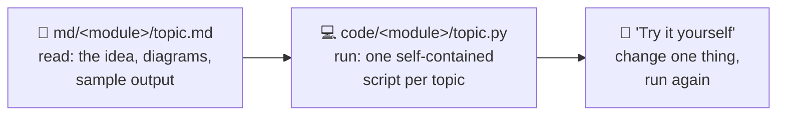
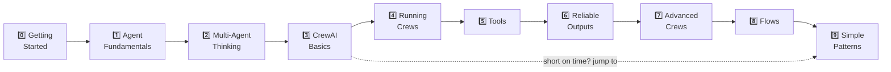
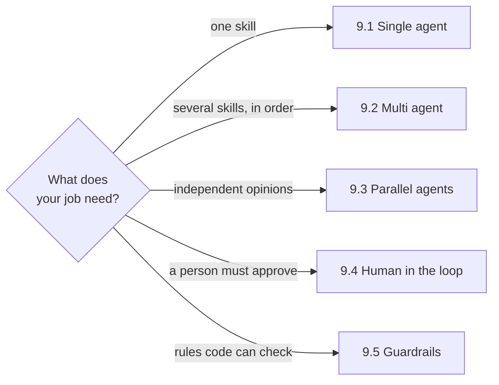

# Crew AI
> Venkata Bhattaram


A beginner-friendly course on **CrewAI**. You don't need any background in AI agents. Every topic has an **explanation page** (plain English + diagrams) and a **runnable script** (one idea, fully commented, with real output).

---

## How this course works



- **Read** the topic page in `md/`, then **run** its matching script in `code/`.
- Every script is **self-contained**: it reads the LLM key from `settings.config` and runs on its own.
- Every page has **🏠 Home · ⬅ Previous · Next ➡** links at the top and bottom.
- Start with **Module 0** to set up, then go in order. Each topic builds on the last.

```text
crew-ai-masterclass/
├── README.md            ← you are here
├── settings.config      ← your LLM key (git-ignored)
├── md/                  ← explanation pages, one folder per module
│   ├── 00-getting-started/
│   ├── 01-agent-fundamentals/
│   └── ...
└── code/                ← runnable scripts, same folders and names
    ├── 00-getting-started/
    ├── 01-agent-fundamentals/
    └── ...
```

## Learning path



> **In a hurry?** After Module 3, try **[Module 9: Simple Patterns](#module-9-simple-patterns-problems--solutions)**: five tiny problem → solution examples (single agent, multi agent, parallel, human-in-the-loop, guardrails).

---

## Table of Contents

### Module 0: Getting Started

| # | Topic | Code | You'll learn |
|---|---|---|---|
| 0.1 | [Setup & LLM Keys](md/00-getting-started/0_1_setup_and_keys.md) | [0_1_check_setup.py](code/00-getting-started/0_1_check_setup.py) | Install CrewAI, add your key, check everything works |
| 0.2 | [Words You Need to Know](md/00-getting-started/0_2_words_you_need_to_know.md) | [0_2_glossary_in_code.py](code/00-getting-started/0_2_glossary_in_code.py) | The 10 words CrewAI uses everywhere, in real code |

### Module 1: Agent Fundamentals

| # | Topic | Code | You'll learn |
|---|---|---|---|
| 1.1 | [LLM vs Agent](md/01-agent-fundamentals/1_1_llm_vs_agent.md) | [1_1_llm_vs_agent.py](code/01-agent-fundamentals/1_1_llm_vs_agent.py) | Why an agent with tools beats a plain LLM; levels of autonomy |
| 1.2 | [Components of Agents](md/01-agent-fundamentals/1_2_components_of_agents.md) | [1_2_components_of_agents.py](code/01-agent-fundamentals/1_2_components_of_agents.py) | Brain, identity, tools, limits, and the hidden prompt they become |
| 1.3 | [Characteristics of Agents](md/01-agent-fundamentals/1_3_characteristics_of_agents.md) | [1_3_characteristics_of_agents.py](code/01-agent-fundamentals/1_3_characteristics_of_agents.py) | The think → act → observe loop, the scratchpad, and `max_iter` |

### Module 2: Thinking in Multi-Agent Systems

| # | Topic | Code | You'll learn |
|---|---|---|---|
| 2.1 | [Why Multi-Agent Systems?](md/02-multi-agent-thinking/2_1_why_multi_agent.md) | [2_1_why_multi_agent.py](code/02-multi-agent-thinking/2_1_why_multi_agent.py) | One generalist vs three specialists: quality vs cost |
| 2.2 | [Newsletter Pipeline Example](md/02-multi-agent-thinking/2_2_newsletter_pipeline.md) | [2_2_newsletter_pipeline.py](code/02-multi-agent-thinking/2_2_newsletter_pipeline.py) | Designing a real pipeline: steps, owners, handoffs |
| 2.3 | [Design Question: Agent Overkill](md/02-multi-agent-thinking/2_3_agent_overkill.md) | [2_3_agent_overkill.py](code/02-multi-agent-thinking/2_3_agent_overkill.py) | When plain code or one LLM call beats a crew |
| 2.4 | [CrewAI vs Chatbots](md/02-multi-agent-thinking/2_4_crewai_vs_chatbots.md) | [2_4_crewai_vs_chatbots.py](code/02-multi-agent-thinking/2_4_crewai_vs_chatbots.py) | Conversations vs jobs |

### Module 3: CrewAI Basics

| # | Topic | Code | You'll learn |
|---|---|---|---|
| 3.1 | [CrewAI: What Is It?](md/03-crewai-basics/3_1_what_is_crewai.md) | [3_1_what_is_crewai.py](code/03-crewai-basics/3_1_what_is_crewai.py) | The smallest CrewAI program, line by line; CrewAI vs other frameworks |
| 3.2 | [CrewAI Philosophy](md/03-crewai-basics/3_2_crewai_philosophy.md) | [3_2_crewai_philosophy.py](code/03-crewai-basics/3_2_crewai_philosophy.py) | Model your team like a real company: vague vs sharp agents |
| 3.3 | [CrewAI Components](md/03-crewai-basics/3_3_crewai_components.md) | [3_3_crewai_components.py](code/03-crewai-basics/3_3_crewai_components.py) | Every component in one program, and the CrewOutput object |
| 3.4 | [CrewAI Process Types](md/03-crewai-basics/3_4_process_types.md) | [3_4_process_types.py](code/03-crewai-basics/3_4_process_types.py) | Sequential vs hierarchical, side by side |

### Module 4: Running Crews

| # | Topic | Code | You'll learn |
|---|---|---|---|
| 4.1 | [Types of Kickoff](md/04-running-crews/4_1_kickoff_types.md) | [4_1_kickoff_types.py](code/04-running-crews/4_1_kickoff_types.py) | `kickoff`, `kickoff_for_each`, `kickoff_async`, `kickoff_for_each_async`, and when to use each |
| 4.2 | [Agents in Sequence](md/04-running-crews/4_2_agents_in_sequence.md) | [4_2_agents_in_sequence.py](code/04-running-crews/4_2_agents_in_sequence.py) | One full run step by step, with a live timeline |
| 4.3 | [Agents in Parallel](md/04-running-crews/4_3_agents_in_parallel.md) | [4_3_agents_in_parallel.py](code/04-running-crews/4_3_agents_in_parallel.py) | `async_execution=True` and joining results with `context` |
| 4.4 | [Async Crews](md/04-running-crews/4_4_async_crews.md) | [4_4_async_crews.py](code/04-running-crews/4_4_async_crews.py) | Whole crews at once with `asyncio.gather` |

### Module 5: Tools

| # | Topic | Code | You'll learn |
|---|---|---|---|
| 5.1 | [Types of Tools](md/05-tools/5_1_types_of_tools.md) | [5_1_types_of_tools.py](code/05-tools/5_1_types_of_tools.py) | Out-of-the-box, third-party and custom; agent-level vs task-level |
| 5.2 | [Out-of-the-box Tools](md/05-tools/5_2_out_of_the_box_tools.md) | [5_2_out_of_the_box_tools.py](code/05-tools/5_2_out_of_the_box_tools.py) | The `crewai-tools` package: files, web, search |
| 5.3 | [Third-party Tools](md/05-tools/5_3_third_party_tools.md) | [5_3_third_party_tools.py](code/05-tools/5_3_third_party_tools.py) | LangChain tools and MCP servers |
| 5.4 | [Building Custom Tools](md/05-tools/5_4_custom_tools.md) | [5_4_custom_tools.py](code/05-tools/5_4_custom_tools.py) | `@tool`, `BaseTool` + schema, errors, caching |

### Module 6: Reliable Outputs

| # | Topic | Code | You'll learn |
|---|---|---|---|
| 6.1 | [Structured Outputs with Pydantic](md/06-reliable-outputs/6_1_structured_outputs.md) | [6_1_structured_outputs.py](code/06-reliable-outputs/6_1_structured_outputs.py) | Turn AI text into typed Python objects |
| 6.2 | [Guardrails](md/06-reliable-outputs/6_2_guardrails.md) | [6_2_guardrails.py](code/06-reliable-outputs/6_2_guardrails.py) | Check outputs with code and make the agent retry |

### Module 7: Advanced Crews

| # | Topic | Code | You'll learn |
|---|---|---|---|
| 7.1 | [Hierarchical Process](md/07-advanced-crews/7_1_hierarchical_process.md) | [7_1_hierarchical_process.py](code/07-advanced-crews/7_1_hierarchical_process.py) | A custom manager that delegates, with a delegation log |
| 7.2 | [Memory in CrewAI](md/07-advanced-crews/7_2_memory.md) | [7_2_memory.py](code/07-advanced-crews/7_2_memory.py) | Remember and recall by meaning; crews that remember you |

### Module 8: Flows

| # | Topic | Code | You'll learn |
|---|---|---|---|
| 8.1 | [Flows in CrewAI](md/08-flows/8_1_flows_intro.md) | [8_1_flows_intro.py](code/08-flows/8_1_flows_intro.py) | `@start` / `@listen`; Crew vs Flow |
| 8.2 | [Routing & State](md/08-flows/8_2_routing_and_state.md) | [8_2_routing_and_state.py](code/08-flows/8_2_routing_and_state.py) | `@router`, typed state, `or_` |
| 8.3 | [Crews inside Flows](md/08-flows/8_3_crews_inside_flows.md) | [8_3_crews_inside_flows.py](code/08-flows/8_3_crews_inside_flows.py) | Crews as steps + a quality gate that loops |

### Module 9: Simple Patterns (problems & solutions)

Small, everyday problems, each solved with one pattern. Short scripts, no extras.

| # | Pattern | Code | The problem it solves |
|---|---|---|---|
| 9.1 | [Single Agent](md/09-simple-patterns/9_1_single_agent.md) | [9_1_single_agent.py](code/09-simple-patterns/9_1_single_agent.py) | Reply politely to an angry customer review |
| 9.2 | [Multi Agent (a relay)](md/09-simple-patterns/9_2_multi_agent.md) | [9_2_multi_agent.py](code/09-simple-patterns/9_2_multi_agent.py) | Turn messy meeting notes into a clean team email |
| 9.3 | [Parallel Agents](md/09-simple-patterns/9_3_parallel_agents.md) | [9_3_parallel_agents.py](code/09-simple-patterns/9_3_parallel_agents.py) | Get 3 expert opinions at once, then a go / no-go |
| 9.4 | [Human in the Loop (HITL)](md/09-simple-patterns/9_4_human_in_the_loop.md) | [9_4_human_in_the_loop.py](code/09-simple-patterns/9_4_human_in_the_loop.py) | Don't send a customer email until a person approves it |
| 9.5 | [Guardrails](md/09-simple-patterns/9_5_guardrails.md) | [9_5_guardrails.py](code/09-simple-patterns/9_5_guardrails.py) | Make sure a product description is short and shows the price |



---

## Quick start

```powershell
pip install uv
uv venv --python 3.13 .venv
uv pip install --python .venv\Scripts\python.exe crewai crewai-tools langchain-community wikipedia requests
```

Then add your key to `settings.config` in the repo root and run the check:

```text
NVDIA_API_KEY='nvapi-...'
```

```powershell
.venv\Scripts\python code\00-getting-started\0_1_check_setup.py
```

Full details: [0.1 Setup & LLM Keys](md/00-getting-started/0_1_setup_and_keys.md).

---

## More in this repo

| Where | What |
|---|---|
| [scripts/basic-examples/](scripts/basic-examples/basic-examples.md) | 10 quick single-file examples, including an **LLM metrics** script (tokens, timing, speed) |
| [scripts/simple-crew-agent/](scripts/simple-crew-agent/simple-crew-agent.md) | A complete small project: an agent that researches a country and writes a Markdown fact sheet |
| [topics/](topics/01-foundations.md) | Deep-dive reference notes (11 topics, incl. testing, deployment, LLM integration) |
| [crew-ai.md](crew-ai.md) | Installation notes and the topic checklist |
| [rag-building.md](rag-building.md) | Build a RAG pipeline (Postgres + Qdrant + local Ollama), with scripts in [scripts/](scripts/) |
