# Crew AI
> Venkata Bhattaram

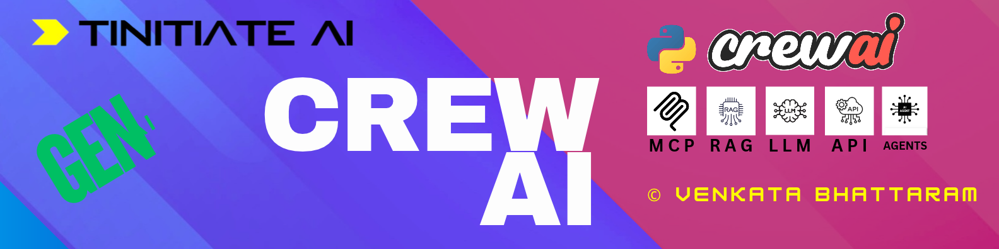

A beginner-friendly guide to **CrewAI**. You don't need any background in AI agents. Every idea comes with a small picture (diagram) and a plain-English explanation.

> **How to read this page:** go top to bottom. Each section builds on the one before it. The diagrams render automatically on GitHub and in VS Code (with a Mermaid preview extension).

---

## Table of Contents

1. [What is Crew AI](#what-is-crew-ai)
2. [Why use a team of agents?](#why-use-a-team-of-agents)
   - [Levels of autonomy in LLM applications](#levels-of-autonomy-in-llm-applications)
3. [Words you need to know](#words-you-need-to-know)
4. [Crew AI Program Structure](#crew-ai-program-structure)
5. [Components of a CrewAI Program](#components-of-a-crewai-program)
   - [Agents](#1-agents--the-workers)
   - [Tasks](#2-tasks--the-to-do-items)
   - [Tools](#3-tools--the-equipment)
   - [Skills](#4-skills--what-an-agent-is-good-at)
   - [Crews and Process](#5-crews-and-process--the-team-and-its-way-of-working)
   - [Flows](#6-flows--the-project-manager-for-many-crews)
   - [Memory and Knowledge](#7-memory-and-knowledge--what-agents-remember)
6. [How Agents Think](#how-agents-think)
   - [The agent scratchpad](#the-agent-scratchpad-the-agents-rough-notebook)
7. [One full run, step by step](#one-full-run-step-by-step)
8. [Your first Crew: a worked example](#your-first-crew-a-worked-example)
9. [Crews vs Flows: which one do I use?](#crews-vs-flows-which-one-do-i-use)
10. [CrewAI vs other frameworks](#crewai-vs-other-frameworks)
11. [Setup](#setup)
12. [Learning path in this repo](#learning-path-in-this-repo)
13. [References](#references)

---

## What is Crew AI

**CrewAI is an open-source Python framework that lets several AI "workers" (called _agents_) team up to finish a job.**

Think of a small company:

- A **researcher** finds information.
- A **writer** turns that information into an article.
- An **editor** checks the article.

Each person has a clear **role**, and the work is passed from one person to the next. CrewAI lets you build exactly this kind of team, except every team member is an AI model.

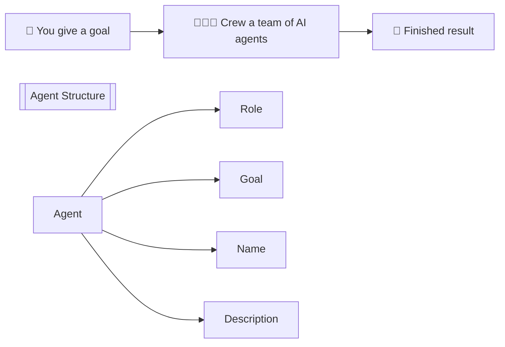


In one sentence: **you describe the team and the work, and CrewAI runs it.**

---

## Why use a team of agents?

You could ask a single chatbot to "research, write and edit an article". It often does an okay job. But one model doing everything tends to lose focus, skip steps, or mix up instructions.

Splitting the work among specialists usually gives better, more reliable results, just like in real life.

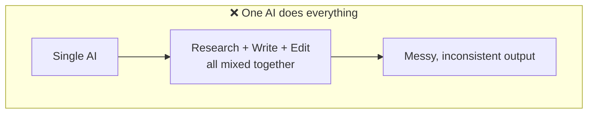

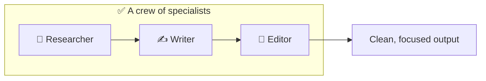

---

## Levels of autonomy in LLM applications

Not every "AI app" is an agent. Apps sit on a **ladder**. At the bottom, **your code** makes every decision. At the top, **the LLM** makes every decision.


*Source: LangChain, "Levels of autonomy in LLM applications".*

Every LLM app has to answer three questions. The ladder is about **who answers each one: your code (👩‍💻) or the LLM (🧠)**.

| Question | Plain meaning |
|---|---|
| **Decide output of a step** | Who writes the actual content (text, answer, summary)? |
| **Decide which steps to take** | Who chooses what happens next? |
| **Decide what steps are available** | Who defines the menu of possible actions or tools? |

| Level | Name | Output of step | Which steps | Steps available | Example |
|---|---|---|---|---|---|
| 1 | **Code** | 👩‍💻 | 👩‍💻 | 👩‍💻 | A normal Python script with no AI |
| 2 | **LLM Call** | 🧠 *one step only* | 👩‍💻 | 👩‍💻 | "Summarise this email" with one API call |
| 3 | **Chain** | 🧠 *multiple steps* | 👩‍💻 | 👩‍💻 | Translate → summarise → format, in a fixed order |
| 4 | **Router** | 🧠 | 🧠 *no cycles* | 👩‍💻 | The LLM picks "billing" or "tech support", then the app moves on |
| 5 | **State Machine** | 🧠 | 🧠 *cycles* | 👩‍💻 | The LLM can loop: try → check → retry until done |
| 6 | **Autonomous** | 🧠 | 🧠 | 🧠 | The LLM even invents new steps or tools for itself |

Levels 1–4 are **human-driven**: you still control the path. Levels 5–6 are **agent-executed**: the LLM steers.

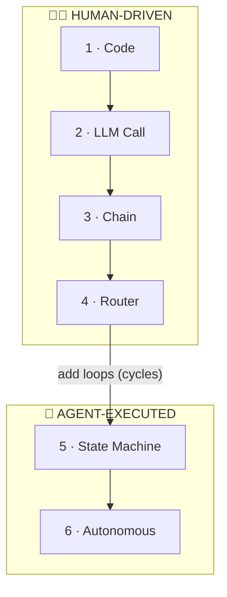

The difference between a **Router** and a **State Machine** is just one thing: **can the LLM go back and repeat a step?**

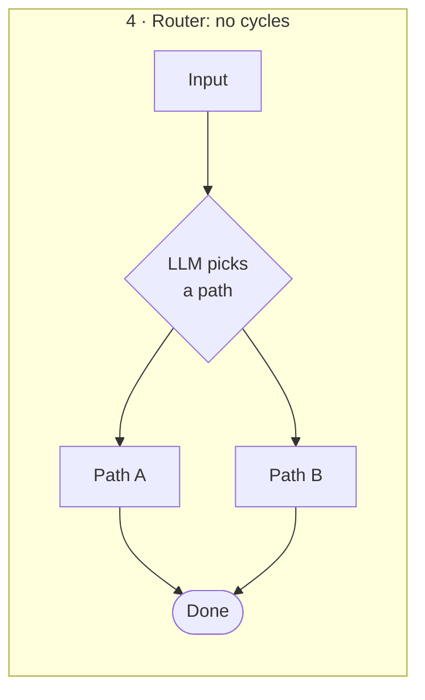

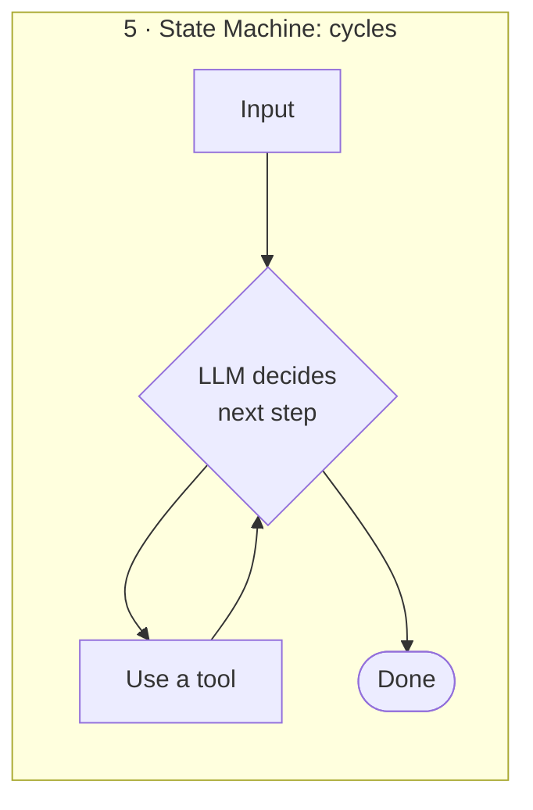

**Where does CrewAI fit?**

- A **Crew agent** runs the think → act → observe loop (see [How Agents Think](#how-agents-think)). It decides its own output and which tool to use next, and it can loop. **You** still define which tools it has. That puts it at **level 5**.
- A **hierarchical crew**, where a manager agent decides which agent works next, is also level 5.
- A **Flow** with `@router` gives you deliberate **level 4** control when you want predictability.
- Level 6 (fully autonomous) is rare in production because it's hard to test and to trust.

> **Takeaway for beginners:** more autonomy means more flexibility but less predictability. Climb only as high as your problem needs.

---

## Words you need to know

| Word | Plain meaning | Real-life comparison |
|---|---|---|
| **LLM** | Large Language Model, the "brain" (e.g. GPT, Claude, Llama) | A smart person's brain |
| **Agent** | An AI worker with a role, a goal and a personality | An employee |
| **Task** | One piece of work with a clear expected result | A to-do item on a ticket |
| **Tool** | Something an agent can *use* to act in the world (search, read files, etc.) | A laptop, a phone, a calculator |
| **Crew** | A group of agents plus the tasks they must do | A project team |
| **Process** | The *order* in which the crew works | The team's way of working |
| **Flow** | A bigger workflow that can connect many crews with if/else logic | A project plan across departments |
| **Memory** | What agents remember during and between runs | Meeting notes |
| **Kickoff** | The command that starts the crew | "Okay team, let's begin!" |

How these words relate to each other:

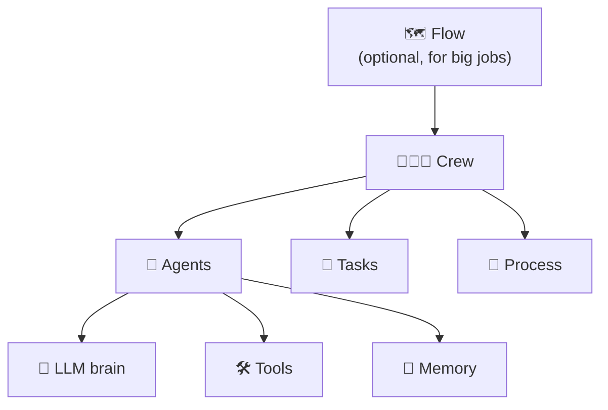

---

## Crew AI Program Structure

When you create a new project with the command `crewai create crew my_project`, CrewAI builds a ready-made folder for you:

```text
my_project/
├── .env                  # secret keys (API keys) - never commit this
├── pyproject.toml        # project info and dependencies
└── src/my_project/
    ├── main.py           # the "start button" - runs the crew
    ├── crew.py           # glues agents + tasks into a crew
    ├── config/
    │   ├── agents.yaml   # WHO does the work
    │   └── tasks.yaml    # WHAT work is done
    └── tools/
        └── custom_tool.py  # your own tools (optional)
```

What each file is responsible for:

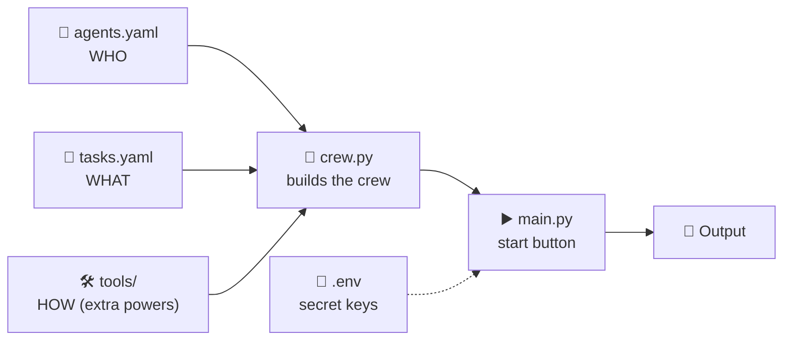

> **Tip:** Keeping *who* (agents.yaml) and *what* (tasks.yaml) in separate text files means you can change the team's instructions without touching Python code.

---

## Components of a CrewAI Program

Every CrewAI program is built from the same few building blocks:

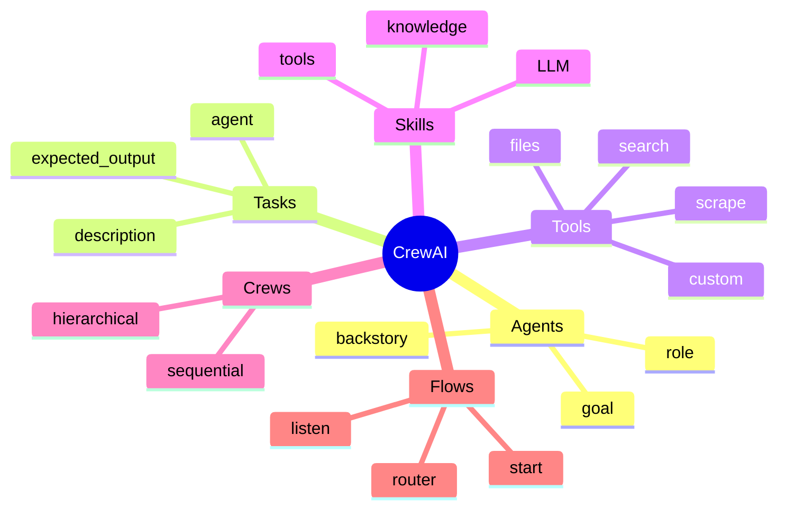

Let's go through them one at a time.

### 1. Agents – the workers

An **agent** is an AI worker. You describe it with three plain-English fields:

| Field | Question it answers | Example |
|---|---|---|
| `role` | Who are you? | "Senior Research Analyst" |
| `goal` | What are you trying to achieve? | "Find the 5 most important AI news items this week" |
| `backstory` | What's your experience and personality? | "You've worked 10 years at a tech magazine and you hate fluff." |

These three fields are turned into instructions for the LLM. Good descriptions lead to good output.

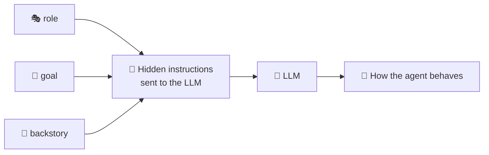

Optional settings you'll meet later: `tools`, `llm` (which brain to use), `allow_delegation` (may it ask teammates for help?), `verbose` (print its thinking), `max_iter` (how many tries before giving up), `memory`.

```python
from crewai import Agent

researcher = Agent(
    role="Senior Research Analyst",
    goal="Find the 5 most important AI news items this week",
    backstory="You worked 10 years at a tech magazine and you hate fluff.",
    verbose=True,
    allow_delegation=False,
)
```

### 2. Tasks – the to-do items

A **task** is one clear job given to one agent.

| Field | Meaning |
|---|---|
| `description` | What exactly needs to be done |
| `expected_output` | What "done" looks like (format, length) |
| `agent` | Who is responsible |
| `context` *(optional)* | Other tasks whose results this task needs |
| `output_file` *(optional)* | Save the result to a file |

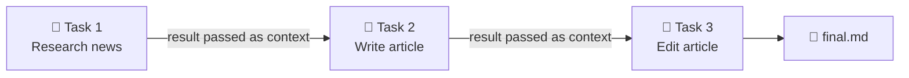

```python
from crewai import Task

research_task = Task(
    description="Search for this week's top AI news.",
    expected_output="A bullet list of 5 news items, each with a one-line summary.",
    agent=researcher,
)
```

> **Rule of thumb:** a vague `expected_output` gives vague results. Be specific about the format.

### 3. Tools – the equipment

On its own, an LLM can only *think and write*. It cannot browse the web or open a file. **Tools** give agents hands.

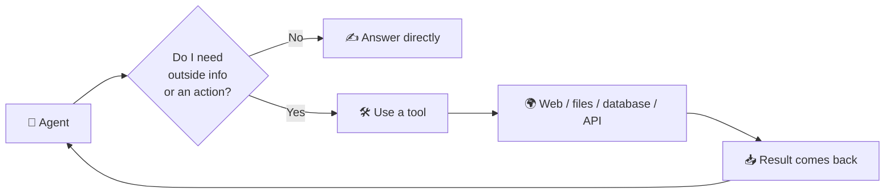

Common built-in tools from the `crewai-tools` package:

| Tool | What it does |
|---|---|
| `ScrapeWebsiteTool` | Reads the text of a web page |
| `FileWriterTool` | Writes text into a file |
| `TXTSearchTool` | Searches inside a text file (a small RAG) |
| `SerperDevTool` | Google-style web search |
| *Your own* `@tool` | Any Python function you write |

### 4. Skills – what an agent is good at

"Skill" isn't a separate class you import in the core CrewAI API. It's a useful way to think about **everything that makes an agent capable**. An agent's skill set comes from three sources combined:

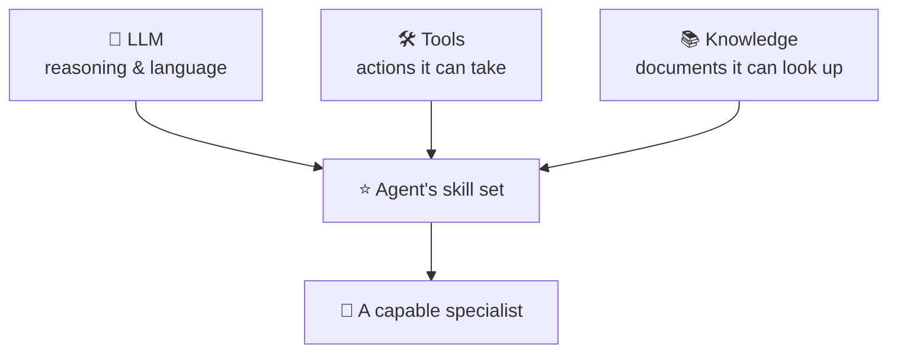

So to give an agent a new skill, you either pick a stronger LLM, give it a new tool, or attach new knowledge.

### 5. Crews and Process – the team and its way of working

A **crew** puts agents and tasks together and starts the work with `kickoff()`.

The **process** decides *how* the work is organised. There are two main options.

**Sequential**: tasks run one after another, like an assembly line.

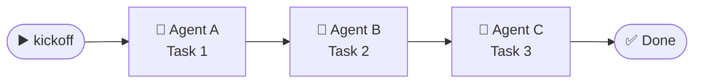

**Hierarchical**: a *manager* agent receives the goal, hands out the work, and checks results, like a team lead.

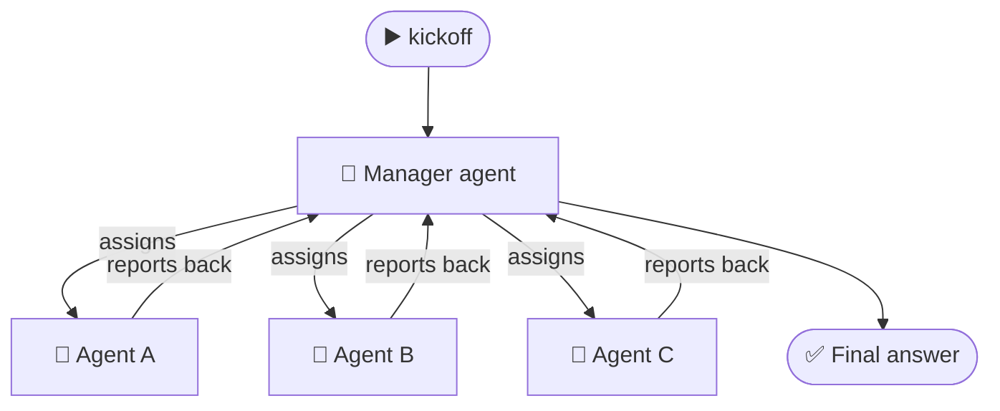

| | Sequential | Hierarchical |
|---|---|---|
| Who decides the order? | You (task order in the list) | The manager agent |
| Good for | Simple, predictable pipelines | Open-ended jobs needing coordination |
| Beginner friendly? | ✅ Start here | Try later |

```python
from crewai import Crew, Process

crew = Crew(
    agents=[researcher, writer],
    tasks=[research_task, write_task],
    process=Process.sequential,
)
result = crew.kickoff(inputs={"topic": "AI agents"})
print(result)
```

### 6. Flows – the project manager for many crews

A **Flow** is used when one crew is not enough, for example when you need **if/else decisions**, **saved state**, or **several crews in a row**.

Flows use three simple decorators:

| Decorator | Meaning |
|---|---|
| `@start()` | Run this step first |
| `@listen(step)` | Run this step after `step` finishes |
| `@router(step)` | Look at the result and choose which path to take next |

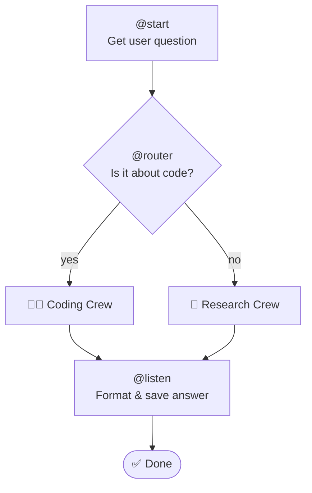

### 7. Memory and Knowledge – what agents remember

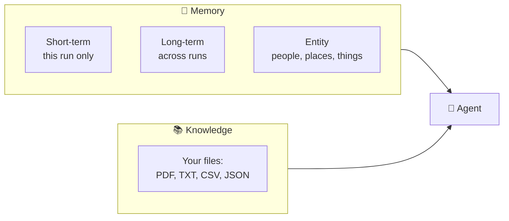

- **Short-term memory:** remembers what happened earlier in *this* run.
- **Long-term memory:** remembers lessons from *previous* runs.
- **Entity memory:** keeps track of named things (a person, a company, a product).
- **Knowledge:** documents you give the agent to look things up in. This is closely related to RAG. See [rag-building.md](rag-building.md).

---

## How Agents Think

Agents don't answer in one shot. They work in a **loop** of *think → act → observe* until they're confident. This pattern is called **ReAct** (Reason + Act).

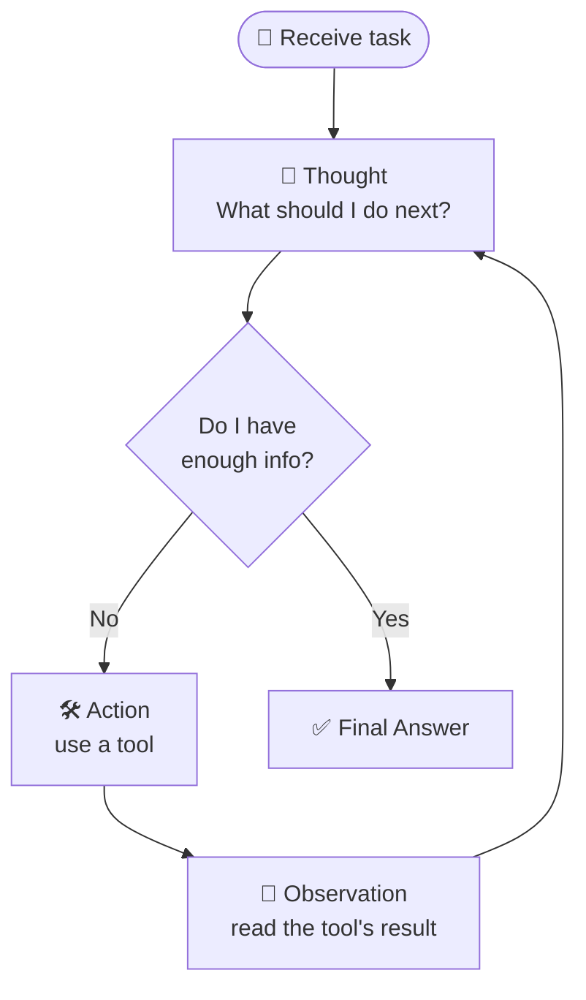

The same loop as a conversation between the agent, its brain, and a tool:

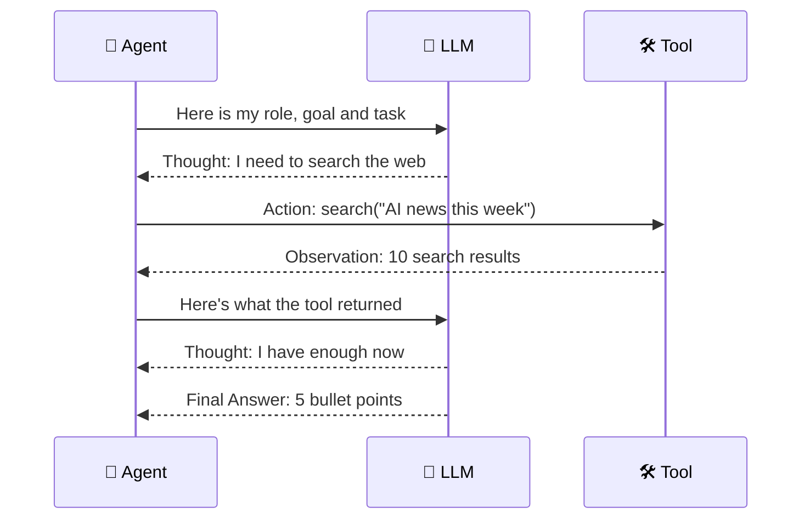

> **Why this matters:** when you set `verbose=True` you'll actually see these *Thought / Action / Observation* lines printed in your terminal. Now you know how to read them.

### The agent scratchpad: the agent's rough notebook

**Problem:** an LLM has **no memory between calls**. Each time the agent asks the LLM "what next?", the LLM starts from zero. So how does it remember that it already searched the web two steps ago?

**Answer:** the **scratchpad**. It's a running log of every *Thought → Action → Observation* so far in the current task. Before each new LLM call, the whole log is pasted back into the prompt, so the LLM can "see" its own past work.

Think of a student solving a maths problem on **rough paper**. They write each step down, look at what they've written, then decide the next step. The rough paper is the scratchpad.

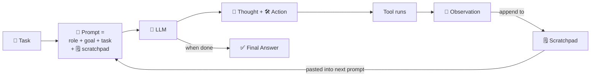

How the scratchpad grows, loop by loop:

```mermaid
flowchart TB
    subgraph L1["Loop 1: scratchpad is empty"]
        A1["Thought: I should search<br/>Action: search('AI news')<br/>Observation: 10 results"]
    end
    subgraph L2["Loop 2: scratchpad has loop 1"]
        A2["Thought: read the top article<br/>Action: scrape(url)<br/>Observation: article text"]
    end
    subgraph L3["Loop 3: scratchpad has loops 1 + 2"]
        A3["Thought: I have enough<br/>Final Answer: 5 bullet points"]
    end
    L1 --> L2 --> L3
```

What the prompt looks like on loop 3 (simplified):

```mermaid
flowchart TB
    subgraph Prompt["📜 Full prompt sent to the LLM on loop 3"]
        direction TB
        subgraph Fixed["🔒 Fixed part (same every loop)"]
            direction TB
            R["🎭 You are a Senior Research Analyst.<br/>Your goal is ..."]
            T["📝 Task: Find this week's top 5 AI news items."]
            R --> T
        end
        subgraph Pad["🗒️ Scratchpad (everything the agent has done so far)"]
            direction TB
            subgraph S1["Loop 1"]
                direction TB
                T1["💭 Thought: I should search the web first."]
                A1["🛠️ Action: search<br/>Input: query = AI news this week"]
                O1["👀 Observation: 10 results ..."]
                T1 --> A1 --> O1
            end
            subgraph S2["Loop 2"]
                direction TB
                T2["💭 Thought: Let me read the top article."]
                A2["🛠️ Action: scrape<br/>Input: url = https://..."]
                O2["👀 Observation: article text ..."]
                T2 --> A2 --> O2
            end
            S1 --> S2
        end
        Next["💭 Thought: ...<br/>⬅️ the LLM continues writing from here"]
        Fixed --> Pad --> Next
    end
    Next --> LLM["🧠 LLM"]
```

**Scratchpad vs memory.** These two are easy to confuse:

| | 🗒️ Scratchpad | 💾 Memory |
|---|---|---|
| Lives for | **One task**, then thrown away | The run, or across many runs |
| Holds | Raw Thought / Action / Observation steps | Summaries, facts, entities, lessons |
| Purpose | Let the LLM continue its own reasoning | Share and reuse knowledge between tasks |
| Analogy | Rough paper during an exam | Your notebook you keep after class |

**Why it matters to you:**

- **It costs tokens.** The scratchpad is re-sent on *every* loop, so long tasks get slower and more expensive.
- **It can overflow.** Too many loops can exceed the LLM's context window. CrewAI's `respect_context_window=True` (on the agent) summarises older steps when that happens.
- **Cap the loops.** `max_iter` limits how many times the agent can go round, so the scratchpad can't grow forever.
- **It's what you see in `verbose=True`.** Those printed Thought/Action/Observation lines *are* the scratchpad.

> 💡 The name comes from LangChain, where the prompt variable is literally called `agent_scratchpad`. CrewAI does the same job internally: it keeps the step history and feeds it back to the LLM on each iteration.

---

## One full run, step by step

What happens when you run `crew.kickoff()` on a two-task sequential crew:

```mermaid
sequenceDiagram
    participant U as 👤 You
    participant C as 🧑‍🤝‍🧑 Crew
    participant R as 🔎 Researcher
    participant W as ✍️ Writer
    U->>C: kickoff with topic = AI agents
    C->>R: Task 1: research the topic
    R->>R: think → use tools → observe (loop)
    R-->>C: research notes
    C->>W: Task 2: write article + research notes as context
    W->>W: think → write → review (loop)
    W-->>C: finished article
    C-->>U: final result
```

---

## Your first Crew: a worked example
* Goal: **read a Wikipedia page and explain one topic from it in simple words.**

```mermaid
flowchart TD
    W["🌐 Wikipedia page<br/>'Artificial Intelligence'"] -->|ScrapeWebsiteTool| Txt["📄 raw text"]
    Txt -->|FileWriterTool| File["💾 ai.txt"]
    File -->|TXTSearchTool| Ctx["🔎 relevant passages"]
    Ctx --> Ag["🤖 Educator agent"]
    Ag --> Ans["✅ Simple explanation<br/>of NLP"]
```

The four steps:

1. **Scrape:** `ScrapeWebsiteTool` downloads the page text.
2. **Save:** `FileWriterTool` stores it in `ai.txt`.
3. **Search:** `TXTSearchTool` finds the parts of `ai.txt` relevant to the question.
4. **Explain:** an *Educator* agent gets one task, "explain Natural Language Processing", inside a one-agent crew, and runs with `kickoff()`.

Sketch of the code:

```python
from crewai import Agent, Task, Crew
from crewai_tools import ScrapeWebsiteTool, FileWriterTool, TXTSearchTool

# 1. Scrape and 2. Save
text = ScrapeWebsiteTool(website_url="https://en.wikipedia.org/wiki/Artificial_intelligence").run()
FileWriterTool().run(filename="ai.txt", content=text, overwrite="True")

# 3. Search tool over the saved file
search = TXTSearchTool(txt="ai.txt")

# 4. Agent + Task + Crew
educator = Agent(
    role="Educator",
    goal="Explain topics in simple words for beginners",
    backstory="You are a patient teacher who loves clear examples.",
    tools=[search],
)
task = Task(
    description="Explain what Natural Language Processing is.",
    expected_output="A short, beginner-friendly explanation with one example.",
    agent=educator,
)
print(Crew(agents=[educator], tasks=[task]).kickoff())
```

> ⚠️ Keep API keys in a `.env` file, never inside your code.

---

## Crews vs Flows: which one do I use?

```mermaid
flowchart TD
    Q1{"Is it one team<br/>doing one job?"} -- "Yes" --> Crew["Use a <b>Crew</b>"]
    Q1 -- "No" --> Q2{"Need if/else branches,<br/>saved state, or<br/>several crews?"}
    Q2 -- "Yes" --> Flow["Use a <b>Flow</b>"]
    Q2 -- "Not sure" --> Crew
```

| | Crews | Flows |
|---|---|---|
| Best for | Autonomous, collaborative agent work | Multi-stage pipelines with strict control |
| Who's in control | The agents decide *how* | You decide *what, when and if* |
| Start here? | ✅ Yes | When you need production reliability |

---

## CrewAI vs other frameworks

```mermaid
flowchart LR
    subgraph Easy["Easier to start"]
        CA["CrewAI<br/>role-based teams"]
    end
    subgraph Control["More low-level control"]
        LG["LangGraph<br/>graphs & state machines"]
    end
    AG["AutoGen (Microsoft)<br/>conversational agents"]
    Easy --- AG --- Control
```

- **CrewAI:** you think in *roles and teams*. This is the fastest way for a beginner to get a working multi-agent prototype.
- **LangGraph:** you think in *graphs* (nodes and edges). You get more control, but you need to understand directed graphs and state.
- **AutoGen:** Microsoft's framework, built around agents chatting with each other.

---

## Setup

```mermaid
flowchart LR
    P["🐍 Install Python<br/>3.10 – 3.13"] --> V["📦 Create venv"] --> I["⬇️ pip install<br/>crewai crewai-tools"] --> K["🔑 Add API key to .env<br/>(or use local Ollama)"] --> R["▶️ Run!"]
```

```bash
python -m venv .venv
.venv\Scripts\pip install --upgrade pip
.venv\Scripts\pip install crewai crewai-tools
.venv\Scripts\crewai --version
```

- With [uv](https://docs.astral.sh/uv/) (recommended by CrewAI): `uv add "crewai[tools]"`
- This repo can also run fully **locally** with Ollama (no API key needed). See [common/config.py](common/config.py) and [common/ollama_client.py](common/ollama_client.py).
- Full install notes are in [crew-ai.md](crew-ai.md#installation).

---

## Learning path in this repo

Follow the topics in order. Each one builds on the last.

```mermaid
flowchart TD
    T1["1️⃣ Foundations"] --> T2["2️⃣ Agents"] --> T3["3️⃣ Tasks"] --> T4["4️⃣ Tools"]
    T4 --> T5["5️⃣ Crews & Process"] --> T6["6️⃣ Memory & Knowledge"] --> T7["7️⃣ Flows"]
    T7 --> T8["8️⃣ LLM Integration"] --> T9["9️⃣ Testing & Observability"] --> T10["🔟 Deployment"] --> T11["🏗️ Applied Projects"]
```

| # | Topic | File |
|---|---|---|
| 1 | Foundations | [topics/01-foundations.md](topics/01-foundations.md) |
| 2 | Agents | [topics/02-agents.md](topics/02-agents.md) |
| 3 | Tasks | [topics/03-tasks.md](topics/03-tasks.md) |
| 4 | Tools | [topics/04-tools.md](topics/04-tools.md) |
| 5 | Crews & Process | [topics/05-crews-process.md](topics/05-crews-process.md) |
| 6 | Memory & Knowledge | [topics/06-memory-knowledge.md](topics/06-memory-knowledge.md) |
| 7 | Flows | [topics/07-flows.md](topics/07-flows.md) |
| 8 | LLM Integration | [topics/08-llm-integration.md](topics/08-llm-integration.md) |
| 9 | Testing & Observability | [topics/09-testing-observability.md](topics/09-testing-observability.md) |
| 10 | Deployment | [topics/10-deployment.md](topics/10-deployment.md) |
| 11 | Applied Projects | [topics/11-applied-projects.md](topics/11-applied-projects.md) |

Bonus: build your own RAG pipeline in [rag-building.md](rag-building.md) (scripts in [scripts/](scripts/)).

