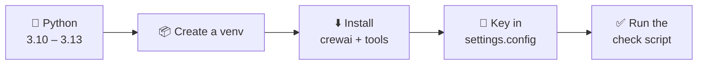
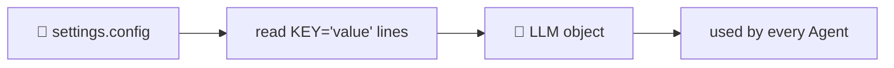

# 0.1 Setup & LLM Keys

[🏠 Home](../../README.md) · [0.2 Words You Need to Know ➡](0_2_words_you_need_to_know.md)

> **Module 0 · Getting Started** · 💻 Code: [0_1_check_setup.py](../../code/00-getting-started/0_1_check_setup.py)

## In one sentence

Install Python and CrewAI once, put your LLM key in `settings.config`, and run one script that checks everything works.

## The setup, step by step



**1. Python 3.10 – 3.13.** CrewAI doesn't install on Python 3.14 yet. If your computer only has 3.14, let `uv` download 3.13 for you:

```powershell
pip install uv
uv venv --python 3.13 .venv
```

**2. Install the packages** (from the repo root):

```powershell
uv pip install --python .venv\Scripts\python.exe crewai crewai-tools langchain-community wikipedia requests
```

| Package | Why |
|---|---|
| `crewai` | The framework: Agent, Task, Crew, Flow |
| `crewai-tools` | Ready-made tools (files, web, search). Used in Module 5 |
| `langchain-community`, `wikipedia` | Third-party tool example in 5.1 and 5.3 |
| `requests` | Plain web requests in 8.1 |

**3. Your LLM key.** Create `settings.config` in the repo root (it's in `.gitignore`, so it never gets committed):

```text
NVDIA_API_KEY='nvapi-...'
# optional: choose a different model
NVIDIA_MODEL='nvidia/nemotron-3-super-120b-a12b'
```

Get a free key at <https://build.nvidia.com>.

## How every script finds the LLM

Every script in `code/` starts with the same few lines:

```python
SETTINGS = Path(__file__).resolve().parents[2] / "settings.config"   # repo root
cfg = dict(re.findall(r"...", SETTINGS.read_text()))                  # KEY='value' lines -> dict
llm = LLM(
    model=cfg.get("NVIDIA_MODEL", "nvidia/nemotron-3-super-120b-a12b"),
    custom_openai=True,                                # NVIDIA speaks the OpenAI protocol
    base_url="https://integrate.api.nvidia.com/v1",
    api_key=cfg.get("NVIDIA_API_KEY") or cfg["NVDIA_API_KEY"],
)
```



It's repeated in each file on purpose, so you can copy any single script anywhere and it still runs.

> **Why `custom_openai=True`?** NVIDIA's API uses the same format as OpenAI's. CrewAI's OpenAI client works with it if we change only the `base_url`. No extra packages needed.

## Run it

```powershell
.venv\Scripts\python code\00-getting-started\0_1_check_setup.py
```

## What you'll see

```text
===== SETUP CHECK =====

  ✅ Python 3.10 - 3.13     3.13.15
  ✅ crewai installed       1.15.28
  ✅ settings.config found  C:\...\crew-ai-masterclass\settings.config
  ✅ NVIDIA key present     nvapi-...XXXX
  ✅ Model                  nvidia/nemotron-3-super-120b-a12b
  ✅ LLM responds           'READY' in 1.0s

All good. You're ready for Module 1.
```

The key is **masked**: only the first 6 and last 4 characters are shown.

## Key takeaways

- Keys live in `settings.config`, never in code.
- One LLM setup block, copied into every script, keeps each file self-contained.
- If this check passes, every other script in the course will run.

## Try it yourself

- Add `NVIDIA_MODEL='nvidia/nemotron-3.5-lightning-30b-a3b'` to `settings.config` and run the check again. Is it faster?

---

[🏠 Home](../../README.md) · [0.2 Words You Need to Know ➡](0_2_words_you_need_to_know.md)
