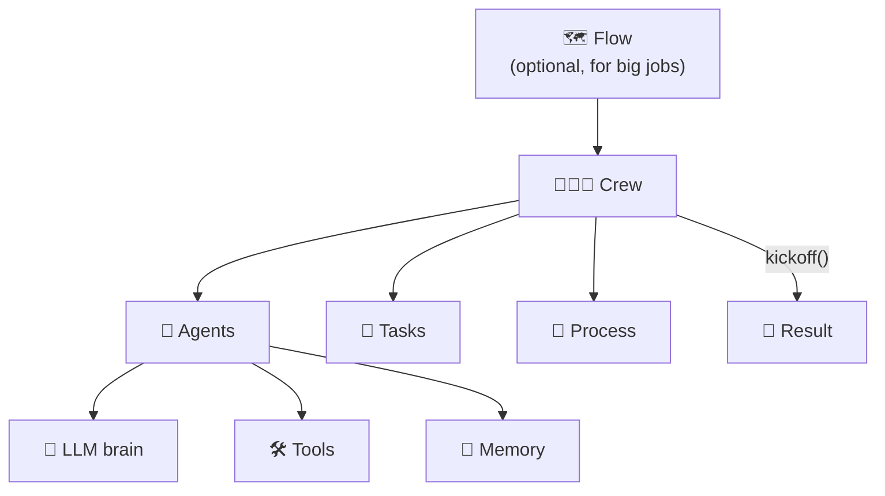

# 0.2 Words You Need to Know

[🏠 Home](../../README.md) · [⬅ 0.1 Setup & LLM Keys](0_1_setup_and_keys.md) · [1.1 LLM vs Agent ➡](../01-agent-fundamentals/1_1_llm_vs_agent.md)

> **Module 0 · Getting Started** · 💻 Code: [0_2_glossary_in_code.py](../../code/00-getting-started/0_2_glossary_in_code.py)

## In one sentence

CrewAI uses about ten words over and over. Learn them once and every later page reads easily.

## The glossary

| Word | Plain meaning | Real-life comparison |
|---|---|---|
| **LLM** | Large Language Model, the "brain" (e.g. Llama, Nemotron, GPT, Claude) | A smart person's brain |
| **Agent** | An AI worker with a role, a goal and a personality | An employee |
| **Task** | One piece of work with a clear expected result | A to-do item on a ticket |
| **Tool** | Something an agent can *use* to act in the world (search, read files, ...) | A laptop, a phone, a calculator |
| **Crew** | A group of agents plus the tasks they must do | A project team |
| **Process** | The *order* in which the crew works | The team's way of working |
| **Kickoff** | The command that starts the crew | "Okay team, let's begin!" |
| **Result** | What comes back: the final answer plus every step | The finished report |
| **Flow** | A bigger workflow that connects code, LLM calls and crews with if/else logic | A project plan across departments |
| **Memory** | What agents remember during and between runs | Meeting notes |

## How the words fit together



## The words in real code

The script is a tiny working crew (a haiku poet that checks its own word count). Every glossary word is tagged in the code:

```python
llm = LLM(...)                                     # [LLM]

@tool("Word counter")                              # [TOOL]
def count_words(text: str) -> str: ...

poet = Agent(role="Haiku Poet", tools=[count_words], llm=llm, ...)          # [AGENT]
write_haiku = Task(description="Write one haiku about {subject}...", ...)   # [TASK]
crew = Crew(agents=[poet], tasks=[write_haiku], process=Process.sequential) # [CREW] [PROCESS]
result = crew.kickoff(inputs={"subject": "morning coffee"})                 # [KICKOFF]
print(result.raw)                                                           # [RESULT]
```

## Run it

```powershell
.venv\Scripts\python code\00-getting-started\0_2_glossary_in_code.py
```

## What you'll see

```text
===== RESULT =====

Steam rises in cup
Dark brew awakens the day
Morning sips bring peace
13

===== GLOSSARY MAP: what each word was in this program =====

  LLM      -> nvidia/nemotron-3-super-120b-a12b
  Agent    -> Haiku Poet
  Tool     -> Word counter
  Task     -> Write one haiku about morning coffee. Use the word...
  Crew     -> 1 agent, 1 task
  Process  -> sequential
  Kickoff  -> crew.kickoff(inputs={'subject': 'morning coffee'})
  Result   -> result.raw (72 characters)
```

## Key takeaways

- **LLM** thinks, **Tool** acts, **Agent** = LLM + identity + tools.
- **Task** = the job, **Crew** = the team, **Kickoff** = "go".
- Every program in this course uses these same words.

## Try it yourself

- Change `"morning coffee"` to another subject. Does the poet still use the word counter?

---

[🏠 Home](../../README.md) · [⬅ 0.1 Setup & LLM Keys](0_1_setup_and_keys.md) · [1.1 LLM vs Agent ➡](../01-agent-fundamentals/1_1_llm_vs_agent.md)
