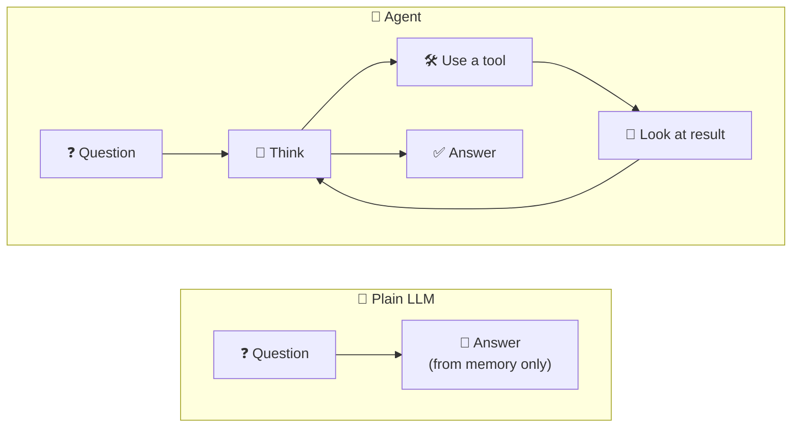
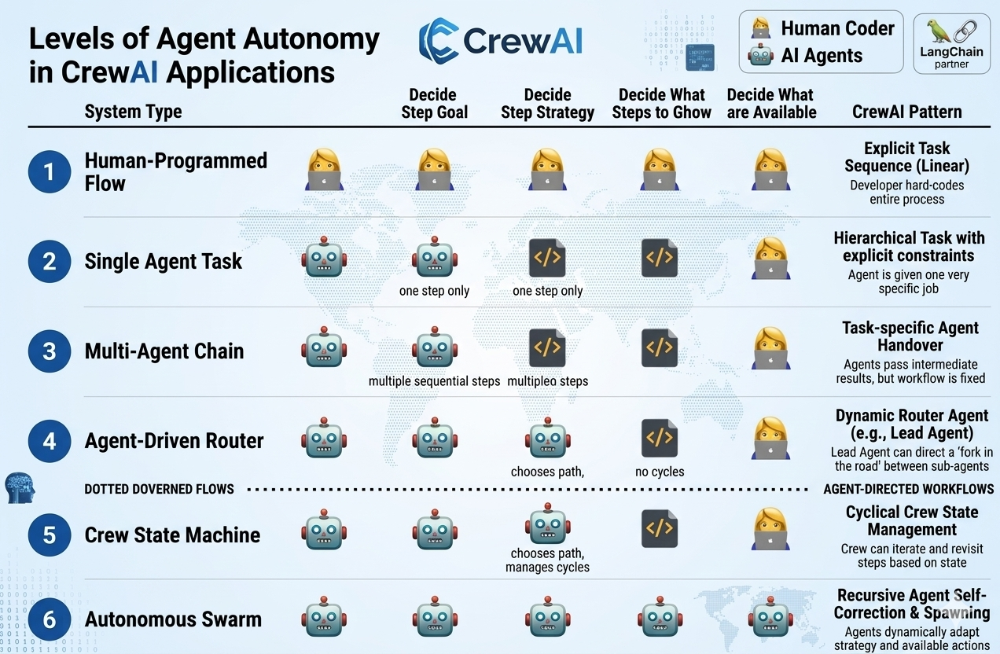
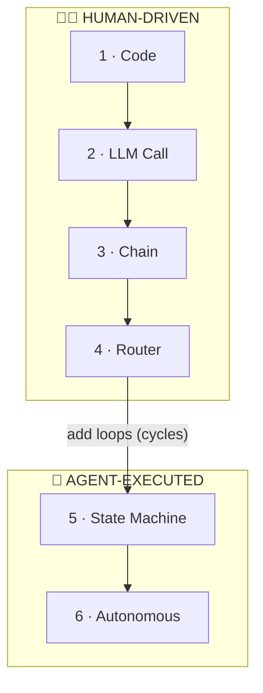

# 1.1 LLM vs Agent

[🏠 Home](../../README.md) · [⬅ 0.2 Words You Need to Know](../00-getting-started/0_2_words_you_need_to_know.md) · [1.2 Components of Agents ➡](1_2_components_of_agents.md)

> **Module 1 · Agent Fundamentals** · 💻 Code: [1_1_llm_vs_agent.py](../../code/01-agent-fundamentals/1_1_llm_vs_agent.py)

## In one sentence

An **LLM** can only *answer* from what it already knows; an **agent** can *decide* to use tools, look at the results, and then answer.

## The idea



| | 🧠 LLM | 🤖 Agent |
|---|---|---|
| What it is | A text predictor | LLM + tools + a loop |
| Knows today's date? | ❌ Only its training data | ✅ If it has a tool for it |
| Exact maths? | ❌ Often guesses | ✅ Uses a calculator tool |
| Number of steps | 1 | As many as it needs |

## Levels of autonomy in LLM applications

Not every "AI app" is an agent. Apps sit on a **ladder**. At the bottom, **your code** makes every decision. At the top, **the LLM** does.



*Source: LangChain, "Levels of autonomy in LLM applications".*

The ladder is about **who answers three questions: your code (👩‍💻) or the LLM (🧠)**.

| Level | Name | Output of a step | Which steps | Steps available | Example |
|---|---|---|---|---|---|
| 1 | **Code** | 👩‍💻 | 👩‍💻 | 👩‍💻 | A normal Python script |
| 2 | **LLM Call** | 🧠 *one step* | 👩‍💻 | 👩‍💻 | "Summarise this email" |
| 3 | **Chain** | 🧠 *many steps* | 👩‍💻 | 👩‍💻 | Translate → summarise → format |
| 4 | **Router** | 🧠 | 🧠 *no cycles* | 👩‍💻 | LLM picks "billing" or "tech" |
| 5 | **State Machine** | 🧠 | 🧠 *cycles* | 👩‍💻 | Try → check → retry until done |
| 6 | **Autonomous** | 🧠 | 🧠 | 🧠 | LLM invents its own tools |



**Where this script sits:** Part 1 (plain LLM) is **level 2**. Part 2 (the agent loops: think → tool → think) is **level 5**. A CrewAI agent decides its own steps and can loop, but **you** still choose its tools.

> **Takeaway:** more autonomy = more flexibility but less predictability. Climb only as high as your problem needs.

## The code, step by step

1. **Plain LLM:** `llm.call(QUESTION)`. One call, no tools.
2. **Agent:** the same LLM plus three tools (`Calculator`, `Today's date`, `Days between dates`) inside a crew.
3. **Truth:** the same numbers computed in plain Python, to compare.

```python
@tool("Today's date")
def todays_date() -> str:
    """Return today's date as YYYY-MM-DD."""
    return date.today().isoformat()

assistant = Agent(role="Careful Assistant", tools=[calculator, todays_date, days_between], llm=llm, ...)
```

## Run it

```powershell
.venv\Scripts\python code\01-agent-fundamentals\1_1_llm_vs_agent.py
```

## What you'll see

```text
===== 1. PLAIN LLM (just answers) =====

17.5% of 2,348.60 is 411.005. There are 537 days left from today (2025-09-24) until 2027-03-15.

===== 2. AGENT (decides, uses tools, then answers) =====

17.5% of 2,348.60 is 411.005. There are 152 days left from today until 2027-03-15.

===== 3. TRUTH (plain Python) =====

17.5% of 2,348.60 = 411.00
Days from 2026-10-14 to 2027-03-15 = 152
```

The plain LLM **thought today was 2025-09-24** (its training data ends around then), so its day count was wrong by over a year. The agent *checked* the date with a tool and got it exactly right.

## Key takeaways

- **LLM:** text in → text out. It can't check anything.
- **Agent:** LLM + tools + a loop (think → act → observe → answer).
- Agents are useful when the answer depends on things the LLM can't know: today's date, your files, live data, exact calculations.

## Try it yourself

- Remove `todays_date` from the agent's tools. What date does the agent assume now?

---

[🏠 Home](../../README.md) · [⬅ 0.2 Words You Need to Know](../00-getting-started/0_2_words_you_need_to_know.md) · [1.2 Components of Agents ➡](1_2_components_of_agents.md)
