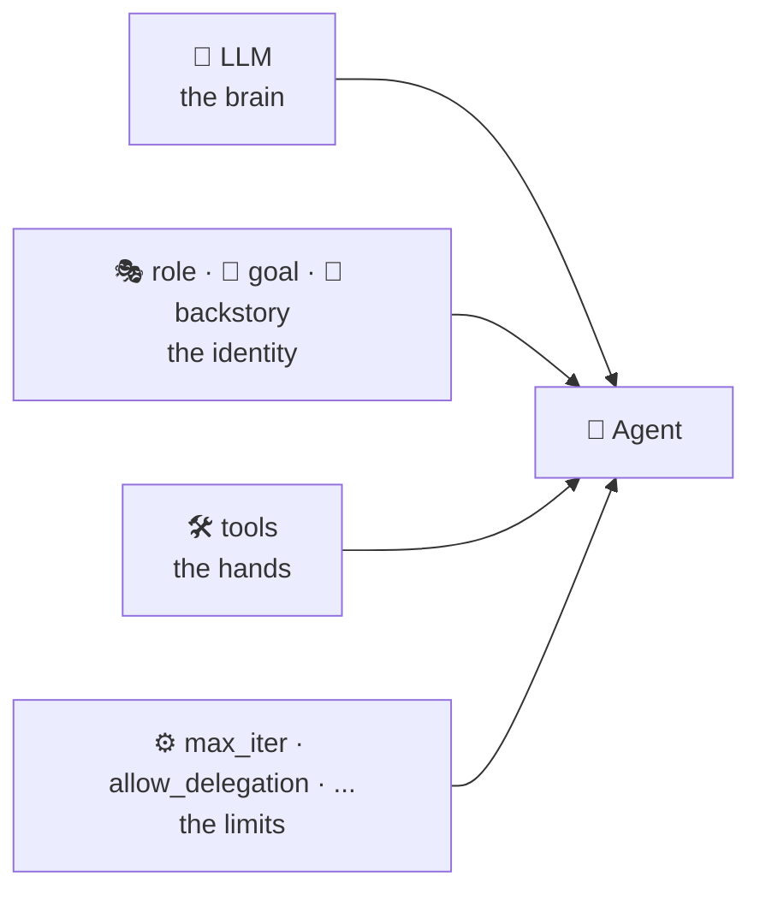
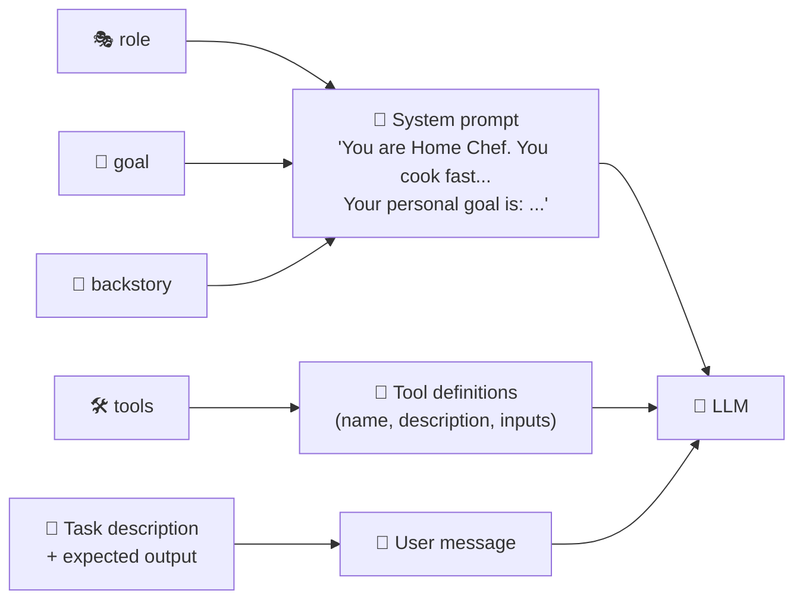
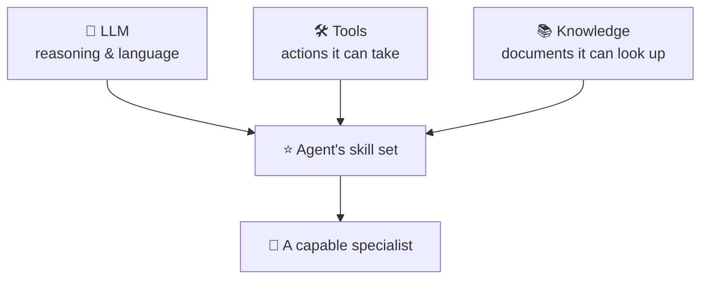

# 1.2 Components of Agents

[🏠 Home](../../README.md) · [⬅ 1.1 LLM vs Agent](1_1_llm_vs_agent.md) · [1.3 Characteristics of Agents ➡](1_3_characteristics_of_agents.md)

> **Module 1 · Agent Fundamentals** · 💻 Code: [1_2_components_of_agents.py](../../code/01-agent-fundamentals/1_2_components_of_agents.py)

## In one sentence

An agent is built from a **brain** (LLM), an **identity** (role, goal, backstory), **hands** (tools) and **limits** (settings), and CrewAI turns all of them into a hidden prompt.

## The parts



| Component | Question it answers | Example |
|---|---|---|
| `llm` | Which brain thinks? | `nvidia/nemotron-3-super-120b-a12b` |
| `role` | Who are you? | "Home Chef" |
| `goal` | What are you trying to achieve? | "Suggest a quick dinner using what the user has" |
| `backstory` | What's your experience and personality? | "You cook fast weeknight meals and keep instructions short." |
| `tools` | What can you *do*? | A recipe finder |
| `max_iter` | How many think→act loops at most? | 3 |
| `allow_delegation` | May you ask teammates for help? | `False` |
| `verbose` | Print your thinking? | `True` while learning |

## Where the parts go: the hidden prompt

Role, goal and backstory aren't magic. CrewAI **writes them into the prompt** it sends to the LLM:



The script **captures that prompt** using CrewAI's events and prints it, so you can see this for yourself.

## Skills: what makes an agent capable

"Skill" isn't a separate class in CrewAI. It's a useful way to think about **everything that makes an agent good at its job**:



To give an agent a new skill: pick a stronger LLM, give it a new tool, or attach new knowledge.

## The code, step by step

```python
chef = Agent(
    role="Home Chef",                                                 # WHO
    goal="Suggest a quick dinner using what the user has",            # WHAT
    backstory="You cook fast weeknight meals and keep instructions short.",  # HOW
    tools=[find_recipe],                                              # hands
    llm=llm,                                                          # brain
    max_iter=3,                                                       # limits
    allow_delegation=False,
)

@crewai_event_bus.on(LLMCallStartedEvent)       # listen for "an LLM call is starting"
def capture_prompt(source, event):
    if not captured:
        captured.extend(event.messages)         # keep the first prompt
```

## Run it

```powershell
.venv\Scripts\python code\01-agent-fundamentals\1_2_components_of_agents.py
```

## What you'll see

```text
===== THE HIDDEN PROMPT (first LLM call) =====

--- role: system ---
You are Home Chef. You cook fast weeknight meals and keep instructions short.
Your personal goal is: Suggest a quick dinner using what the user has

--- role: user ---
Current Task: I have eggs. What can I cook in 10 minutes? This is the expected
criteria for your final answer: One dish and 3 short steps. you MUST return the
actual complete content as the final answer, not a summary.

===== WHERE EACH COMPONENT WENT =====

  role       found in prompt: ✅  ('Home Chef')
  goal       found in prompt: ✅  ('Suggest a quick dinner using what the user has')
  backstory  found in prompt: ✅  ('You cook fast weeknight meals ')
  tool       sent as a tool definition: 'Recipe finder'
```

## Key takeaways

- **role + backstory** become "You are ...", and **goal** becomes "Your personal goal is ...".
- The **task** becomes the user message, including your `expected_output`.
- Tools are described to the LLM separately so it can *choose* to call them.
- Better descriptions = better behaviour. Writing these well is how you "prompt" an agent.

## Try it yourself

- Make the backstory "You are a Michelin-star chef who loves fancy techniques." How does the recipe change?

---

[🏠 Home](../../README.md) · [⬅ 1.1 LLM vs Agent](1_1_llm_vs_agent.md) · [1.3 Characteristics of Agents ➡](1_3_characteristics_of_agents.md)
