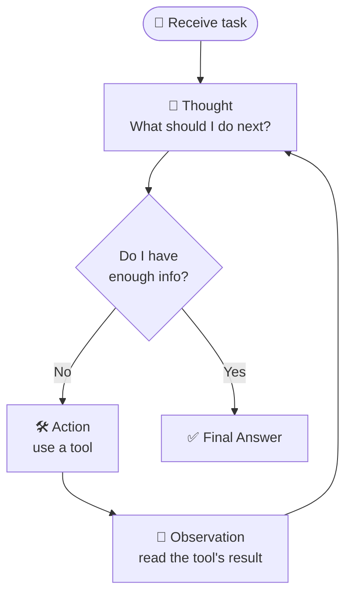
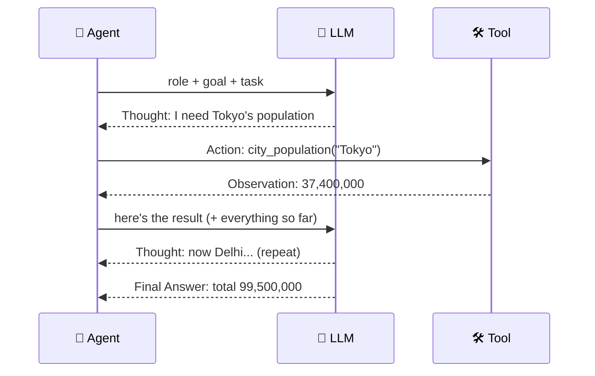
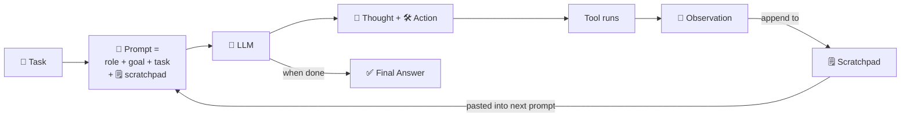
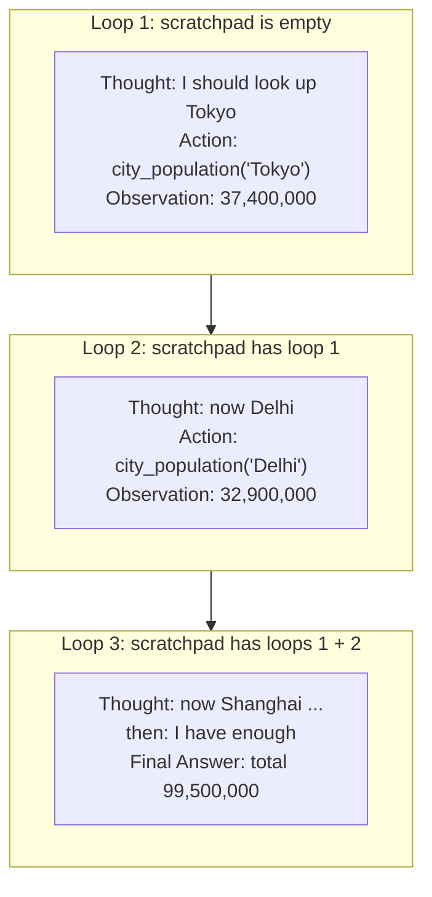
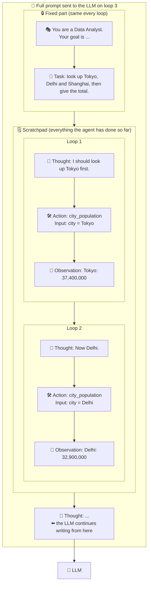

# 1.3 Characteristics of Agents

[🏠 Home](../../README.md) · [⬅ 1.2 Components of Agents](1_2_components_of_agents.md) · [2.1 Why Multi-Agent Systems? ➡](../02-multi-agent-thinking/2_1_why_multi_agent.md)

> **Module 1 · Agent Fundamentals** · 💻 Code: [1_3_characteristics_of_agents.py](../../code/01-agent-fundamentals/1_3_characteristics_of_agents.py)

## In one sentence

Agents are **autonomous**, **goal-directed** and **use tools** in a **think → act → observe loop**, and you control how long that loop may run.

## The four characteristics

| Characteristic | Meaning | In the demo |
|---|---|---|
| **Autonomous** | Decides its own next step | Nobody tells it "call the tool 3 times" |
| **Goal-directed** | Keeps going until the goal is met | Looks up every city before answering |
| **Tool-using** | Acts on the world, not just talks | Uses the `City population` tool |
| **Iterative (loops)** | Think → act → observe, again and again | 3 tool calls, 4 LLM calls |

## How agents think: the ReAct loop

Agents don't answer in one shot. They loop until they're confident. This pattern is called **ReAct** (Reason + Act):





## The agent scratchpad: the agent's rough notebook

**Problem:** an LLM has **no memory between calls**. So how does the agent remember it already looked up Tokyo?

**Answer:** the **scratchpad**, a running log of every *Thought → Action → Observation* in the current task. Before each LLM call, the whole log is pasted back into the prompt. Think of a student's **rough paper** during a maths exam.



How the scratchpad grows, loop by loop:



What the prompt looks like on loop 3 (simplified):



| | 🗒️ Scratchpad | 💾 Memory (see 7.2) |
|---|---|---|
| Lives for | **One task**, then thrown away | The run, or across many runs |
| Holds | Raw Thought / Action / Observation steps | Facts, preferences, lessons |
| Analogy | Rough paper during an exam | The notebook you keep after class |

Why it matters:
- **It costs tokens:** the scratchpad is re-sent on *every* loop.
- **It can overflow:** `respect_context_window=True` summarises old steps when needed.
- **Cap the loops:** `max_iter` stops it growing forever, which is exactly what this demo tests.

## The code, step by step

A fake population "database" the agent can only reach through a tool, and the same job run twice:

```python
run(max_iter=6)   # A) room to loop as much as it needs
run(max_iter=2)   # B) the loop is cut short
```

CrewAI's **events** count every LLM call and tool call:

```python
@crewai_event_bus.on(ToolUsageFinishedEvent)
def on_tool(source, event):
    counts["tools"].append(f"{event.tool_name}({event.tool_args})")
```

## Run it

```powershell
.venv\Scripts\python code\01-agent-fundamentals\1_3_characteristics_of_agents.py
```

## What you'll see

```text
----- max_iter=6 -----
LLM calls : 4
Tool calls: 3 -> ["city_population({'city': 'Tokyo'})", "city_population({'city': 'Delhi'})", "city_population({'city': 'Shanghai'})"]
Answer    : Tokyo: 37,400,000 / Delhi: 32,900,000 / Shanghai: 29,200,000 / Total: 99,500,000

----- max_iter=2 -----
LLM calls : 3
Tool calls: 2 -> ["city_population({'city': 'Tokyo'})", "city_population({'city': 'Delhi'})"]
Answer    : Tokyo: 37,400,000 / Delhi: 32,900,000 / Shanghai: 24,900,000 / Total: 95,200,000

True total: 99,500,000
```

With `max_iter=2` the agent ran out of loops before looking up Shanghai, so it **made up a number** (24.9M instead of 29.2M) and the total is wrong. That's the most important lesson on this page.

## Key takeaways

- **Autonomous:** you never said "call the tool 3 times". It decided.
- **Goal-directed:** it loops until the goal is met... or a limit stops it.
- **A cut-short agent guesses.** Set `max_iter` high enough for the job, and check outputs.
- `verbose=True` prints the Thought / Action / Observation steps, i.e. the scratchpad.

## Try it yourself

- Add a 4th city to the task (and to `POPULATION`). What's the smallest `max_iter` that still gets the right total?

---

[🏠 Home](../../README.md) · [⬅ 1.2 Components of Agents](1_2_components_of_agents.md) · [2.1 Why Multi-Agent Systems? ➡](../02-multi-agent-thinking/2_1_why_multi_agent.md)
