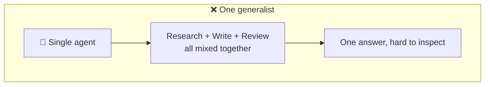
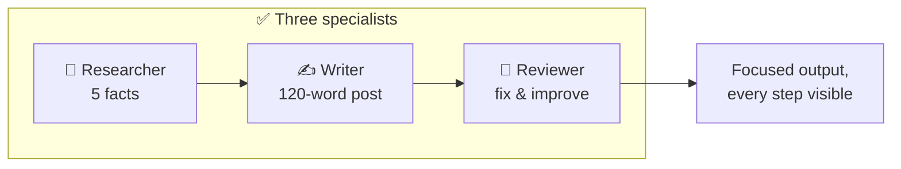

# 2.1 Why Multi-Agent Systems?

[🏠 Home](../../README.md) · [⬅ 1.3 Characteristics of Agents](../01-agent-fundamentals/1_3_characteristics_of_agents.md) · [2.2 Newsletter Pipeline Example ➡](2_2_newsletter_pipeline.md)

> **Module 2 · Thinking in Multi-Agent Systems** · 💻 Code: [2_1_why_multi_agent.py](../../code/02-multi-agent-thinking/2_1_why_multi_agent.py)

## In one sentence

Splitting a job across **specialist agents** makes each step focused and easy to inspect, at the cost of more LLM calls.

## The idea

You could ask one agent to "research, write and review a post". It often does an okay job, but one model doing everything tends to lose focus, skip steps or mix up instructions. Splitting the work is how real teams work too.





| | One generalist | Specialists |
|---|---|---|
| Focus | Juggles every step at once | Each agent does one thing well |
| Debugging | One big answer: where did it go wrong? | Inspect each step's output |
| Reuse | All-or-nothing | Swap or improve one agent |
| Cost | ✅ Fewer calls and tokens | ❌ More calls and tokens |

## The code, step by step

Both versions use the same LLM and the same brief. Only the team shape changes:

```python
# A) one agent, one big task
do_everything = Task(description="Research {topic}, write a 120-word post..., then review and improve it.", ...)

# B) three agents, three small tasks, chained with context
research = Task(description="List 5 key facts about {topic}.", agent=researcher, ...)
write    = Task(description="Write a 120-word post...", agent=writer, context=[research])
review   = Task(description="Review and improve the post.", agent=reviewer, context=[write])
```

A small event listener counts LLM calls and tokens for each version.

## Run it

```powershell
.venv\Scripts\python code\02-multi-agent-thinking\2_1_why_multi_agent.py "remote work"
```

## What you'll see

```text
===== A) ONE GENERALIST =====
Remote work lets you perform your job from anywhere with an internet connection,
freeing you from a daily commute and a fixed office desk. For beginners, start by ...

===== B) THREE SPECIALISTS =====
Remote work is reshaping how we think about jobs. Stanford's 2020-2021 study found
remote employees up to 13% more productive than office workers. ...

===== COMPARISON =====
                   LLM calls   Tokens  Seconds
A) Generalist              1    1,890     21.0
B) Specialists             3   11,759    172.0
```

The specialist version is **more concrete**: it cites facts that the research step produced. But it cost **6× the tokens and 8× the time**.

## Key takeaways

- Multi-agent = **separation of concerns**, like a real team.
- You get focus, visibility and reusable parts...
- ...and you pay in LLM calls, tokens and time.
- If the specialist version isn't clearly better for your job, you may not need a crew. See [2.3 Agent Overkill](2_3_agent_overkill.md).

## Try it yourself

- Remove the reviewer (2 agents instead of 3). Does quality drop? How much faster is it?

---

[🏠 Home](../../README.md) · [⬅ 1.3 Characteristics of Agents](../01-agent-fundamentals/1_3_characteristics_of_agents.md) · [2.2 Newsletter Pipeline Example ➡](2_2_newsletter_pipeline.md)
