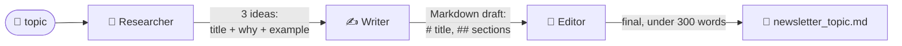

# 2.2 Newsletter Pipeline Example

[🏠 Home](../../README.md) · [⬅ 2.1 Why Multi-Agent Systems?](2_1_why_multi_agent.md) · [2.3 Design Question: Agent Overkill ➡](2_3_agent_overkill.md)

> **Module 2 · Thinking in Multi-Agent Systems** · 💻 Code: [2_2_newsletter_pipeline.py](../../code/02-multi-agent-thinking/2_2_newsletter_pipeline.py)

## In one sentence

Design a real pipeline by deciding **who does what** and **what each step hands to the next**, then let CrewAI run it.

## Design first, code second

Before writing any code, answer three questions:

| Question | Newsletter answer |
|---|---|
| What are the steps? | Research → Write → Edit |
| Who owns each step? | Researcher, Writer, Editor (one job each) |
| What passes between them? | Ideas list → Markdown draft → final Markdown file |



The labels on the arrows are the **contracts**. In code they are each task's `expected_output`.

## The code, step by step

```python
research = Task(
    description="Research {topic}. Pick 3 ideas a beginner can use this week.",
    expected_output="3 ideas, each with: a title, a 2-sentence explanation, and one tiny example.",
    agent=researcher,
)
write = Task(..., agent=writer, context=[research])            # gets the ideas
edit  = Task(..., agent=editor, context=[write],
             output_file=str(output_file))                      # CrewAI saves the result
```

After the run, `result.tasks_output` lets you inspect **every handoff**, not just the final answer:

```python
for task_output in result.tasks_output:
    print(task_output.agent, len(task_output.raw.split()), "words")
```

## Run it

```powershell
.venv\Scripts\python code\02-multi-agent-thinking\2_2_newsletter_pipeline.py "Python tips"
```

## What you'll see

```text
===== WHAT EACH STEP HANDED ON =====

--- Newsletter Researcher (204 words) ---
**1. Use List Comprehensions for Simple Transformations**
List comprehensions let you build a new list by applying an expression to each item ...
    squares = [x*x for x in range(1, 6)]  # → [1, 4, 9, 16, 25]

--- Newsletter Writer (239 words) ---
# Python Tips for This Week
Here are three quick ways to write cleaner, more Pythonic code.
## Use List Comprehensions for Simple Transformations ...

--- Newsletter Editor (238 words) ---
Python Tips for This Week
Here are three quick ways to write cleaner, more Pythonic code. ...

===== SAVED: ...\code\02-multi-agent-thinking\output\newsletter_python_tips.md =====
```

Notice the Editor **dropped the `#`** from the title, even though the format said to keep it. Agents don't always follow instructions. [6.2 Guardrails](../06-reliable-outputs/6_2_guardrails.md) and [8.3 Crews inside Flows](../08-flows/8_3_crews_inside_flows.md) show how to catch and fix this automatically.

## Key takeaways

- Design the pipeline first: steps, owners, handoffs.
- `expected_output` is the contract for each handoff. Make it specific.
- `output_file` saves the final task's answer for you.
- `result.tasks_output` shows every intermediate step: great for debugging.

## Try it yourself

- Add a fourth agent, a "Headline Writer", that gives 3 alternative titles. Where in the chain should it go?

---

[🏠 Home](../../README.md) · [⬅ 2.1 Why Multi-Agent Systems?](2_1_why_multi_agent.md) · [2.3 Design Question: Agent Overkill ➡](2_3_agent_overkill.md)
