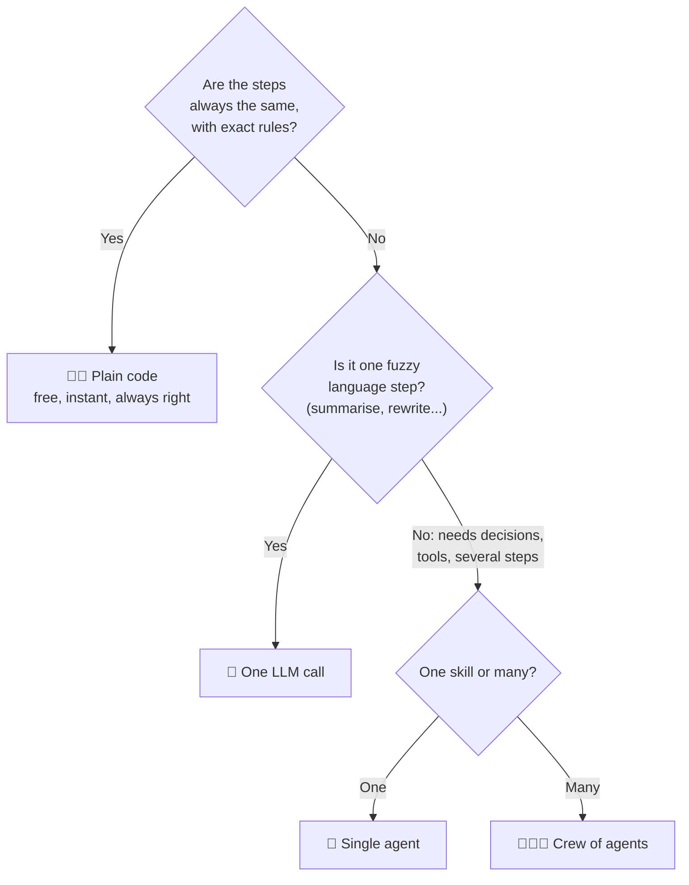

# 2.3 Design Question: Agent Overkill

[🏠 Home](../../README.md) · [⬅ 2.2 Newsletter Pipeline Example](2_2_newsletter_pipeline.md) · [2.4 CrewAI vs Chatbots ➡](2_4_crewai_vs_chatbots.md)

> **Module 2 · Thinking in Multi-Agent Systems** · 💻 Code: [2_3_agent_overkill.py](../../code/02-multi-agent-thinking/2_3_agent_overkill.py)

## In one sentence

Agents are powerful but expensive. If plain code or a single LLM call can do the job, **use that instead**.

## The decision



| Approach | Cost | Speed | Reliability | Use for |
|---|---|---|---|---|
| Plain code | Free | Instant | Always the same | Rules, maths, formatting |
| One LLM call | Small | Seconds | Usually right | Summarising, rewriting, classifying |
| Agent / crew | Highest | Slowest | Needs checking | Decisions, tools, multi-step research |

## The demo

One small job: **convert 5 Celsius readings to Fahrenheit and label each cold/mild/hot.** These are fixed rules, so it's a perfect job for code. We solve it three ways anyway and compare.

```python
# 1) Plain Python
f"{c}C = {c * 9 / 5 + 32:.1f}F {label(c)}"

# 2) One LLM call
llm.call(JOB)

# 3) A full CrewAI agent
Crew(agents=[agent], tasks=[task]).kickoff()
```

## Run it

```powershell
.venv\Scripts\python code\02-multi-agent-thinking\2_3_agent_overkill.py
```

## What you'll see

```text
--- 1) Plain Python ---
12C = 53.6F cold
25C = 77.0F mild
31C = 87.8F hot
8C = 46.4F cold
19C = 66.2F mild
[time 0.000s | tokens 0 | numbers correct: ✅]

--- 2) One LLM call ---
(same 5 lines)
[time 4.307s | tokens 468 | numbers correct: ✅]

--- 3) CrewAI agent ---
(same 5 lines)
[time 4.941s | tokens 626 | numbers correct: ✅]

===== VERDICT =====
Approach            Seconds  Tokens
1) Plain Python       0.000       0
2) One LLM call       4.307     468
3) CrewAI agent       4.941     626
```

All three got the right answer, but code was **instant and free**. The LLM versions took ~4–5 seconds and used hundreds of tokens, and they *could* have made a mistake on another run.

## Key takeaways

- **Fixed rules + exact answers → plain code.**
- **One fuzzy language step → a single LLM call.**
- **Decisions, tools, several steps → that's when an agent or crew earns its cost.**
- Mixing is normal: in [Module 8](../08-flows/8_1_flows_intro.md), Flows use code for the fixed parts and LLMs only where needed.

## Try it yourself

- Change the job to something fuzzy: "Describe each temperature the way a poet would." Which approach makes sense now?

---

[🏠 Home](../../README.md) · [⬅ 2.2 Newsletter Pipeline Example](2_2_newsletter_pipeline.md) · [2.4 CrewAI vs Chatbots ➡](2_4_crewai_vs_chatbots.md)
