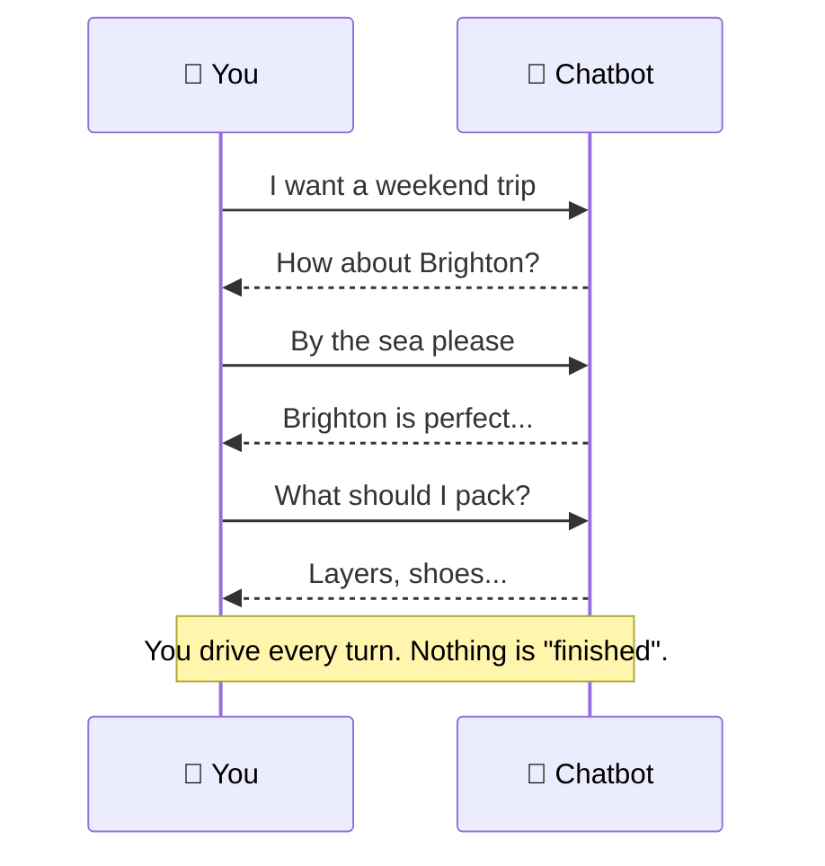
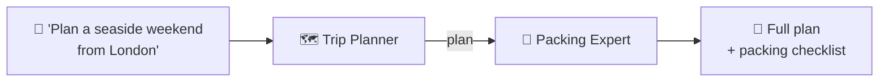

# 2.4 CrewAI vs Chatbots

[🏠 Home](../../README.md) · [⬅ 2.3 Design Question: Agent Overkill](2_3_agent_overkill.md) · [3.1 CrewAI: What Is It? ➡](../03-crewai-basics/3_1_what_is_crewai.md)

> **Module 2 · Thinking in Multi-Agent Systems** · 💻 Code: [2_4_crewai_vs_chatbots.py](../../code/02-multi-agent-thinking/2_4_crewai_vs_chatbots.py)

## In one sentence

A **chatbot** holds a conversation that *you* lead; a **crew** takes a job and hands back a *finished result*.

## The idea





| | 💬 Chatbot | 🧑‍🤝‍🧑 Crew |
|---|---|---|
| Who leads? | You, every turn | The agents |
| Output | Replies in a chat | A finished deliverable |
| "Memory" | The growing message history | Task context passed between agents |
| Best for | Open-ended conversation | A job with a clear result |

## The code, step by step

**Chatbot:** a list of messages that grows every turn. The *whole* history is sent each time:

```python
history = [{"role": "system", "content": "You are a friendly travel chatbot..."}]
for turn in user_turns:
    history.append({"role": "user", "content": turn})
    reply = llm.call(history)
    history.append({"role": "assistant", "content": reply})
```

**Crew:** one request, two specialists, one finished result:

```python
plan = Task(description="Plan a 2-day seaside weekend trip from {city}.", agent=planner, ...)
pack = Task(description="Write a packing checklist for this exact trip.", agent=packer, context=[plan])
result = Crew(agents=[planner, packer], tasks=[plan, pack]).kickoff(inputs={"city": "London"})
```

## Run it

```powershell
.venv\Scripts\python code\02-multi-agent-thinking\2_4_crewai_vs_chatbots.py
```

## What you'll see

```text
===== A) CHATBOT: you lead, turn by turn =====

👤 I want a weekend trip from London.
🤖 How about a weekend in the Cotswolds ... Or head to Brighton for a seaside vibe ...
👤 Somewhere by the sea, please.
🤖 Brighton is perfect for a seaside weekend—just under an hour by train ...
👤 OK, what should I pack?
🤖 Pack layers (light sweater/jacket) for changeable coastal weather, comfy walking shoes ...

===== B) CREW: one request in, a finished plan out =====

**Destination:** Brighton, East Sussex – a classic seaside town ...
**Day 1 – Arrival & Seaside Exploration** ...
**Day 2 – Culture & Departure** ...

[ ] Comfortable walking shoes or sneakers
[ ] Light rain jacket or waterproof layer
[ ] Sunscreen, sunglasses, and a hat
...

===== THE DIFFERENCE =====
             Chatbot                          Crew
Who leads?   You, every turn                  The agents
Output       Replies in a chat                A finished deliverable
Memory       Message history (7 messages)     Task context between agents
Best for     Open-ended conversation          A job with a clear result
```

## Key takeaways

- Chatbots are **conversations**; crews are **jobs**.
- A chatbot needs you to steer; a crew steers itself towards `expected_output`.
- They combine well: a chatbot can collect the request, then hand it to a crew to do the work.

## Try it yourself

- Make the chatbot interactive: replace the scripted `user_turns` with `input("You: ")` in a loop.

---

[🏠 Home](../../README.md) · [⬅ 2.3 Design Question: Agent Overkill](2_3_agent_overkill.md) · [3.1 CrewAI: What Is It? ➡](../03-crewai-basics/3_1_what_is_crewai.md)
