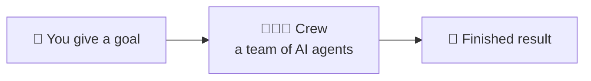
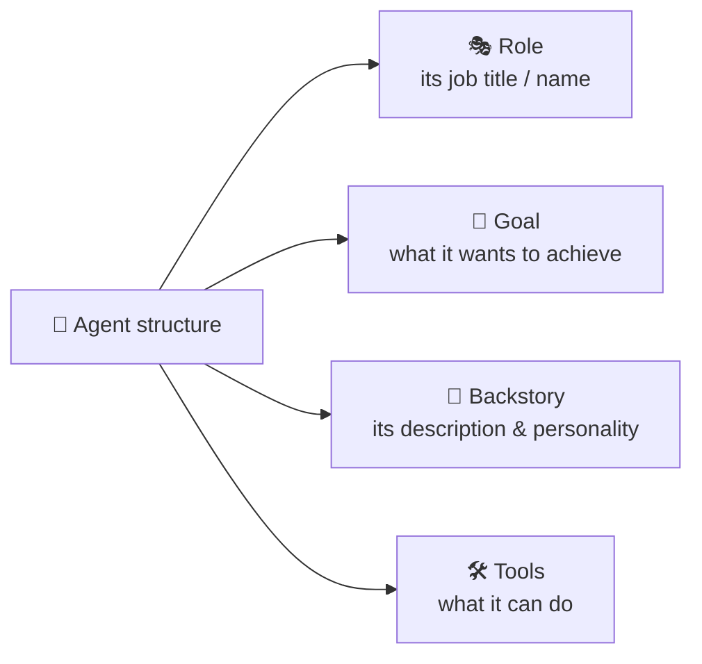
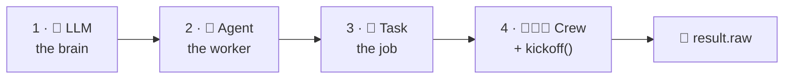
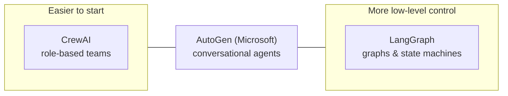

# 3.1 CrewAI: What Is It?

[🏠 Home](../../README.md) · [⬅ 2.4 CrewAI vs Chatbots](../02-multi-agent-thinking/2_4_crewai_vs_chatbots.md) · [3.2 CrewAI Philosophy ➡](3_2_crewai_philosophy.md)

> **Module 3 · CrewAI Basics** · 💻 Code: [3_1_what_is_crewai.py](../../code/03-crewai-basics/3_1_what_is_crewai.py)

## In one sentence

**CrewAI is an open-source Python framework that lets several AI "workers" (called _agents_) team up to finish a job.** You describe the team and the work, and CrewAI runs it.

## The idea

Think of a small company:

- A **researcher** finds information.
- A **writer** turns it into an article.
- An **editor** checks the article.

Each person has a clear **role**, and work is passed along. CrewAI lets you build exactly this kind of team, except every member is an AI model.



Every agent in that crew is described the same way:



## The smallest CrewAI program

Every CrewAI program follows the same 4 steps:



```python
teacher = Agent(
    role="Friendly Teacher",                                   # job title
    goal="Explain {topic} so a 12-year-old understands it",    # {topic} filled in at kickoff
    backstory="You have taught science for 20 years...",       # personality
    llm=llm,
)
explain = Task(
    description="Explain {topic} in simple words.",
    expected_output="3 short paragraphs and one everyday analogy. No jargon.",
    agent=teacher,
)
crew = Crew(agents=[teacher], tasks=[explain])
result = crew.kickoff(inputs={"topic": "black holes"})
print(result.raw)
```

The script explains **every line** in comments, including the setup lines at the top.

## CrewAI vs other frameworks



- **CrewAI:** you think in *roles and teams*. The fastest way for a beginner to get a working multi-agent prototype.
- **LangGraph:** you think in *graphs* (nodes and edges). More control, but you need to understand graphs and state.
- **AutoGen:** Microsoft's framework, built around agents chatting with each other.

## Run it

```powershell
.venv\Scripts\python code\03-crewai-basics\3_1_what_is_crewai.py "black holes"
```

## What you'll see

```text
===== RESULT =====

A black hole is a spot in space where the pull of gravity is so strong that nothing—not even
light—can get away once it gets too close. It looks completely black because no light can escape...

Black holes usually form when a really big star runs out of fuel and its own weight makes it
collapse inward...

**Everyday analogy:** Think of a bathtub drain when you pull the plug. The water whirls faster
and faster as it gets closer to the hole...
```

It followed the `expected_output`: 3 short paragraphs plus an analogy, with no jargon.

## Key takeaways

- CrewAI = a Python framework for **teams of AI agents**.
- You **describe** agents and tasks in plain English; CrewAI **runs** them.
- Every program in this course is a variation of these ~10 lines.

## Try it yourself

- Run it with your own topic: `... 3_1_what_is_crewai.py "how vaccines work"`.

---

[🏠 Home](../../README.md) · [⬅ 2.4 CrewAI vs Chatbots](../02-multi-agent-thinking/2_4_crewai_vs_chatbots.md) · [3.2 CrewAI Philosophy ➡](3_2_crewai_philosophy.md)
