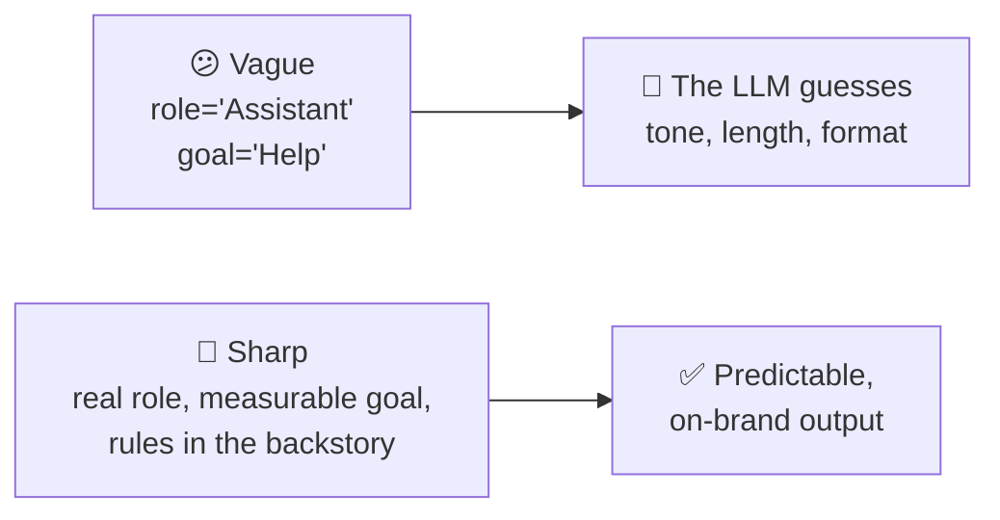

# 3.2 CrewAI Philosophy

[🏠 Home](../../README.md) · [⬅ 3.1 CrewAI: What Is It?](3_1_what_is_crewai.md) · [3.3 CrewAI Components ➡](3_3_crewai_components.md)

> **Module 3 · CrewAI Basics** · 💻 Code: [3_2_crewai_philosophy.py](../../code/03-crewai-basics/3_2_crewai_philosophy.py)

## In one sentence

CrewAI's big idea is to **model your AI team like a real company**: clear roles, clear tasks and clear handoffs give better results.

## The idea

| Real company | CrewAI |
|---|---|
| Job title | `role` |
| What you're measured on | `goal` |
| Your experience and style | `backstory` |
| The ticket you're assigned | `Task.description` |
| The definition of done | `Task.expected_output` |
| Who you hand work to | `context=[...]` |
| The team and how it works | `Crew` + `Process` |



Three principles:
1. **Role-playing:** a specific role ("Senior UX Writer for a payments app") pulls in the right knowledge and tone.
2. **Clear deliverables:** `expected_output` is your acceptance test. Make it measurable (word counts, sections, format).
3. **Collaboration by design:** decide who hands what to whom, like a real workflow.

## The demo

The same job, *"Write the error message shown when a customer's card payment fails"*, given to two agents:

```python
# A) vague
Agent(role="Assistant", goal="Help", backstory="You help.")
Task(description=JOB, expected_output="An error message.")

# B) sharp
Agent(
    role="Senior UX Writer for a payments app",
    goal="Write error messages that calm users and tell them exactly what to do next",
    backstory="You've written UI copy for banks for 10 years. You never blame the user, "
              "never use technical codes, and always give one clear next step.",
)
Task(description=JOB, expected_output="A title (max 6 words) and a body (max 25 words) with one clear next step. No error codes.")
```

## Run it

```powershell
.venv\Scripts\python code\03-crewai-basics\3_2_crewai_philosophy.py
```

## What you'll see

```text
===== A) VAGUE: role='Assistant', goal='Help' =====

Sorry, your card payment could not be processed. Please verify your card details and try again,
or contact your bank.

===== B) SHARP: a real role, goal, backstory and 'done' =====

We couldn't complete your payment
Please check the card details and try again, or contact your bank if the issue continues.
```

Both are fine here, because modern LLMs are good at this. But **B has a title and a body exactly as specified**, uses "we" instead of "your payment could not be processed" (it doesn't blame the user), and stays within the limits. With vague instructions, you get whatever the model feels like: it might be right this time and wrong next time.

## Key takeaways

- Treat agents like **hires**: give them a real job title and clear standards.
- Put rules (tone, do's and don'ts) in the **backstory**.
- Make `expected_output` **measurable**, so you (or a guardrail, see [6.2](../06-reliable-outputs/6_2_guardrails.md)) can check it.

## Try it yourself

- Run it 3 times. Which version changes more between runs?

---

[🏠 Home](../../README.md) · [⬅ 3.1 CrewAI: What Is It?](3_1_what_is_crewai.md) · [3.3 CrewAI Components ➡](3_3_crewai_components.md)
