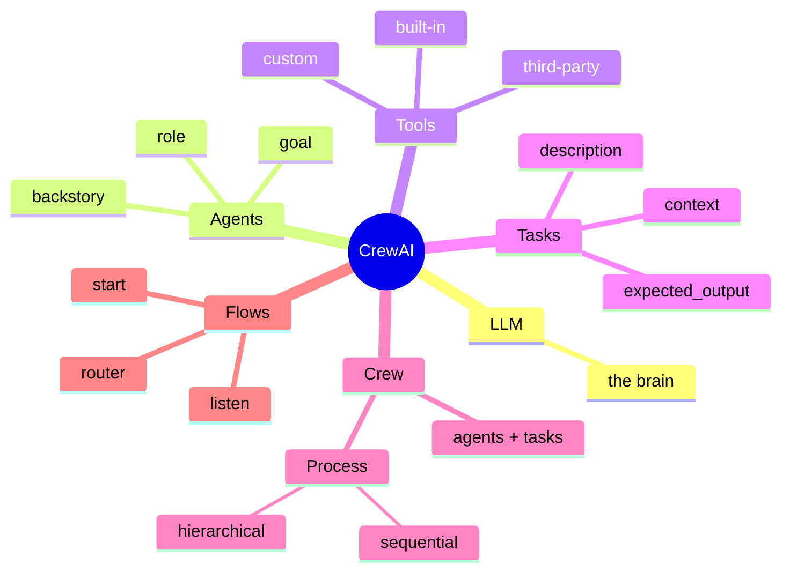
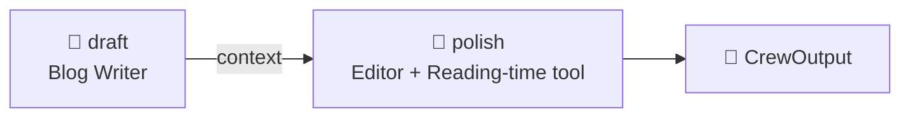
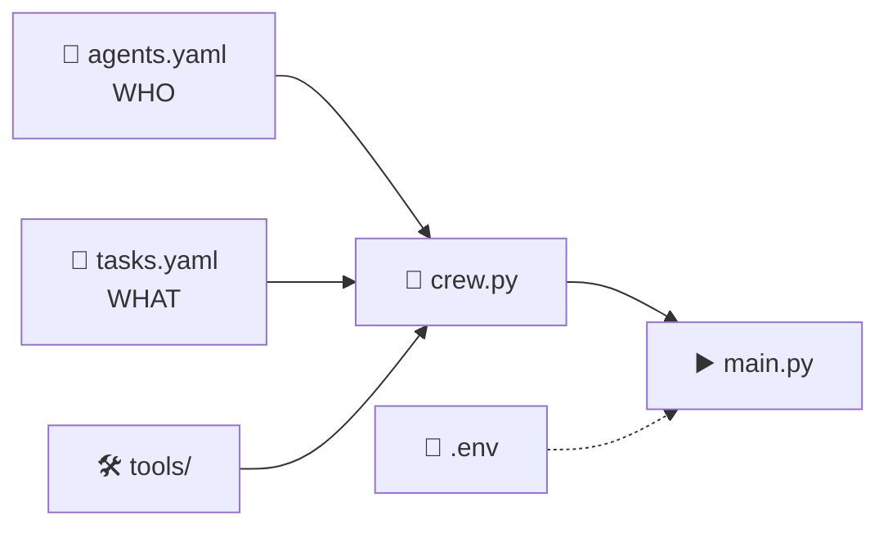

# 3.3 CrewAI Components

[🏠 Home](../../README.md) · [⬅ 3.2 CrewAI Philosophy](3_2_crewai_philosophy.md) · [3.4 CrewAI Process Types ➡](3_4_process_types.md)

> **Module 3 · CrewAI Basics** · 💻 Code: [3_3_crewai_components.py](../../code/03-crewai-basics/3_3_crewai_components.py)

## In one sentence

Every CrewAI program is built from the same few components (**LLM, Agent, Tool, Task, Crew, Process**) and returns a **CrewOutput** object.

## The components



| Component | What it is | Covered in |
|---|---|---|
| **LLM** | The brain every agent thinks with | [0.1](../00-getting-started/0_1_setup_and_keys.md) |
| **Agent** | A worker: role + goal + backstory + tools | [1.2](../01-agent-fundamentals/1_2_components_of_agents.md) |
| **Tool** | Something an agent can *do* | [Module 5](../05-tools/5_1_types_of_tools.md) |
| **Task** | One job + its definition of done | this page |
| **Crew** | The team: agents + tasks | this page |
| **Process** | How the crew works (sequential / hierarchical) | [3.4](3_4_process_types.md) |
| **Memory** | What agents remember | [7.2](../07-advanced-crews/7_2_memory.md) |
| **Flow** | Code-controlled pipeline around crews | [Module 8](../08-flows/8_1_flows_intro.md) |

## Tasks: the to-do items

| Field | Meaning |
|---|---|
| `description` | What exactly needs to be done |
| `expected_output` | What "done" looks like (format, length) |
| `agent` | Who is responsible |
| `context` *(optional)* | Earlier tasks whose output this task needs |
| `tools` *(optional)* | Task-only tools (see [5.1](../05-tools/5_1_types_of_tools.md)) |
| `output_file` *(optional)* | Save the result to a file |
| `output_pydantic` *(optional)* | Return a typed object (see [6.1](../06-reliable-outputs/6_1_structured_outputs.md)) |



> **Rule of thumb:** a vague `expected_output` gives vague results. Be specific about the format.

## The result object: CrewOutput

`kickoff()` returns more than text:

| Attribute | What's in it |
|---|---|
| `result.raw` | The final task's answer as plain text |
| `result.tasks_output` | A list with **every** task's output (`.raw`, `.agent`, ...) |
| `result.pydantic` | A typed object, if the last task used `output_pydantic` |
| `result.json_dict` | A dict, if the last task used `output_json` |
| `result.token_usage` | Token counts for the run |

## Bonus: project structure for bigger projects

For larger projects, `crewai create crew my_project` scaffolds a ready-made folder:

```text
my_project/
├── .env                  # secret keys - never commit this
├── pyproject.toml        # project info and dependencies
└── src/my_project/
    ├── main.py           # the "start button"
    ├── crew.py           # glues agents + tasks into a crew
    ├── config/
    │   ├── agents.yaml   # WHO does the work
    │   └── tasks.yaml    # WHAT work is done
    └── tools/
        └── custom_tool.py
```



This course keeps everything in single files to stay simple; the components are exactly the same.

## Run it

```powershell
.venv\Scripts\python code\03-crewai-basics\3_3_crewai_components.py
```

## What you'll see

```text
===== FINAL RESULT (result.raw) =====

Learning to code at forty feels like embarking on a new adventure. You bring life experience,
problem-solving skills, and fresh curiosity to every line of syntax. ...
Reading time: 76 words, about 1 min

===== COMPONENT MAP =====

LLM       nvidia/nemotron-3-super-120b-a12b
Process   sequential
Agent     Blog Writer  tools: none
Agent     Editor       tools: Reading time
Task 1    by Blog Writer  -> 80 words
Task 2    by Editor       -> 83 words

===== THE RESULT OBJECT (CrewOutput) =====

result.raw           -> final text (516 chars)
result.tasks_output  -> 2 TaskOutput objects, one per task
result.pydantic      -> None  (filled when a task uses output_pydantic, see 6.1)
result.json_dict     -> None  (filled when a task uses output_json)
```

## Key takeaways

- **LLM** thinks, **Tool** acts, **Agent** = both + identity, **Task** = the job, **Crew + Process** = the team.
- `kickoff()` returns a **CrewOutput**: the final answer *and* every step.
- Memory and Flows build on these same pieces.

## Try it yourself

- Print `result.token_usage` at the end. How many tokens did the two tasks use?

---

[🏠 Home](../../README.md) · [⬅ 3.2 CrewAI Philosophy](3_2_crewai_philosophy.md) · [3.4 CrewAI Process Types ➡](3_4_process_types.md)
