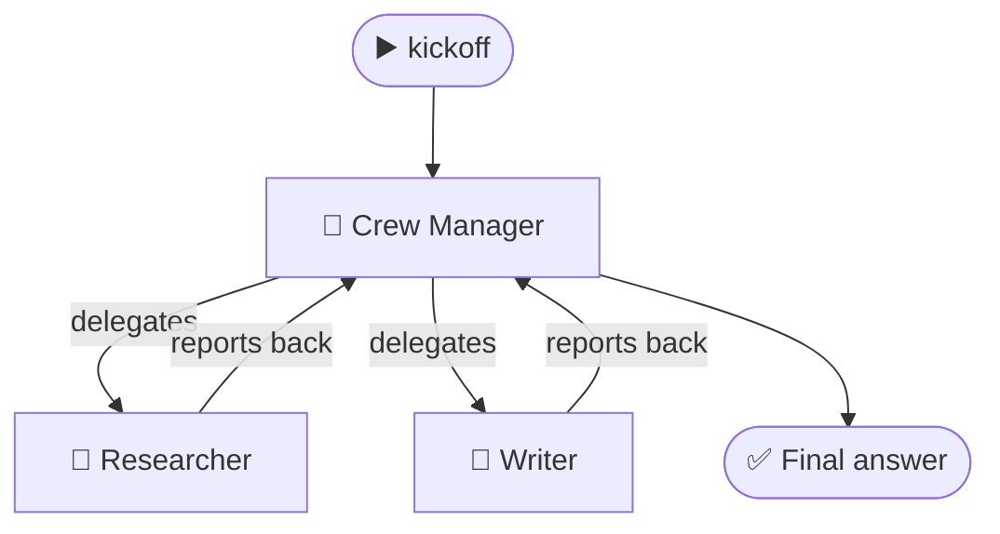

# 3.4 CrewAI Process Types

[🏠 Home](../../README.md) · [⬅ 3.3 CrewAI Components](3_3_crewai_components.md) · [4.1 Types of Kickoff ➡](../04-running-crews/4_1_kickoff_types.md)

> **Module 3 · CrewAI Basics** · 💻 Code: [3_4_process_types.py](../../code/03-crewai-basics/3_4_process_types.py)

## In one sentence

The **process** decides how a crew works: **sequential** (you set the order) or **hierarchical** (a manager agent decides who does what).

## The two processes

**Sequential:** tasks run one after another, like an assembly line.


**Hierarchical:** a *manager* receives the goal, hands out work, and checks results, like a team lead.



| | Sequential | Hierarchical |
|---|---|---|
| Who decides the order? | You (the task list order) | The manager agent |
| Tasks need an `agent=`? | Yes | No: the manager assigns |
| Extra setting | none | `manager_llm=` or `manager_agent=` |
| Cost | Lowest | Extra manager LLM calls |
| Good for | Predictable pipelines | Open-ended jobs needing coordination |
| Beginner friendly? | ✅ Start here | Try later ([7.1](../07-advanced-crews/7_1_hierarchical_process.md)) |

## The code, step by step

```python
# Sequential: YOU assign each task and set the order
tasks = [
    Task(description="List 3 facts about honeybees.", agent=researcher, ...),
    Task(description="Write a 50-word summary from the facts.", agent=writer, ...),
]
Crew(agents=[researcher, writer], tasks=tasks, process=Process.sequential)

# Hierarchical: ONE task, NO agent. The manager splits it up.
tasks = [Task(description="Find 3 facts about honeybees, then write a 50-word summary from them.", ...)]
Crew(agents=[researcher, writer], tasks=tasks, process=Process.hierarchical, manager_llm=llm)
```

An event listener counts which agent made each LLM call.

## Run it

```powershell
.venv\Scripts\python code\03-crewai-basics\3_4_process_types.py
```

## What you'll see

```text
===== SEQUENTIAL =====

Honeybees share food locations via the waggle dance, indicating distance and direction relative
to the sun; a colony may hold up to 60,000 workers ...

LLM calls: 2  {'Researcher': 1, 'Writer': 1}
Time     : 19.9s

===== HIERARCHICAL =====

Honeybees perform a waggle dance to signal food source direction and distance relative to the
sun. A colony holds 60,000 workers ...

LLM calls: 5  {'Crew Manager': 3, 'Researcher': 1, 'Writer': 1}
Time     : 78.5s
```

The results are very similar, but hierarchical made **3 extra manager calls** and took **4× longer**. The manager had to plan, delegate twice, and review.

## Key takeaways

- **Sequential:** predictable, cheap, you control the order. **Start here.**
- **Hierarchical:** flexible: a manager plans and delegates. It costs extra calls, so use it when the work really needs planning.
- In hierarchical crews, tasks don't need `agent=`; the manager decides.

## Try it yourself

- Add a third agent (a "Fact Checker") to both versions. Does the manager use it?

---

[🏠 Home](../../README.md) · [⬅ 3.3 CrewAI Components](3_3_crewai_components.md) · [4.1 Types of Kickoff ➡](../04-running-crews/4_1_kickoff_types.md)
