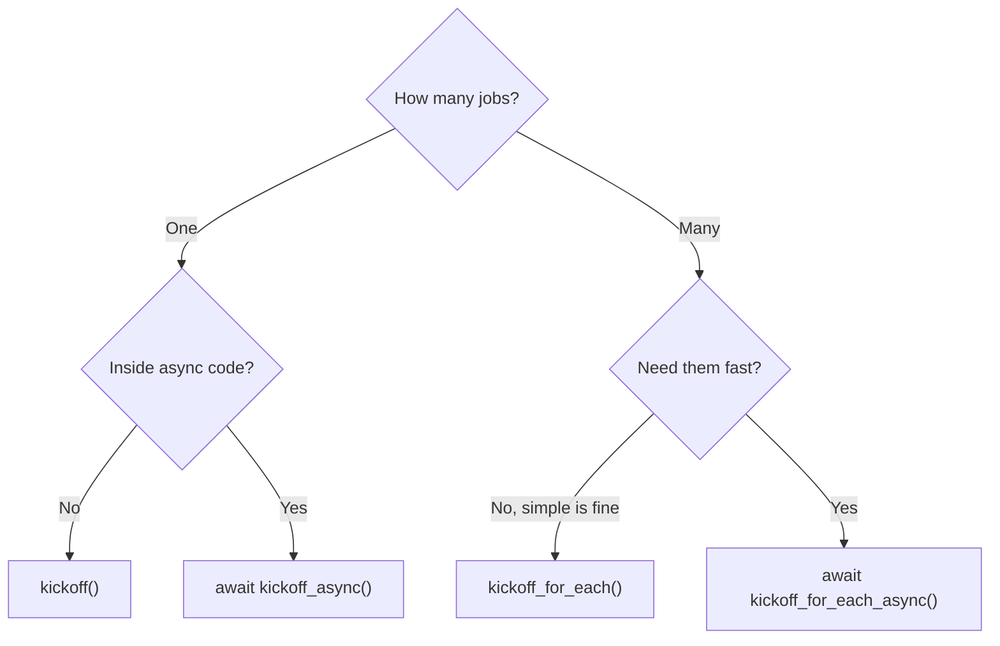

# 4.1 Types of Kickoff

[🏠 Home](../../README.md) · [⬅ 3.4 CrewAI Process Types](../03-crewai-basics/3_4_process_types.md) · [4.2 Agents in Sequence ➡](4_2_agents_in_sequence.md)

> **Module 4 · Running Crews** · 💻 Code: [4_1_kickoff_types.py](../../code/04-running-crews/4_1_kickoff_types.py)

## In one sentence

There are **four ways to start a crew**: one job or many, waiting or not waiting.

## The four methods

| Method | Runs | Blocks your code? | Use it when |
|---|---|---|---|
| `crew.kickoff(inputs={...})` | Once | Yes | The normal case: one job, wait for the answer |
| `crew.kickoff_for_each(inputs=[...])` | Once per input, **one after another** | Yes | A batch of similar jobs |
| `await crew.kickoff_async(inputs={...})` | Once | No | Inside async apps (web servers), or to run several *different* crews at once ([4.4](4_4_async_crews.md)) |
| `await crew.kickoff_for_each_async(inputs=[...])` | Once per input, **all at the same time** | No | A big batch where speed matters |



**Sequential batch vs async batch:**

```mermaid
gantt
    title 3 jobs: kickoff_for_each vs kickoff_for_each_async
    dateFormat X
    axisFormat %s
    section for_each
    octopus :0, 1
    owl     :1, 2
    axolotl :2, 3
    section for_each_async
    octopus :0, 1
    owl     :0, 1
    axolotl :0, 1
```



## "async" in plain words

`async` code can **start a job and move on** instead of waiting. You must call async methods with `await`, inside an `async def` function, started with `asyncio.run(...)`:

```python
async def async_demos():
    job = asyncio.create_task(make_crew().kickoff_async(inputs={"animal": "octopus"}))
    print("started... free to do other work here")
    result = await job                       # now wait for it

asyncio.run(async_demos())
```

## ⚠️ Gotcha: build a fresh crew per kickoff

After `kickoff()`, a crew's tasks **keep the filled-in values**. Reusing the same crew object for a new kickoff can repeat the old input. (In testing, every "owl" and "axolotl" answer came back about the octopus!) The script builds a fresh crew each time:

```python
def make_crew() -> Crew:
    zoologist = Agent(...)
    fact = Task(description="Give one surprising fact about the {animal}.", ...)
    return Crew(agents=[zoologist], tasks=[fact])

make_crew().kickoff_for_each(inputs=[{"animal": "octopus"}, {"animal": "owl"}, {"animal": "axolotl"}])
```

## Run it

```powershell
.venv\Scripts\python code\04-running-crews\4_1_kickoff_types.py
```

## What you'll see

```text
----- kickoff  (1.7s) -----
  • An octopus has three hearts—two pump blood to the gills while the third sends it to the rest of the body ...

----- kickoff_for_each  (3.6s) -----
  • An octopus has three hearts—two pump blood to the gills while the third sends it to the rest of the body.
  • Owls can rotate their heads up to 270 degrees without damaging their blood vessels or nerves.
  • Axolotls can regenerate entire limbs, spinal cord, heart tissue, and even portions of their brain ...

(kickoff_async started... the program is free to do other work here)

----- kickoff_async  (2.2s) -----
  • An octopus has three hearts ... its copper-based blood turns blue when oxygenated

----- kickoff_for_each_async  (2.3s) -----
  • An octopus can edit its own RNA to rapidly adapt its nervous system to changing temperatures ...
  • Some owls can rotate their heads up to 270 degrees thanks to extra vertebrae ...
  • Axolotls can regenerate entire limbs, spinal cords, heart tissue, and even parts of their brain ...

===== SUMMARY =====
Method                   Jobs  Seconds
kickoff                     1      1.7
kickoff_for_each            3      3.6
kickoff_async               1      2.2
kickoff_for_each_async      3      2.3
```

The async batch did **3 jobs in about the time of 1** (2.3s vs 3.6s one-by-one).

## Key takeaways

- `kickoff` is the default; `kickoff_for_each` is the simplest batch.
- Async doesn't make *one* job faster; it lets *many* jobs overlap.
- Build a **fresh crew** for each kickoff (or use `kickoff_for_each`, which copies the crew for you).

## Try it yourself

- Add 5 more animals to `ANIMALS`. Does the async batch still take about the same time?

---

[🏠 Home](../../README.md) · [⬅ 3.4 CrewAI Process Types](../03-crewai-basics/3_4_process_types.md) · [4.2 Agents in Sequence ➡](4_2_agents_in_sequence.md)
