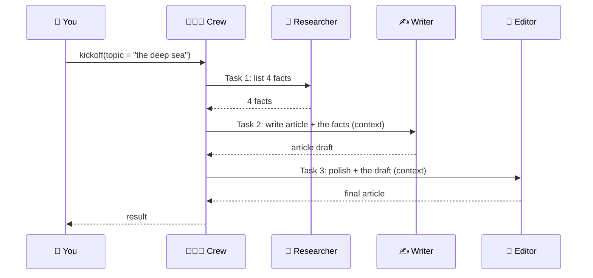
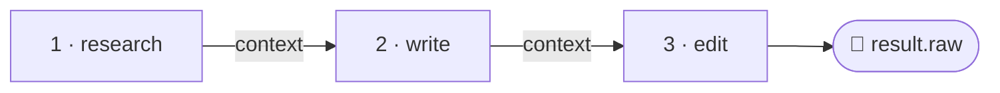

# 4.2 Agents in Sequence

[🏠 Home](../../README.md) · [⬅ 4.1 Types of Kickoff](4_1_kickoff_types.md) · [4.3 Agents in Parallel ➡](4_3_agents_in_parallel.md)

> **Module 4 · Running Crews** · 💻 Code: [4_2_agents_in_sequence.py](../../code/04-running-crews/4_2_agents_in_sequence.py)

## In one sentence

In a sequential crew, each task **waits for the previous one** and receives its output through `context`, like an assembly line.

## One full run, step by step





## The code, step by step

**1. Chain the tasks** with `context`:

```python
research = Task(name="1 research", description="List 4 facts about {topic}.", agent=researcher, ...)
write    = Task(name="2 write", ..., agent=writer, context=[research])
edit     = Task(name="3 edit",  ..., agent=editor, context=[write])
```

**2. Record a timeline** with CrewAI's task events:

```python
@crewai_event_bus.on(TaskStartedEvent)
def task_started(source, event):
    timeline[event.task.name] = [time.perf_counter() - T0, None]

@crewai_event_bus.on(TaskCompletedEvent)
def task_done(source, event):
    timeline[event.task.name][1] = time.perf_counter() - T0
```

**3. Draw it** as text bars (`█`), scaled to 50 characters.

## Run it

```powershell
.venv\Scripts\python code\04-running-crews\4_2_agents_in_sequence.py
```

## What you'll see

```text
===== FINAL ARTICLE =====

The deep sea starts around 200 meters (≈656 feet), where sunlight vanishes and pressure climbs
about one atmosphere per ten meters ...

===== TIMELINE =====

1 research  |████                                              |   0.0s ->   3.4s
2 write     |    █████████████████████████████████             |   3.4s ->  28.1s
3 edit      |                                     ████████████ |  28.1s ->  37.4s

Total: 37.4s. No bars overlap: each task waited for the previous one.
```

Each bar starts exactly where the previous one ends. **Total time = the sum of all steps.**

## Key takeaways

- Sequential = an assembly line; the order is your task list order.
- `context=[earlier_task]` hands output forward.
- Total time adds up. If some tasks don't depend on each other, run them in parallel → [4.3](4_3_agents_in_parallel.md).

## Try it yourself

- Remove `context=[research]` from the write task. Does the writer still use the 4 facts?

---

[🏠 Home](../../README.md) · [⬅ 4.1 Types of Kickoff](4_1_kickoff_types.md) · [4.3 Agents in Parallel ➡](4_3_agents_in_parallel.md)
