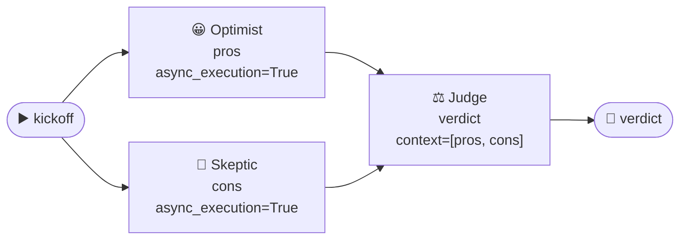

# 4.3 Agents in Parallel

[🏠 Home](../../README.md) · [⬅ 4.2 Agents in Sequence](4_2_agents_in_sequence.md) · [4.4 Async Crews ➡](4_4_async_crews.md)

> **Module 4 · Running Crews** · 💻 Code: [4_3_agents_in_parallel.py](../../code/04-running-crews/4_3_agents_in_parallel.py)

## In one sentence

Tasks that don't need each other's output can run **at the same time** with `async_execution=True`; a later task then **joins** their results through `context`.

## The idea



- `pros` and `cons` don't depend on each other, so they run **side by side**.
- `verdict` needs both, so it **waits** for both and receives both outputs.

```mermaid
gantt
    title Sequential vs parallel
    dateFormat X
    axisFormat %s
    section Sequential (4.2)
    pros    :0, 2
    cons    :2, 4
    verdict :4, 9
    section Parallel (this page)
    pros    :0, 2
    cons    :0, 2
    verdict :2, 7
```



## The code, step by step

```python
pros = Task(name="pros", description="List the 3 biggest advantages of {topic}.",
            agent=optimist, async_execution=True)     # don't wait, start the next task
cons = Task(name="cons", description="List the 3 biggest disadvantages of {topic}.",
            agent=skeptic, async_execution=True)       # runs alongside 'pros'
verdict = Task(name="verdict", description="Weigh the pros and cons ...",
               agent=judge, context=[pros, cons])      # waits for BOTH
```

The same timeline code as [4.2](4_2_agents_in_sequence.md) shows the overlap.

## Run it

```powershell
.venv\Scripts\python code\04-running-crews\4_3_agents_in_parallel.py "electric cars"
```

## What you'll see

```text
===== VERDICT =====
Electric cars offer zero tailpipe emissions, lower operating costs, and instant torque, making
them environmentally friendly and fun to drive, yet they suffer from ...

===== TIMELINE =====

pros     | ████                                             |   0.6s ->   1.9s
cons     | ███████                                          |   0.6s ->   3.1s
verdict  |         ████████████████████████████████████████ |   3.1s ->  16.7s

Sum of task times: 17.5s   Actual total: 16.7s   Saved: 0.7s
```

`pros` and `cons` **both start at 0.6s**: they ran in parallel. `verdict` starts only when the slower of the two finishes (3.1s).

The saving here is small because the judge's task dominated the time. Parallelism pays off most when the **parallel tasks are the slow ones** (e.g. 3 researchers each searching the web).

## Key takeaways

- `async_execution=True` = "start me and move on".
- A following task with `context=[...]` waits for those async tasks.
- Only parallelise tasks that **don't need each other's output**.
- A crew can't *end* on an async task: always finish with a normal one.

## Try it yourself

- Add a third parallel researcher ("Cost Analyst") and add it to the judge's `context`. Does the total time grow?

---

[🏠 Home](../../README.md) · [⬅ 4.2 Agents in Sequence](4_2_agents_in_sequence.md) · [4.4 Async Crews ➡](4_4_async_crews.md)
