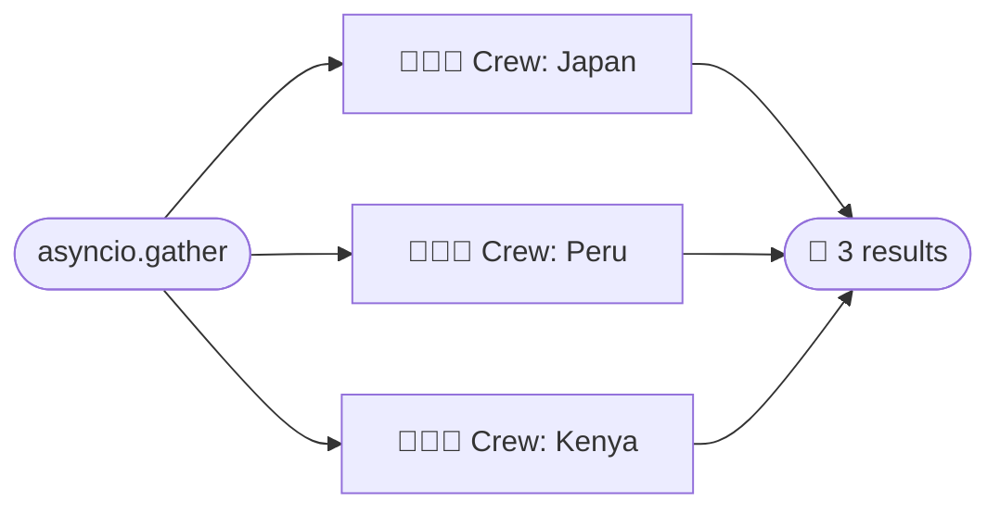

# 4.4 Async Crews

[🏠 Home](../../README.md) · [⬅ 4.3 Agents in Parallel](4_3_agents_in_parallel.md) · [5.1 Types of Tools ➡](../05-tools/5_1_types_of_tools.md)

> **Module 4 · Running Crews** · 💻 Code: [4_4_async_crews.py](../../code/04-running-crews/4_4_async_crews.py)

## In one sentence

[4.3](4_3_agents_in_parallel.md) ran *tasks* in parallel inside one crew; here we run whole, separate **crews** at the same time with `kickoff_async()` and `asyncio.gather()`.

## The idea



| | Parallel tasks (4.3) | Async crews (this page) |
|---|---|---|
| What runs together | Tasks **inside one crew** | **Separate crews** |
| How | `async_execution=True` on tasks | `kickoff_async()` + `asyncio.gather()` |
| Results combine? | Yes, via `context` | No, each crew is independent |
| Typical use | Research the same topic from different angles | One crew per customer, file, country... |

## Why it's faster

An LLM call spends most of its time **waiting on the network**. While one crew waits, the others can work:

```mermaid
gantt
    title One by one vs all at once
    dateFormat X
    axisFormat %s
    section One by one
    Japan :0, 6
    Peru  :6, 13
    Kenya :13, 19
    section All at once
    Japan :0, 5
    Peru  :0, 6
    Kenya :0, 6
```



## The code, step by step

```python
def make_crew() -> Crew:          # each country gets its own, independent crew
    ...

# 1) One after another: total = sum of all three
one_by_one = [make_crew().kickoff(inputs={"country": c}) for c in COUNTRIES]

# 2) All at once: total ≈ the slowest one
async def run_all_at_once():
    jobs = [make_crew().kickoff_async(inputs={"country": c}) for c in COUNTRIES]  # nothing runs yet
    return await asyncio.gather(*jobs)    # start them all, wait for every one

together = asyncio.run(run_all_at_once())
```

## Run it

```powershell
.venv\Scripts\python code\04-running-crews\4_4_async_crews.py
```

## What you'll see

```text
===== RESULTS (async run) =====

Japan  Purchase a Japan Rail Pass before arrival and use it for unlimited Shinkansen and local JR trains ...
Peru   Always carry cash in small denominations and a reusable water bottle with a purifier ...
Kenya  Always carry a reusable water bottle and stay hydrated, as Kenya's climate can be dry ...

===== SPEED =====

One by one     :  19.1s
All at once    :   5.7s
Speed-up       : 3.4x
```

## Key takeaways

- `kickoff_async()` returns an *awaitable*; `asyncio.gather()` runs many together.
- Great for **independent** jobs: one crew per customer, per file, per country.
- Watch your provider's **rate limits** when you run many crews at once.

## Try it yourself

- Add 5 more countries. Does the speed-up keep growing, or does the provider start slowing you down?

---

[🏠 Home](../../README.md) · [⬅ 4.3 Agents in Parallel](4_3_agents_in_parallel.md) · [5.1 Types of Tools ➡](../05-tools/5_1_types_of_tools.md)
