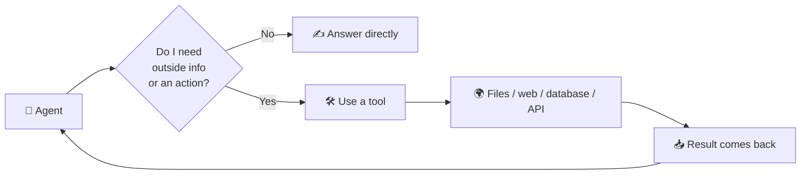
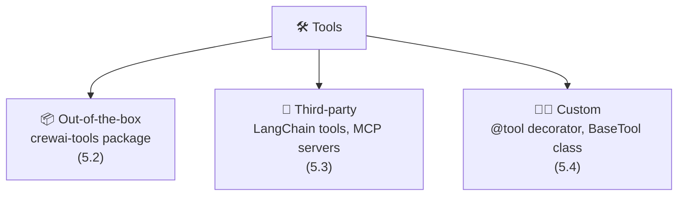
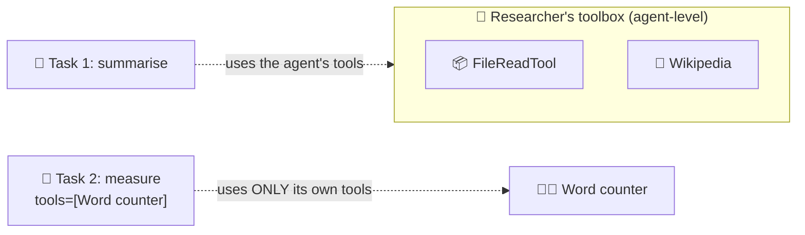

# 5.1 Types of Tools

[🏠 Home](../../README.md) · [⬅ 4.4 Async Crews](../04-running-crews/4_4_async_crews.md) · [5.2 Out-of-the-box Tools ➡](5_2_out_of_the_box_tools.md)

> **Module 5 · Tools** · 💻 Code: [5_1_types_of_tools.py](../../code/05-tools/5_1_types_of_tools.py)

## In one sentence

Tools come in **three families** (ready-made, borrowed and home-made), and you can give them to an **agent** (always available) or to a single **task**.

## Why agents need tools

On its own, an LLM can only *think and write*. It can't open a file, browse the web or run a calculation. **Tools give agents hands.**



## The three families



| Family | Example in the script | Effort | Best for |
|---|---|---|---|
| 📦 **Out-of-the-box** | `FileReadTool` | Import and go | Common jobs: files, web, search, PDFs |
| 🔌 **Third-party** | LangChain `Wikipedia`, wrapped | A small wrapper | Reusing a huge ecosystem |
| 🧑‍💻 **Custom** | `Word counter` (`@tool`) | Write a function | Anything specific to *your* problem |

## Agent-level vs task-level tools



- **Agent-level** (`Agent(tools=[...])`): the agent's normal toolbox, available for every task.
- **Task-level** (`Task(tools=[...])`): a special toolbox for one task. It **replaces** the agent's tools for that task.

## The code, step by step

```python
file_reader = FileReadTool(file_path=str(notes))                 # 📦 import, configure, done

wikipedia = WikipediaQueryRun(api_wrapper=WikipediaAPIWrapper(...))
@tool("Wikipedia")                                               # 🔌 wrap the LangChain tool
def wikipedia_search(query: str) -> str:
    """Look up a topic on Wikipedia and return a short summary."""
    return wikipedia.run(query)

@tool("Word counter")                                            # 🧑‍💻 your own function
def count_words(text: str) -> str:
    """Count the words in a piece of text."""
    return f"{len(text.split())} words"

researcher = Agent(..., tools=[file_reader, wikipedia_search])   # agent-level
measure = Task(..., tools=[count_words])                         # task-level
```

## Run it

```powershell
.venv\Scripts\python code\05-tools\5_1_types_of_tools.py
```

## What you'll see

```text
===== SUMMARY =====
The meeting notes indicate that the team decided to build their next prototype with the Rust
programming language. Rust emphasizes performance, type safety, concurrency, ...

===== WORD COUNT =====
37 words

===== TOOL FAMILIES =====
  📦 out-of-the-box     Read a file's content        used 1x
  🔌 third-party        Wikipedia                    used 1x
  🧑‍💻 custom           Word counter                 used 1x
```

The agent read the notes (📦), found "Rust", looked it up (🔌), and the second task counted the words (🧑‍💻). One tool from each family.

## Key takeaways

- **Out-of-the-box:** fastest to use. **Third-party:** huge ecosystem, may need a wrapper. **Custom:** anything Python can do.
- The tool's **name and description** are what the LLM reads to decide when to use it.
- Agent-level = the toolbox; task-level = a special toolbox that **replaces** it for one task.

## Try it yourself

- Give the `measure` task `tools=[]`. Does the agent still count the words, and how accurately?

---

[🏠 Home](../../README.md) · [⬅ 4.4 Async Crews](../04-running-crews/4_4_async_crews.md) · [5.2 Out-of-the-box Tools ➡](5_2_out_of_the_box_tools.md)
