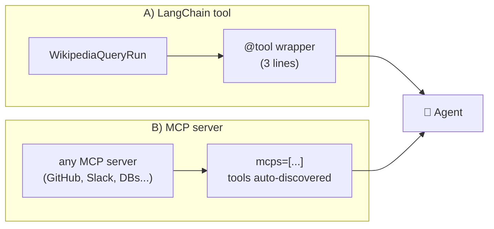
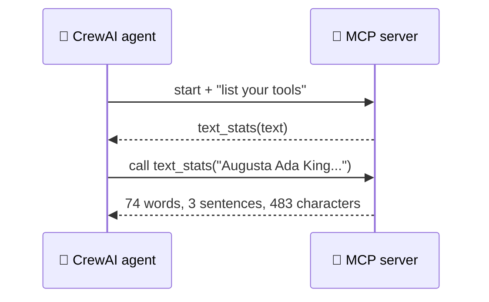

# 5.3 Third-party Tools

[🏠 Home](../../README.md) · [⬅ 5.2 Out-of-the-box Tools](5_2_out_of_the_box_tools.md) · [5.4 Building Custom Tools ➡](5_4_custom_tools.md)

> **Module 5 · Tools** · 💻 Code: [5_3_third_party_tools.py](../../code/05-tools/5_3_third_party_tools.py)

## In one sentence

Use tools that weren't built for CrewAI in two ways: **wrap LangChain tools** in a tiny function, or **connect MCP servers** and let CrewAI discover their tools.

## Two routes



| | LangChain tools | MCP servers |
|---|---|---|
| What | Python tool objects from LangChain | Separate programs speaking the **Model Context Protocol** |
| Connect with | A `@tool` wrapper | `Agent(mcps=[MCPServerStdio(...)])` or `MCPServerHTTP(url)` |
| Discovery | One tool at a time | All the server's tools at once |
| Ecosystem | Hundreds of integrations | Thousands of servers, any language |

## A) LangChain: wrap it

Passing a LangChain tool straight to `tools=[...]` **fails validation**: it isn't a CrewAI tool. A 3-line wrapper fixes that:

```python
langchain_wikipedia = WikipediaQueryRun(api_wrapper=WikipediaAPIWrapper(top_k_results=1, ...))

@tool("Wikipedia")
def wikipedia(query: str) -> str:
    """Look up a person or topic on Wikipedia."""
    return langchain_wikipedia.run(query)
```

## B) MCP: connect a server

**MCP (Model Context Protocol)** is a universal plug for tools. A server announces its tools; any MCP client (CrewAI, Claude, IDEs...) can use them.



To keep the course one-file-per-topic, **the script is also its own MCP server**: started with `--serve`, it exposes a `text_stats` tool. The agent just describes how to launch it:

```python
if "--serve" in sys.argv:                       # server side
    server = FastMCP("text-stats", log_level="WARNING")
    @server.tool()
    def text_stats(text: str) -> str: ...
    server.run()

text_stats_server = MCPServerStdio(command=sys.executable, args=[__file__, "--serve"])   # client side
biographer = Agent(..., tools=[wikipedia], mcps=[text_stats_server])
```

In real projects you'd point `MCPServerStdio` at someone else's server (e.g. `command="npx", args=[...]`), or use `MCPServerHTTP(url=...)` for a remote one.

## Run it

```powershell
.venv\Scripts\python code\05-tools\5_3_third_party_tools.py
```

## What you'll see

```text
===== RESULT =====

Augusta Ada King, Countess of Lovelace (née Byron; 10 December 1815 – 27 November 1852), was an
English mathematician and writer known for her work on Charles Babbage's analytical engine. ...
Stats: 74 words, 3 sentences, 483 characters

===== TOOLS USED =====

  LangChain (wrapped)        1x
  MCP server (text_stats)    1x
```

## Key takeaways

- **LangChain tools:** wrap with `@tool` (or a `BaseTool`) and you're done.
- **MCP:** describe how to start/reach the server; CrewAI discovers its tools.
- `MCPServerStdio` = launch a local server; `MCPServerHTTP` = connect to a URL.
- `langchain-community` is being retired. Prefer MCP or a standalone package for new projects.

## Try it yourself

- Add a second tool to the MCP server (e.g. `reading_level(text)`). Does the agent find and use it without any other changes?

---

[🏠 Home](../../README.md) · [⬅ 5.2 Out-of-the-box Tools](5_2_out_of_the_box_tools.md) · [5.4 Building Custom Tools ➡](5_4_custom_tools.md)
