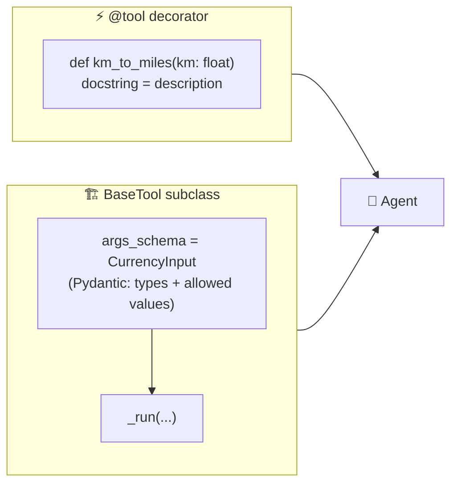
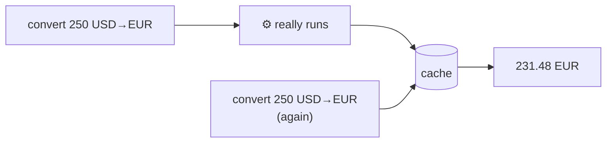

# 5.4 Building Custom Tools

[🏠 Home](../../README.md) · [⬅ 5.3 Third-party Tools](5_3_third_party_tools.md) · [6.1 Structured Outputs with Pydantic ➡](../06-reliable-outputs/6_1_structured_outputs.md)

> **Module 5 · Tools** · 💻 Code: [5_4_custom_tools.py](../../code/05-tools/5_4_custom_tools.py)

## In one sentence

Turn any Python function into a tool with **`@tool`**, or subclass **`BaseTool`** with a Pydantic schema when inputs need rules, and make it robust with **errors** and **caching**.

## Two ways to build a tool



| | `@tool` | `BaseTool` |
|---|---|---|
| Code | A function | A class |
| Description | The docstring | `description = "..."` |
| Inputs | Type hints | A Pydantic `args_schema` |
| Validation | Basic types | Full: allowed values, ranges, descriptions |
| Use when | Quick, simple tools | Inputs need rules, or the tool has settings |

## The four ideas in the script

**1) Quick tool:**

```python
@tool("Km to miles")
def km_to_miles(km: float) -> str:
    """Convert kilometres to miles."""
    return f"{km} km = {km * 0.621371:.2f} miles"
```

**2) Full tool with a schema:** `Literal[...]` limits the LLM to valid choices:

```python
class CurrencyInput(BaseModel):
    amount: float = Field(description="The amount of money to convert")
    from_currency: Literal["USD", "EUR", "GBP", "INR"] = Field(description="Currency code to convert from")
    to_currency: Literal["USD", "EUR", "GBP", "INR"] = Field(description="Currency code to convert to")

class CurrencyConverter(BaseTool):
    name: str = "Currency converter"
    description: str = "Convert an amount between USD, EUR, GBP and INR ..."
    args_schema: type[BaseModel] = CurrencyInput
    def _run(self, amount, from_currency, to_currency) -> str: ...
```

**3) Errors:** raise with a helpful message. CrewAI passes it to the agent, which can react:

```python
if amount <= 0:
    raise ValueError("Amount must be greater than zero. Ask the user for a positive amount.")
```

**4) Caching:** the same tool with the same inputs returns the saved result instead of running again (`cache=True`, the default).



## Run it

```powershell
.venv\Scripts\python code\05-tools\5_4_custom_tools.py
```

## What you'll see

```text
===== RESULT =====

26.10 miles
231.48 EUR
231.48 EUR
Error: Amount must be greater than zero.

===== TOOL LOG =====

  km_to_miles          {'km': 42}                                                     ok
  currency_converter   {'amount': 250, 'from_currency': 'USD', 'to_currency': 'EUR'}  ok
  currency_converter   {'amount': 250, 'from_currency': 'USD', 'to_currency': 'EUR'}  ok
  currency_converter   {'amount': -20, 'from_currency': 'GBP', 'to_currency': 'INR'}  ERROR: Amount must be greater than zero...

Currency converter: asked 3x, really executed 2x -> 1 answered from cache
Real executions: [(250.0, 'USD', 'EUR'), (-20.0, 'GBP', 'INR')]
```

- The repeated `250 USD → EUR` was answered **from cache**: the code only really ran twice.
- The `-20 GBP` call **raised an error**, and the agent reported it politely instead of crashing.

## Key takeaways

- `@tool` for quick tools; `BaseTool` + `args_schema` when inputs need rules.
- The **docstring / description** is what the LLM reads. Write it like documentation.
- Raise clear errors: the agent reads them and adapts.
- Caching saves time and money on repeated identical calls.

## Try it yourself

- Add `"JPY"` to the rates and the `Literal[...]` lists, then ask for a yen conversion.

---

[🏠 Home](../../README.md) · [⬅ 5.3 Third-party Tools](5_3_third_party_tools.md) · [6.1 Structured Outputs with Pydantic ➡](../06-reliable-outputs/6_1_structured_outputs.md)
