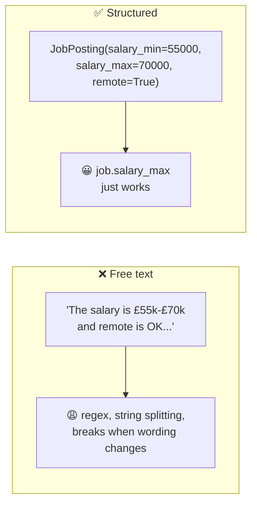
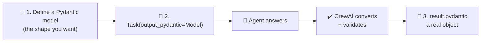

# 6.1 Structured Outputs with Pydantic

[🏠 Home](../../README.md) · [⬅ 5.4 Building Custom Tools](../05-tools/5_4_custom_tools.md) · [6.2 Guardrails ➡](6_2_guardrails.md)

> **Module 6 · Reliable Outputs** · 💻 Code: [6_1_structured_outputs.py](../../code/06-reliable-outputs/6_1_structured_outputs.py)

## In one sentence

With `output_pydantic=YourModel`, CrewAI returns a **typed Python object** instead of free text, so your code can use `job.salary_max` directly.

## The problem with free text



## How it works



**1. Describe the shape.** `Field(description=...)` explains each field to the LLM:

```python
class JobPosting(BaseModel):
    title: str
    company: str
    location: str
    remote: bool = Field(description="True if remote or hybrid work is allowed")
    salary_min: int | None = Field(description="Yearly minimum in GBP, or null if not stated")
    salary_max: int | None = Field(description="Yearly maximum in GBP, or null if not stated")
    skills: list[str] = Field(description="Required technical skills, lowercase")
    years_experience: int | None = Field(description="Minimum years of experience, or null")
```

**2. Ask for it** on the task:

```python
parse = Task(description="Extract the job details from this advert:\n{ad}", ..., output_pydantic=JobPosting)
```

**3. Use it** like any Python object:

```python
job: JobPosting = result.pydantic
if job.salary_min and job.salary_max:
    print(f"Mid salary: £{(job.salary_min + job.salary_max) / 2:,.0f}")
matched = {"python", "postgresql", "react"} & set(job.skills)
```

| Option | You get | Use when |
|---|---|---|
| `output_pydantic=Model` | `result.pydantic` (an object) | You want types, autocomplete, validation |
| `output_json=Model` | `result.json_dict` (a dict) | You'll send it on as JSON (APIs, files) |

## Run it

```powershell
.venv\Scripts\python code\06-reliable-outputs\6_1_structured_outputs.py
```

## What you'll see

The messy input:

```text
🚀 WE'RE HIRING!!! Acme Robotics (Manchester office, but 3 days WFH ok)
is looking for a Backend Engineer to join the Rocket team. You'll write Python
& some Go, work with PostgreSQL, Docker and AWS. Need 3+ yrs exp.
Pay: £55k-£70k + shares. Apply by Friday!!
```

The clean output:

```text
===== THE OBJECT =====
{
  "title": "Backend Engineer",
  "company": "Acme Robotics",
  "location": "Manchester",
  "remote": true,
  "salary_min": 55000,
  "salary_max": 70000,
  "skills": ["python", "go", "postgresql", "docker", "aws"],
  "years_experience": 3
}

===== USING IT IN PLAIN PYTHON =====
Role         : Backend Engineer at Acme Robotics (Manchester)
Remote OK?   : yes
Mid salary   : £62,500
Skill match  : 2/5 -> ['postgresql', 'python']
Apply?       : ✅ yes
```

The LLM understood "3 days WFH ok" → `remote: true`, "£55k" → `55000`, and "3+ yrs exp" → `3`.

## Key takeaways

- `output_pydantic` turns AI text into **data your code can trust**.
- `Field(description=...)` is how you explain each field to the LLM.
- Use `None` for "may be missing" so the LLM isn't forced to **invent** values.
- Pydantic checks the **shape**; [guardrails](6_2_guardrails.md) check the **content**.

## Try it yourself

- Add a field `benefits: list[str]`. Does "shares" end up in it?

---

[🏠 Home](../../README.md) · [⬅ 5.4 Building Custom Tools](../05-tools/5_4_custom_tools.md) · [6.2 Guardrails ➡](6_2_guardrails.md)
