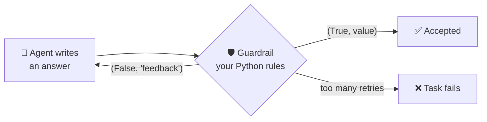
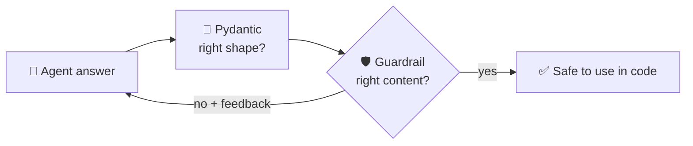

# 6.2 Guardrails

[🏠 Home](../../README.md) · [⬅ 6.1 Structured Outputs with Pydantic](6_1_structured_outputs.md) · [7.1 Hierarchical Process ➡](../07-advanced-crews/7_1_hierarchical_process.md)

> **Module 6 · Reliable Outputs** · 💻 Code: [6_2_guardrails.py](../../code/06-reliable-outputs/6_2_guardrails.py)

## In one sentence

A **guardrail** is a Python function that checks a task's output; if it fails, the agent **retries with your feedback**.

## How it works



The function receives the task output and returns a pair:

| Return | Meaning |
|---|---|
| `(True, value)` | Accepted. `value` becomes the task's result |
| `(False, "feedback")` | Rejected. The agent tries again **with this feedback** |

`guardrail_max_retries=3` stops endless loops.

## The demo: a tagline with strict rules

```python
def tagline_rules(output: TaskOutput) -> tuple[bool, str]:
    text = output.raw.strip().strip('"')
    problems = []
    if len(text.split()) != 5:
        problems.append(f"must be EXACTLY 5 words (you wrote {len(text.split())})")
    if PRODUCT not in text:
        problems.append(f"must include the product name '{PRODUCT}'")
    if "!" in text:
        problems.append("must not use exclamation marks")
    if re.search(r"https?://|www\.", text):
        problems.append("must not contain links")
    if not text.endswith("."):                       # a "hidden" brand rule
        problems.append("must end with a full stop (brand style guide)")
    if problems:
        return False, "Rewrite the tagline. It " + "; it ".join(problems) + "."
    return True, text

task = Task(..., guardrail=tagline_rules, guardrail_max_retries=3)
```

The last rule is **not mentioned** in the task, just like a company style guide the copywriter never read. The guardrail's feedback is how the agent learns it.

## Run it

```powershell
.venv\Scripts\python code\06-reliable-outputs\6_2_guardrails.py
```

## What you'll see

```text
[guardrail] attempt 1: 'BrewBot brews coffee on alarm' -> ❌ must end with a full stop (brand style guide)
[guardrail] attempt 2: 'BrewBot starts your morning perfectly.' -> ✅ pass

===== ATTEMPT LOG =====

  1. ❌ BrewBot brews coffee on alarm
  2. ✅ BrewBot starts your morning perfectly.

FINAL: BrewBot starts your morning perfectly.
```

Attempt 1 broke the hidden rule → the guardrail sent feedback → attempt 2 fixed it, while still keeping exactly 5 words and the product name.

## Guardrails + Pydantic



## Key takeaways

- Guardrails turn *"please follow the rules"* into *"you **must** follow the rules"*.
- The **feedback string** tells the agent exactly what to fix. Be specific.
- Use code for checkable rules: length, required words, banned content, format.
- Always cap retries with `guardrail_max_retries`.

## Try it yourself

- Add a rule "must not contain the word 'coffee'". How many attempts does it take now?

---

[🏠 Home](../../README.md) · [⬅ 6.1 Structured Outputs with Pydantic](6_1_structured_outputs.md) · [7.1 Hierarchical Process ➡](../07-advanced-crews/7_1_hierarchical_process.md)
