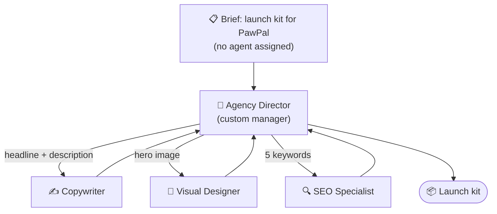

# 7.1 Hierarchical Process

[🏠 Home](../../README.md) · [⬅ 6.2 Guardrails](../06-reliable-outputs/6_2_guardrails.md) · [7.2 Memory in CrewAI ➡](7_2_memory.md)

> **Module 7 · Advanced Crews** · 💻 Code: [7_1_hierarchical_process.py](../../code/07-advanced-crews/7_1_hierarchical_process.py)

## In one sentence

In a hierarchical crew, a **manager agent** reads the brief, **delegates** pieces to the right specialists, checks their work and combines it.

## The idea



The manager delegates using built-in tools CrewAI gives it automatically:

| Built-in manager tool | What it does |
|---|---|
| **Delegate work to coworker** | "Copywriter, write a headline for PawPal..." |
| **Ask question to coworker** | "SEO Specialist, which keyword gets more searches?" |

## manager_llm vs manager_agent

| | `manager_llm=llm` | `manager_agent=director` |
|---|---|---|
| Who builds the manager? | CrewAI (a default "Crew Manager") | You |
| Control over its style | None | Full: role, goal, backstory |
| Used in | [3.4](../03-crewai-basics/3_4_process_types.md) | This page |

```python
director = Agent(
    role="Agency Director",
    goal="Deliver a complete, consistent launch kit by delegating to the right specialist",
    backstory="You never do specialist work yourself. You brief clearly and check every answer.",
    allow_delegation=True,          # a manager MUST be allowed to delegate
    llm=llm,
)
crew = Crew(
    agents=[copywriter, designer, seo],   # the manager is NOT in this list
    tasks=[brief],                        # the task has NO agent=
    process=Process.hierarchical,
    manager_agent=director,
)
```

A tool-usage event listener logs every delegation (`"coworker"` in the tool name).

## Run it

```powershell
.venv\Scripts\python code\07-advanced-crews\7_1_hierarchical_process.py
```

## What you'll see

```text
===== LAUNCH KIT =====

**Copy:**
**Headline:** Never Lose Sight of Your Best Friend
**Description:** PawPal's GPS collar delivers real-time location updates and geofence alerts ...
**Visual:**
The hero image shows a sun-lit meadow under a clear blue sky. A happy, medium-sized dog bounds forward ...
**Keywords:**
PawPal GPS dog collar / Real-time dog tracker with geofencing / Waterproof GPS collar for dogs / ...

===== DELEGATION LOG =====

  Director -> Copywriter       [delegate_work_to_coworker] Create a headline and a 2-sentence description for PawPal...
  Director -> Visual Designer  [delegate_work_to_coworker] Create a description of the hero image for PawPal...
  Director -> SEO Specialist   [delegate_work_to_coworker] Generate 5 SEO keywords for PawPal, a GPS collar for dogs....

===== LLM CALLS PER AGENT =====

  Agency Director  4
  Copywriter       1
  Visual Designer  1
  SEO Specialist   1
  TOTAL            7
```

The director split the brief into exactly the 3 right pieces and sent each to the right specialist. But it made **4 of the 7 LLM calls** itself: planning and combining isn't free.

## Key takeaways

- Hierarchical = tasks **without** a fixed agent + a manager who delegates.
- `manager_llm`: CrewAI makes a default manager. `manager_agent`: you design it.
- The manager **must** have `allow_delegation=True`, and must **not** be in `agents=[...]`.
- It costs extra LLM calls. Use it when the work really needs planning; otherwise sequential is cheaper.

## Try it yourself

- Add a 4th specialist ("Social Media Manager") and add "3 tweets" to the brief. Does the director find them?

---

[🏠 Home](../../README.md) · [⬅ 6.2 Guardrails](../06-reliable-outputs/6_2_guardrails.md) · [7.2 Memory in CrewAI ➡](7_2_memory.md)
