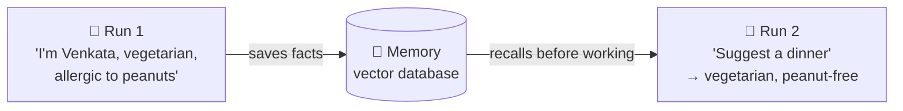
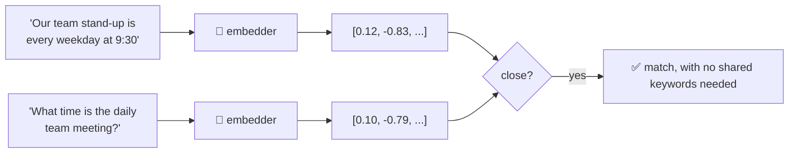

# 7.2 Memory in CrewAI

[🏠 Home](../../README.md) · [⬅ 7.1 Hierarchical Process](7_1_hierarchical_process.md) · [8.1 Flows in CrewAI ➡](../08-flows/8_1_flows_intro.md)

> **Module 7 · Advanced Crews** · 💻 Code: [7_2_memory.py](../../code/07-advanced-crews/7_2_memory.py)

## In one sentence

**Memory** lets agents save facts and find them again **by meaning** (not exact words), so a crew can remember things across tasks and even across runs.

## The idea



How "by meaning" works: an **embedder** turns text into a list of numbers, and similar meanings get similar numbers:



## Memory vs knowledge vs scratchpad

| | 🗒️ Scratchpad ([1.3](../01-agent-fundamentals/1_3_characteristics_of_agents.md)) | 💾 Memory (this page) | 📚 Knowledge |
|---|---|---|---|
| Lives for | One task | Across tasks and runs | Permanent |
| Filled by | The agent's own steps | Crews, automatically (or `remember()`) | You: files, PDFs, CSV, text |
| Use for | Continuing its reasoning | Facts learned along the way | Reference documents (like RAG, see [rag-building.md](../../rag-building.md)) |

## The three parts of a Memory

```python
memory = Memory(
    llm=llm,                                          # 1. analyses each memory: categories, importance
    embedder={"provider": "custom", "config": {"embedding_callable": NvidiaEmbedder}},   # 2. text -> numbers
    storage=LanceDBStorage(path=".../output/memory_db"),                                 # 3. a local vector DB folder
    semantic_weight=0.9, recency_weight=0.05, importance_weight=0.05,                    # how recall ranks
)
```

**The embedder** uses NVIDIA's `nemotron-3-embed-1b` model with the same API key. A tiny custom class is needed because NVIDIA's model wants an extra `input_type` setting. Without it, every fact scored almost the same and recall picked the wrong one:

```python
class NvidiaEmbedder(CustomEmbeddingFunction):
    def __call__(self, input):
        response = nvidia.embeddings.create(model="nvidia/nemotron-3-embed-1b", input=list(input),
                                            extra_body={"input_type": "query"})
        return [item.embedding for item in response.data]
```

**The ranking:** a recall score mixes **meaning**, **recency** and **importance** (defaults 0.5 / 0.3 / 0.2). For a notebook of facts, meaning should win, so the script uses 0.9 / 0.05 / 0.05.

## Part 1: memory as a smart notebook

```python
memory.remember("Our team stand-up is every weekday at 9:30 in room Orion.")
memory.remember("The production database is PostgreSQL 16, hosted in Frankfurt.")
memory.remember("Priya is the on-call engineer this week.")
memory.recall("What time is the daily team meeting?", limit=2)
```

## Part 2: memory shared by crews

```python
def assistant_crew(request):
    ...
    return Crew(agents=[helper], tasks=[task], memory=memory).kickoff().raw   # same memory object

assistant_crew("The user says: 'Hi, I'm Venkata. I'm vegetarian and allergic to peanuts.' ...")   # run 1
assistant_crew("Suggest one dinner recipe for the user tonight. Do not ask questions.")             # run 2
```

Run 2 is a **brand-new crew** that's told nothing about the user, but it shares the memory.

## Run it

```powershell
.venv\Scripts\python code\07-advanced-crews\7_2_memory.py
```

It's the slowest script in the course (a few minutes), because every save uses the LLM to analyse the memory.

## What you'll see

```text
===== PART 1: remember and recall =====

Q: What time is the daily team meeting?
   1. Our team stand-up is every weekday at 9:30 in room Orion.  (score 0.49)
   2. Priya is the on-call engineer this week.  (score 0.41)

Q: Who should I call if the site goes down?
   1. Priya is the on-call engineer this week.  (score 0.43)
   2. The production database is PostgreSQL 16, hosted in Frankfurt.  (score 0.41)

Q: Which database do we use?
   1. The production database is PostgreSQL 16, hosted in Frankfurt.  (score 0.46)
   2. Priya is the on-call engineer this week.  (score 0.41)

Auto-categories the LLM assigned: ['Orion', 'database', 'frankfurt', 'meeting', 'postgresql', 'schedule', 'standup', 'team']

===== PART 2: run 1 learns, run 2 remembers =====

RUN 1 -> Hi Venkata! 👋 Thanks for letting me know you're vegetarian and have a peanut allergy—I've noted that down.

RUN 2 -> How about a hearty chickpea and spinach curry served with basmati rice? It's vegetarian,
         peanut-free, and comes together in about 30 minutes. ...

===== WHAT THE CREWS SAVED: 8 small facts. The ones about the user: =====

  • Venkata's name is Venkata.
  • Venkata is allergic to peanuts.
  • Venkata is vegetarian.
```

- **Part 1:** "daily team meeting" matched "stand-up ... every weekday" with **no shared keywords**. That's recall by meaning.
- **Part 2:** run 2 was never told the diet, but its recipe is vegetarian and peanut-free. The crew split run 1's conversation into small facts and saved them.

> ⚠️ **Remembering isn't the same as using.** In one test run, the task just said "Suggest a dinner recipe", and the agent suggested **salmon**, even though "Venkata is vegetarian" was in memory. Telling the task to *"respect everything you remember about the user"* (without saying what that is) fixed it. Memory supplies the facts; your task wording makes the agent use them.

## Key takeaways

- Memory = `remember()` + `recall()` **by meaning**, backed by an embedder + a vector database.
- `recall()` returns **ranked candidates**, not one "right answer". Crews pass the top few to the agent.
- **Recall is only as good as the embedder.** Always check that the right fact comes first.
- `Crew(memory=...)` saves what it learns after tasks and recalls it before tasks.
- `memory.reset()` wipes everything: do that between tests.

## Try it yourself

- Comment out `memory.reset()` at the start and run the script twice. What does run 2 know now?

---

[🏠 Home](../../README.md) · [⬅ 7.1 Hierarchical Process](7_1_hierarchical_process.md) · [8.1 Flows in CrewAI ➡](../08-flows/8_1_flows_intro.md)
