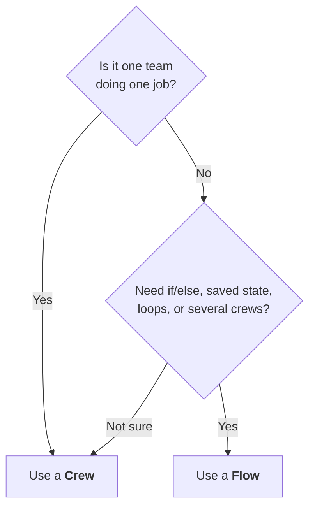
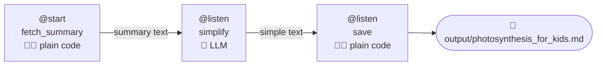

# 8.1 Flows in CrewAI

[🏠 Home](../../README.md) · [⬅ 7.2 Memory in CrewAI](../07-advanced-crews/7_2_memory.md) · [8.2 Routing & State ➡](8_2_routing_and_state.md)

> **Module 8 · Flows** · 💻 Code: [8_1_flows_intro.py](../../code/08-flows/8_1_flows_intro.py)

## In one sentence

A **Flow** is a pipeline **you** control: plain Python steps and LLM steps (or whole crews), wired together with `@start` and `@listen`.

## Crew vs Flow

| | 🧑‍🤝‍🧑 Crew | 🗺️ Flow |
|---|---|---|
| Who's in control | The agents decide *how* | You decide *what, when and if* |
| Steps | Tasks for agents | Python methods: code, LLM calls, crews |
| Branching (if/else) | Limited | `@router` ([8.2](8_2_routing_and_state.md)) |
| Shared data | Task context | `self.state` |
| Best for | Autonomous, collaborative work | Multi-stage pipelines with strict control |



> **Start with Crews.** Move to Flows when you need production reliability: exact control over what runs and when.

## The decorators

| Decorator | Meaning |
|---|---|
| `@start()` | Run this step first |
| `@listen(step)` | Run when `step` finishes. Receives `step`'s **return value** |
| `@router(step)` | Look at the state and return a label to choose the next path ([8.2](8_2_routing_and_state.md)) |

## The demo: an explainer pipeline



Notice: **only one step uses the LLM.** Fetching and saving are plain code because code is enough (see [2.3 Agent Overkill](../02-multi-agent-thinking/2_3_agent_overkill.md)).

```python
class ExplainerFlow(Flow):
    @start()
    def fetch_summary(self):
        topic = self.state["topic"]                      # set from kickoff(inputs=...)
        data = requests.get(f".../page/summary/{topic}").json()
        return data.get("extract")                       # passed to the next step

    @listen(fetch_summary)
    def simplify(self, summary):                         # receives fetch_summary's return value
        return llm.call(f"Rewrite this for a 10-year-old in 3 short sentences:\n\n{summary}")

    @listen(simplify)
    def save(self, simple_text):
        path.write_text(...)
        return simple_text                               # the flow's final result

answer = ExplainerFlow().kickoff(inputs={"topic": "Photosynthesis"})
```

## Run it

```powershell
.venv\Scripts\python code\08-flows\8_1_flows_intro.py "Photosynthesis"
```

## What you'll see

```text
[1 fetch]    901 characters from Wikipedia
[2 simplify] asking the LLM to rewrite it for a 10-year-old
[3 save]     wrote photosynthesis_for_kids.md

===== RESULT =====

Photosynthesis is how plants, algae, and certain bacteria use sunlight and a green pigment called
chlorophyll to turn water and carbon dioxide into sugar, their food. While making sugar, they
release oxygen ...

flow.state = {'id': '41e182c6-...', 'topic': 'Photosynthesis'}
```

## Key takeaways

- Crew = agents decide **how**. Flow = you decide **what runs, when**.
- Mix plain code and LLM steps freely; use code where code is enough.
- Each `@listen` step receives the previous step's return value.
- `self.state` is shared by every step; `kickoff(inputs=...)` fills it.

## Try it yourself

- Add a 4th step, `@listen(save)`, that translates the simple text into Spanish.

---

[🏠 Home](../../README.md) · [⬅ 7.2 Memory in CrewAI](../07-advanced-crews/7_2_memory.md) · [8.2 Routing & State ➡](8_2_routing_and_state.md)
