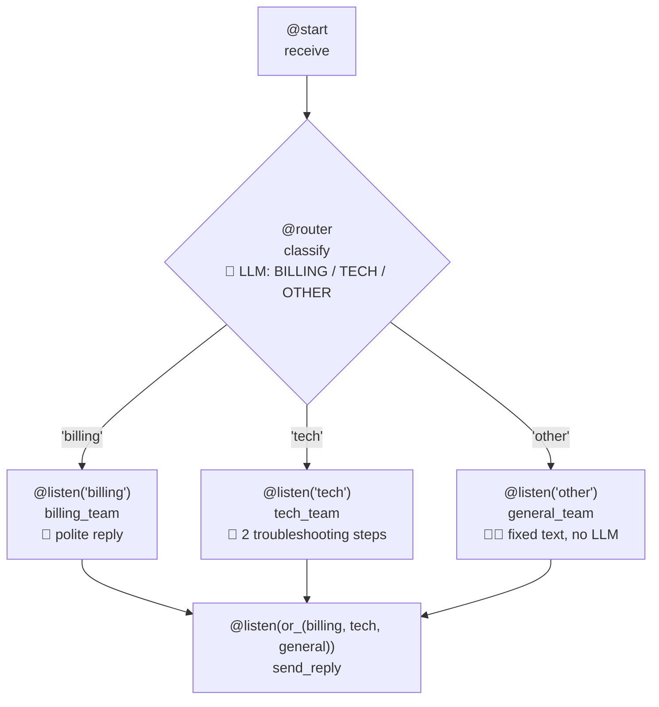

# 8.2 Routing & State

[🏠 Home](../../README.md) · [⬅ 8.1 Flows in CrewAI](8_1_flows_intro.md) · [8.3 Crews inside Flows ➡](8_3_crews_inside_flows.md)

> **Module 8 · Flows** · 💻 Code: [8_2_routing_and_state.py](../../code/08-flows/8_2_routing_and_state.py)

## In one sentence

Give a flow **typed state** (a Pydantic model), use **`@router`** for if/else, and **`or_`** to join the branches back together.

## The demo: support-ticket triage



Only **one** branch runs per ticket. This is **level 4 (Router)** on the [autonomy ladder](../01-agent-fundamentals/1_1_llm_vs_agent.md#levels-of-autonomy-in-llm-applications): the LLM picks the path, and you defined every possible path.

## Three new ideas

**1. Structured state:** a Pydantic model instead of a loose dict. Typos become errors, and your editor autocompletes fields:

```python
class TicketState(BaseModel):
    ticket: str = ""
    category: str = ""
    reply: str = ""
    handled_by: str = ""

class TriageFlow(Flow[TicketState]):     # <- the state type
    ...
    self.state.ticket                    # not self.state["ticket"]
```

**2. `@router`** returns a **label**; only listeners of that label run:

```python
@router(receive)
def classify(self):
    label = llm.call("Classify this support ticket. Reply with exactly one word: BILLING, TECH or OTHER.\n\n" + ...)
    self.state.category = next((c for c in ("BILLING", "TECH") if c in label.upper()), "OTHER").lower()
    return self.state.category           # "billing" | "tech" | "other"

@listen("billing")
def billing_team(self): ...
```

**3. `or_`** joins branches: run after **whichever** one ran (`and_` waits for **all**):

```python
@listen(or_(billing_team, tech_team, general_team))
def send_reply(self):
    return self.state
```

> **Not every branch needs an LLM.** "Other" uses a fixed reply. It's free, instant and always polite.

## Run it

```powershell
.venv\Scripts\python code\08-flows\8_2_routing_and_state.py
```

## What you'll see

```text
===== TRIAGE =====

🎫 I was charged twice for my subscription this month.
   router -> billing
   Billing team: I'm sorry you were charged twice for your subscription this month. I'll investigate
   the duplicate charge and arrange a refund for the extra amount right away....

🎫 The app crashes every time I upload a photo.
   router -> tech
   Tech support: As a patient tech support agent, I'd focus on simple, safe, and high-impact steps ...

🎫 Do you have a office in Lisbon? I'd love to visit.
   router -> other
   General inbox: Thanks for reaching out! A team member will reply within 24 hours....

===== SUMMARY =====

  billing  -> Billing team   | I was charged twice for my subscription this
  tech     -> Tech support   | The app crashes every time I upload a photo.
  other    -> General inbox  | Do you have a office in Lisbon? I'd love to v
```

> 💡 The results are printed **after** each flow finishes. CrewAI draws a live display while a flow runs, and `print()` calls made inside flow steps can get hidden behind it.

## Key takeaways

- `Flow[YourModel]` gives typed, autocompleted state.
- `@router` = if/else for your pipeline. Labels are just strings.
- `or_(a, b, c)` joins branches; `and_(a, b)` waits for all of them.
- Use code for branches that don't need intelligence.

## Try it yourself

- Add a 4th route, `"refund"`, for tickets that ask for money back. What do you need to change?

---

[🏠 Home](../../README.md) · [⬅ 8.1 Flows in CrewAI](8_1_flows_intro.md) · [8.3 Crews inside Flows ➡](8_3_crews_inside_flows.md)
