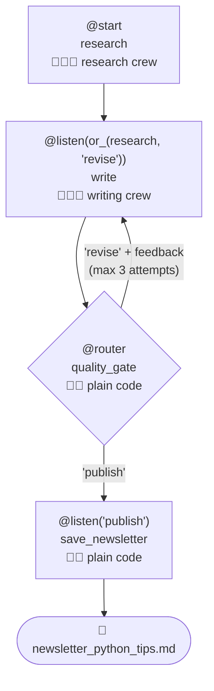

# 8.3 Crews inside Flows

[🏠 Home](../../README.md) · [⬅ 8.2 Routing & State](8_2_routing_and_state.md) · [9.1 Pattern: Single Agent ➡](../09-simple-patterns/9_1_single_agent.md)

> **Module 8 · Flows** · 💻 Code: [8_3_crews_inside_flows.py](../../code/08-flows/8_3_crews_inside_flows.py)

## In one sentence

Put **crews inside a flow**: crews do the creative work, and plain code checks quality and **loops back with feedback** until the result passes.

## The idea

The newsletter from [2.2](../02-multi-agent-thinking/2_2_newsletter_pipeline.md) dropped its `#` title once, and nothing caught it. Here a **quality gate** catches problems and sends the draft back:



| Step | Kind | Job |
|---|---|---|
| `research` | Crew | Find 3 ideas → `state.notes` |
| `write` | Crew | Write the newsletter from notes **+ feedback** → `state.draft` |
| `quality_gate` | Code | Check the rules, return `"revise"` or `"publish"` |
| `save_newsletter` | Code | Save the file |

## Three new ideas

**1. A crew is just a step.** Call `kickoff()` inside a flow method:

```python
@start()
def research(self):
    self.state.notes = research_crew().kickoff(inputs={"topic": self.state.topic}).raw
```

**2. State carries data between crews,** including the gate's feedback for the next attempt:

```python
class NewsletterState(BaseModel):
    topic: str = ""
    notes: str = ""
    draft: str = ""
    feedback: str = ""
    attempts: int = 0
```

**3. A router pointing back to an earlier label creates a loop.** Always cap it:

```python
@listen(or_(research, "revise"))          # runs after research AND after every "revise"
def write(self): ...

@router(write)
def quality_gate(self):
    problems = [...]                      # word count, '# ' title, 'Try this week:' line
    if problems and self.state.attempts < MAX_ATTEMPTS:
        self.state.feedback = "; ".join(problems)
        return "revise"
    return "publish"
```

The gate's word limit (90) is **stricter than the writer's brief**, which doesn't mention it at all. That's like a real editor with standards the writer learns through feedback.

> ⚠️ A step can't have the same name as the label it listens to. `@listen("publish") def publish()` raises an error, so the step is called `save_newsletter`.

## Run it

```powershell
.venv\Scripts\python code\08-flows\8_3_crews_inside_flows.py "Python tips"
```

## What you'll see

```text
[research] 43 words of notes
[write]    attempt 1: 92 words
[gate]     ❌ revise: cut it to under 90 words (now 92)
[write]    attempt 2: 43 words
[gate]     ✅ passed
[publish]  saved newsletter_python_tips.md

===== NEWSLETTER =====

# Python Quick Tips
**Use f-strings**: `print(f"Hello, {name}! You are {age} years old.")`
**List comprehensions**: `squares = [x**2 for x in range(10)]`
**Safe file handling**: `with open('data.txt') as f: lines = f.readlines()`
Try this week: rewrite one script using each of these patterns.

Attempts: 2
```

Attempt 1 was 2 words over the limit → the gate sent feedback → attempt 2 passed.

## Key takeaways

- A crew is just a step: `crew.kickoff()` inside a flow method.
- State carries data between crews (notes → writer, feedback → rewrite).
- `router` + `or_(step, "label")` = a loop. **Always cap it.**
- **Code checks rules reliably; LLMs do the creative part.** This pattern is the backbone of production AI pipelines.

## Try it yourself

- Add a rule to the gate: "must mention at least one code example". Watch how the feedback changes attempt 2.

---

[🏠 Home](../../README.md) · [⬅ 8.2 Routing & State](8_2_routing_and_state.md) · [9.1 Pattern: Single Agent ➡](../09-simple-patterns/9_1_single_agent.md)
