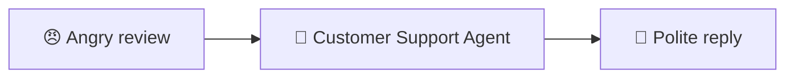

# 9.1 Pattern: Single Agent

[🏠 Home](../../README.md) · [⬅ 8.3 Crews inside Flows](../08-flows/8_3_crews_inside_flows.md) · [9.2 Pattern: Multi Agent (a relay) ➡](9_2_multi_agent.md)

> **Module 9 · Simple Patterns** · 💻 Code: [9_1_single_agent.py](../../code/09-simple-patterns/9_1_single_agent.py)

## 😟 The problem

A customer left an angry review:

> *"Terrible! My pizza arrived 45 minutes late and cold. Never ordering again."*

You need a calm, polite reply, quickly.

## 💡 The solution

**One job → one agent.** Give it a clear role and tell it what a good reply looks like.



```python
support = Agent(
    role="Customer Support Agent",
    goal="Calm unhappy customers and fix their problem",
    backstory="You are kind, you apologise sincerely, and you always offer a fix.",
    llm=llm,
)
reply = Task(
    description="Write a reply to this customer review: {review}",
    expected_output="A short, polite reply (max 3 sentences) with an apology and a concrete offer.",
    agent=support,
)
result = Crew(agents=[support], tasks=[reply]).kickoff(inputs={"review": REVIEW})
```

## ▶️ Run it

```powershell
.venv\Scripts\python code\09-simple-patterns\9_1_single_agent.py
```

## 👀 What you'll see

```text
😠 REVIEW : Terrible! My pizza arrived 45 minutes late and cold. Never ordering again.

🤖 REPLY  : We're sorry your pizza arrived late and cold—thank you for bringing this to our
            attention. Please reply with your order number, and we'll arrange a full refund or a
            complimentary replacement pizza ...
```

An apology, plus a concrete offer, in 3 sentences: exactly what `expected_output` asked for.

## ✅ When to use this pattern

- The job is **one clear thing**: reply, summarise, translate, classify.
- **Always start here.** Add more agents only when one isn't enough.

---

[🏠 Home](../../README.md) · [⬅ 8.3 Crews inside Flows](../08-flows/8_3_crews_inside_flows.md) · [9.2 Pattern: Multi Agent (a relay) ➡](9_2_multi_agent.md)
