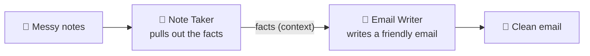

# 9.2 Pattern: Multi Agent (a relay)

[🏠 Home](../../README.md) · [⬅ 9.1 Pattern: Single Agent](9_1_single_agent.md) · [9.3 Pattern: Parallel Agents ➡](9_3_parallel_agents.md)

> **Module 9 · Simple Patterns** · 💻 Code: [9_2_multi_agent.py](../../code/09-simple-patterns/9_2_multi_agent.py)

## 😟 The problem

You have messy meeting notes:

```text
mtg tues - sam, priya, li. website launch moved to 15 nov (design not ready).
priya to finish homepage by fri. li needs logo files from sam asap. budget ok.
next mtg thurs 10am
```

You need a clean email to the team. That takes **two different skills**: understanding messy notes, and writing a nice email.

## 💡 The solution

**Two skills → two agents, in a relay.** The first one hands its work to the second.



The relay baton is `context=[...]`:

```python
extract = Task(description="Extract the decisions, action items (with owners) and next meeting ...",
               agent=note_taker, ...)
write   = Task(description="Write an email to the team based on the extracted facts.",
               agent=email_writer, context=[extract], ...)     # <- receives Note Taker's facts

result = Crew(agents=[note_taker, email_writer], tasks=[extract, write]).kickoff(inputs={"notes": NOTES})
```

## ▶️ Run it

```powershell
.venv\Scripts\python code\09-simple-patterns\9_2_multi_agent.py
```

## 👀 What you'll see

```text
📝 STEP 1 - Note Taker's facts:

Decisions:
- Website launch moved to 15 Nov.
- Budget ok.
Action items:
- Priya – finish homepage – by Friday.
- Sam – provide logo files to Li – ASAP.
Next meeting:
- Thursday 10am.

📧 STEP 2 - Email Writer's email:

Subject: Update on Website Launch – Nov 15, Action Items & Next Meeting
Hi Team, quick update on our project.
- Website launch moved to 15 Nov.
- Budget confirmed as okay.
**Action items:**
- Priya – finish homepage by Friday.
- Sam – provide logo files to Li ASAP.
**Next meeting:**
- Thursday at 10 am.
```

You can see **each step's work** separately, so if the email is wrong, you know which agent to fix.

## ✅ When to use this pattern

- The job has **steps that need different skills** (research → write, extract → format).
- Each step's output is the next step's input.

---

[🏠 Home](../../README.md) · [⬅ 9.1 Pattern: Single Agent](9_1_single_agent.md) · [9.3 Pattern: Parallel Agents ➡](9_3_parallel_agents.md)
