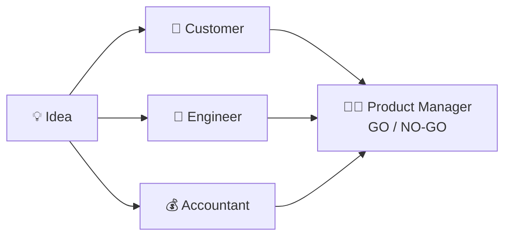

# 9.3 Pattern: Parallel Agents

[🏠 Home](../../README.md) · [⬅ 9.2 Pattern: Multi Agent (a relay)](9_2_multi_agent.md) · [9.4 Pattern: Human in the Loop (HITL) ➡](9_4_human_in_the_loop.md)

> **Module 9 · Simple Patterns** · 💻 Code: [9_3_parallel_agents.py](../../code/09-simple-patterns/9_3_parallel_agents.py)

## 😟 The problem

You have a product idea:

> *"A smart water bottle that glows when you forget to drink, priced at $49."*

You want feedback from **3 experts** (a customer, an engineer and an accountant), then a go / no-go decision. Asking them one by one is slow, and their answers don't depend on each other.

## 💡 The solution

**Independent questions → ask them all at the same time.** Then one more agent reads all three answers and decides.



Two small settings do it:

```python
opinions = [
    Task(description="Would you buy this? ...",           agent=customer,   async_execution=True),  # run now
    Task(description="Is this easy or hard to build? ...", agent=engineer,   async_execution=True),  # run now
    Task(description="Can this make money at that price?", agent=accountant, async_execution=True),  # run now
]
verdict = Task(description="Read the 3 expert opinions and decide: GO or NO-GO ...",
               agent=boss, context=opinions)          # waits for all 3
```

| Setting | Meaning |
|---|---|
| `async_execution=True` | "Start this task and don't wait for it" |
| `context=opinions` | "Wait until these tasks are done, then give me their answers" |

## ▶️ Run it

```powershell
.venv\Scripts\python code\09-simple-patterns\9_3_parallel_agents.py
```

## 👀 What you'll see

```text
💡 IDEA: A smart water bottle that glows when you forget to drink, priced at $49.

🛒 Customer  : No, I wouldn't buy it. $49 is too high for just a glow reminder when free phone
               apps already track hydration effectively.

🔧 Engineer  : Building a smart water bottle that lights up when you haven't drunk enough requires
               integrating a moisture/usage sensor, a small microcontroller, an LED ...

💰 Accountant: At $49 retail, you would need a cost of goods sold well under $20 to achieve a
               healthy gross margin ...

🧑‍💼 VERDICT   : NO-GO
               Consumers are unlikely to pay $49 for a simple glow reminder when free hydration
               apps already serve the need.

⏱️ Done in 8.5s (the 3 experts answered at the same time)
```

## ✅ When to use this pattern

- Several questions that **don't need each other's answers**: different opinions, different sources, different files.
- A final step **combines** them.
- ⚠️ The crew must **end with a normal task** (the verdict), not a parallel one.

---

[🏠 Home](../../README.md) · [⬅ 9.2 Pattern: Multi Agent (a relay)](9_2_multi_agent.md) · [9.4 Pattern: Human in the Loop (HITL) ➡](9_4_human_in_the_loop.md)
