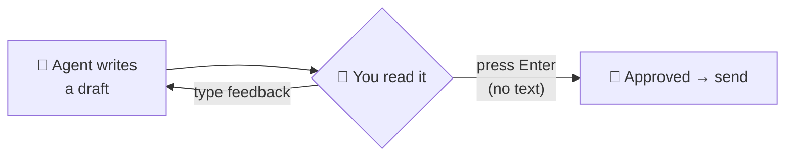

# 9.4 Pattern: Human in the Loop (HITL)

[🏠 Home](../../README.md) · [⬅ 9.3 Pattern: Parallel Agents](9_3_parallel_agents.md) · [9.5 Pattern: Guardrails ➡](9_5_guardrails.md)

> **Module 9 · Simple Patterns** · 💻 Code: [9_4_human_in_the_loop.py](../../code/09-simple-patterns/9_4_human_in_the_loop.py)

## 😟 The problem

An AI writes an email to a customer telling her that her order is delayed. You **don't** want it sent until a real person has read it and is happy with it.

## 💡 The solution

**Make the agent stop and ask you.** One setting: `human_input=True`.



```python
writer = Agent(role="Customer Email Writer", ..., verbose=True)   # verbose: so you can SEE each draft

email = Task(
    description="Write an email telling customer Maria that her order #4521 has been delayed by 2 days.",
    expected_output="A short email: subject line, greeting, 2-3 sentences, sign-off from 'The Shop Team'.",
    agent=writer,
    human_input=True,          # <- pause and ask a human before finishing
)
```

In the terminal you'll be asked:

| You do | What happens |
|---|---|
| Type feedback + Enter (e.g. *"shorter, offer free delivery"*) | The agent rewrites the draft and asks again |
| Press Enter without typing | Approved: the script continues and "sends" it |

## ▶️ Run it

```powershell
.venv\Scripts\python code\09-simple-patterns\9_4_human_in_the_loop.py
```

This one is **interactive**: you answer in the terminal.

## 👀 What you'll see

**Draft 1** (the agent's first try):

```text
Subject: Update on Your Order #4521

Hi Maria,

We wanted to let you know that the delivery of your order #4521 has been delayed by 2 days due to
unexpected shipping challenges. Your package is now expected to arrive two days later than
originally scheduled.

We apologize for any inconvenience and appreciate your patience.

The Shop Team
```

**You type:** `Make it shorter and offer free delivery on the next order as an apology`

**Draft 2:**

```text
Subject: Update on Your Order #4521

Hi Maria,

Your order #4521 has been delayed by 2 days; as an apology, we're offering free delivery on your
next order.

Thank you for your understanding,

The Shop Team
```

**You press Enter** → `✅ APPROVED BY A HUMAN. Sending...` → `📧 Sent!`

## ✅ When to use this pattern

- Anything **risky or public**: emails to customers, social posts, payments, deleting data.
- When the AI needs **your judgement** (tone, what to offer).
- Be specific in your feedback: the agent does exactly what you ask.

---

[🏠 Home](../../README.md) · [⬅ 9.3 Pattern: Parallel Agents](9_3_parallel_agents.md) · [9.5 Pattern: Guardrails ➡](9_5_guardrails.md)
