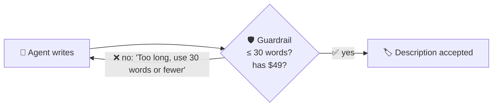

# 9.5 Pattern: Guardrails

[🏠 Home](../../README.md) · [⬅ 9.4 Pattern: Human in the Loop (HITL)](9_4_human_in_the_loop.md)

> **Module 9 · Simple Patterns** · 💻 Code: [9_5_guardrails.py](../../code/09-simple-patterns/9_5_guardrails.py)

## 😟 The problem

An AI writes product descriptions for your online shop. There are two rules:

1. **At most 30 words**: it must fit on the product card.
2. **It must show the price, "$49".**

AIs sometimes ignore rules like these, especially when they get excited about a product.

## 💡 The solution

**A guardrail: a small Python function that checks every answer.** If a rule is broken, the agent is told what's wrong and tries again.



The guardrail returns **two things**: did it pass, and either the answer or what to fix:

```python
def check_description(output):
    text = output.raw.strip()
    words = len(text.split())
    if words > 30:
        return (False, f"Too long: {words} words. Use 30 words or fewer.")   # ❌ try again
    if "$49" not in text:
        return (False, "You forgot the price. Include '$49' exactly.")      # ❌ try again
    return (True, text)                                                     # ✅ accepted

describe = Task(
    description="Write a product description for: a smart water bottle ... Price: $49.",
    expected_output="A product description.",
    agent=copywriter,
    guardrail=check_description,      # check every answer
    guardrail_max_retries=3,          # give up after 3 retries
)
```

The copywriter's backstory says *"you love describing every single feature in rich detail"*, so it's **tempted** to break the length rule.

## ▶️ Run it

```powershell
.venv\Scripts\python code\09-simple-patterns\9_5_guardrails.py
```

## 👀 What you'll see

```text
🛡️ Checking each attempt:
   ❌ attempt 1: 558 words, too long
   ✅ attempt 2: 24 words, price included

🏷️ FINAL DESCRIPTION:

Meet LumiSip: a smart water bottle that glows when you forget to drink, syncs via app, BPA-free,
30-day battery—stay hydrated in style for $49.
```

Attempt 1 was **558 words**. The guardrail said "too long, use 30 words or fewer", and attempt 2 was 24 words with the price.

## ✅ When to use this pattern

- Rules you can **check with code**: length, required words, banned words, format.
- Use **[HITL](9_4_human_in_the_loop.md)** instead when the check needs human judgement ("is the tone right?").
- Want more? See [6.2 Guardrails](../06-reliable-outputs/6_2_guardrails.md) for more rules and a full attempt log.

---

[🏠 Home](../../README.md) · [⬅ 9.4 Pattern: Human in the Loop (HITL)](9_4_human_in_the_loop.md)
