# CrewAI Basic Examples

Ten **single-file** CrewAI programs, from "hello world" to Flows. Each file:

- is **one `.py` file**, with nothing to import from the rest of the repo;
- reads the LLM key from **`settings.config`** at the repo root (NVIDIA, see below);
- runs on its own: `.venv\Scripts\python scripts\basic-examples\<file>.py`.

Go through them **in order**. Each one adds exactly one new idea.

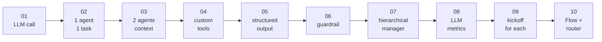

| # | File | New idea | Try it |
|---|---|---|---|
| 01 | [01_hello_llm.py](01_hello_llm.py) | Call the LLM directly, no agent | `01_hello_llm.py` |
| 02 | [02_one_agent_one_task.py](02_one_agent_one_task.py) | Agent + Task + Crew, `{topic}` inputs | `02_one_agent_one_task.py "black holes"` |
| 03 | [03_two_agents_sequential.py](03_two_agents_sequential.py) | Two agents, `context=[...]` passes work along | `03_two_agents_sequential.py "electric cars"` |
| 04 | [04_custom_tool.py](04_custom_tool.py) | Your own tools with `@tool` | `04_custom_tool.py` |
| 05 | [05_structured_output.py](05_structured_output.py) | `output_pydantic`: get a Python object back | `05_structured_output.py "a scary movie"` |
| 06 | [06_guardrail.py](06_guardrail.py) | `guardrail`: auto-check the answer and retry | `06_guardrail.py "our new bakery"` |
| 07 | [07_hierarchical.py](07_hierarchical.py) | `Process.hierarchical`: a manager delegates | `07_hierarchical.py` |
| 08 | [08_llm_metrics.py](08_llm_metrics.py) | Measure every LLM call: read time, tokens, response time | `08_llm_metrics.py "the moon"` |
| 09 | [09_kickoff_for_each.py](09_kickoff_for_each.py) | Run one crew for many inputs | `09_kickoff_for_each.py` |
| 10 | [10_flow.py](10_flow.py) | `Flow` with `@start`, `@router`, `@listen`, state | `10_flow.py "Why is the sky blue?"` |

---

## The shared pattern (in every file)

Every file starts with the same ~15 lines. They read `settings.config` and build the LLM:

```python
SETTINGS = Path(__file__).resolve().parents[2] / "settings.config"
cfg = dict(re.findall(r"^[ \t]*(\w+)[ \t]*=[ \t]*['\"]?(.*?)['\"]?[ \t]*$", SETTINGS.read_text(), re.M))
llm = LLM(
    model=cfg.get("NVIDIA_MODEL", "nvidia/nemotron-3-super-120b-a12b"),
    custom_openai=True,                                # NVIDIA speaks the OpenAI protocol
    base_url="https://integrate.api.nvidia.com/v1",
    api_key=cfg.get("NVIDIA_API_KEY") or cfg["NVDIA_API_KEY"],
)
```

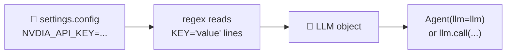

That repetition is on purpose: copy any single file anywhere and it still works.

---

## 01 · Hello LLM

The "brain" on its own: one prompt in, one answer out. A string or a list of chat messages both work.

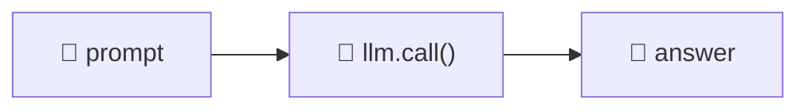

## 02 · One agent, one task

The smallest real crew. `{topic}` in the agent and task text is filled in by `kickoff(inputs={"topic": ...})`.

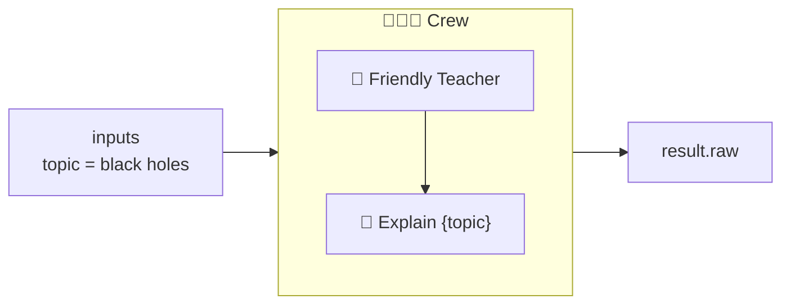

## 03 · Two agents, sequential

The writer's task has `context=[research_task]`, so it receives the researcher's notes. `result.tasks_output` keeps every task's output.

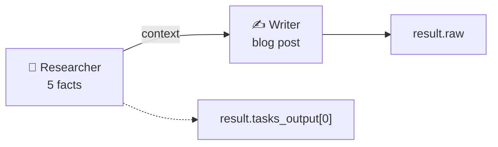

## 04 · Custom tools

LLMs guess at dates and arithmetic. Two plain Python functions become tools with `@tool`, and the **docstring** tells the LLM when to use each one.

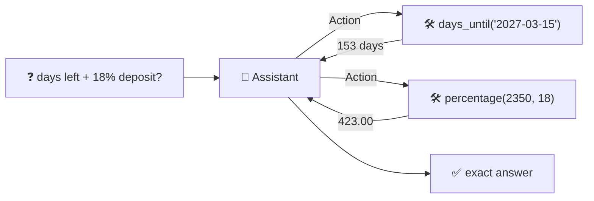

## 05 · Structured output

`output_pydantic=MovieList` makes CrewAI return a typed object. Your code then uses `m.title` and `m.year` instead of parsing text.

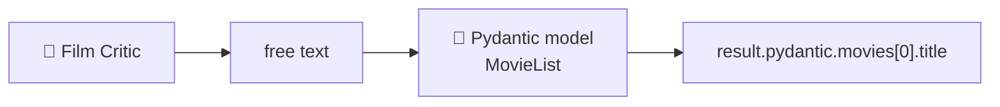

## 06 · Guardrail

A normal Python function checks the answer. If it returns `(False, "feedback")`, the agent retries with that feedback, up to `guardrail_max_retries`.

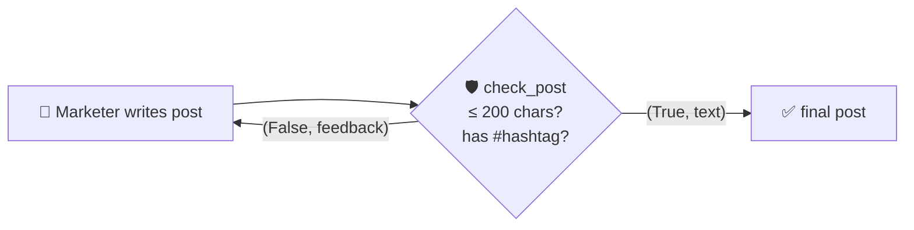

## 07 · Hierarchical

The task has **no agent**. A manager (built from `manager_llm`) reads the task, delegates parts to the Chef and the Nutritionist, and combines their answers.

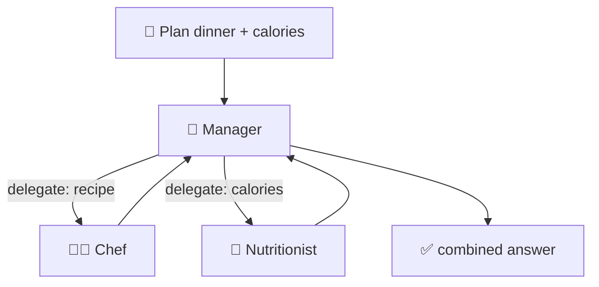

## 08 · LLM metrics

The script prints three things: the **LLM details** (model, provider, temperature, masked key), **per-call metrics** in two tables (timing and tokens), and a **summary**.

CrewAI fires **events** during every LLM call. Three small listener functions record the timings and token counts.

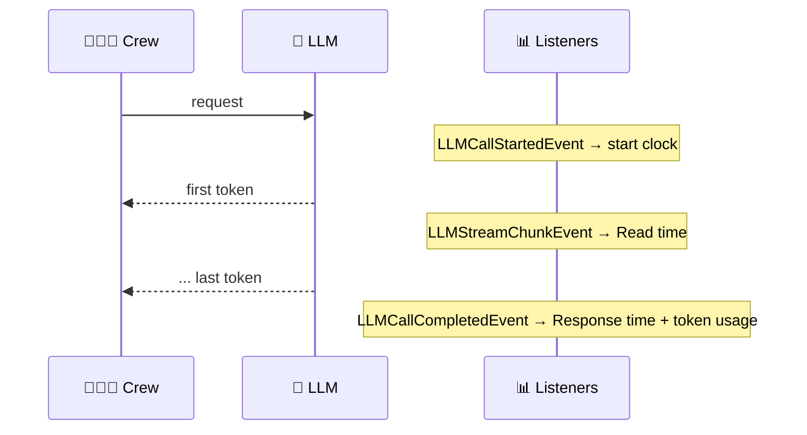

**LLM details** (printed before the crew starts):

```text
  Model        nvidia/nemotron-3-super-120b-a12b
  Provider     NVIDIA (OpenAI-compatible API)
  Client       CrewAI OpenAICompletion (provider='openai')
  Endpoint     https://integrate.api.nvidia.com/v1
  Temperature  0.7
  Max tokens   provider default
  Top-p        provider default
  Streaming    True
  API key      nvapi-...XXXX  (70 chars, 'NVDIA_API_KEY' in settings.config)
```

The key is **masked**: only the first 6 and last 4 characters show, enough to tell which key is in use without leaking it. "Client" says `openai` because CrewAI talks to NVIDIA through its OpenAI-compatible client.

**Per-call metrics:**

| Metric | Meaning |
|---|---|
| **Msgs** | Messages in the prompt (system + user ...) |
| **Read time** | Seconds until the first *visible* token. Includes reading the prompt **and** hidden reasoning |
| **Gen time** | Seconds spent streaming the visible answer |
| **Response** | Seconds from request to last token |
| **Speed** | Output tokens per second over the whole response |
| **Chunks** | How many streamed pieces the answer arrived in |
| **Finish** | Why the model stopped: `stop` = done, `length` = hit the token limit |
| **Read tok** | Input tokens served from the provider's prompt cache (NVIDIA reports 0) |
| **Input / Output** | Tokens sent / generated |
| **Reasoning** | Hidden "thinking" tokens: you pay for them but never see them |
| **Visible** | Output minus reasoning: the part you actually read |

Sample output:

```text
===== LLM METRICS: TIMING =====
 #  Agent    Msgs Read time Gen time Response     Speed Chunks  Finish
 1  Writer      2     1.17s    0.74s    1.91s    59 t/s     23  stop
 2  Editor      2     3.97s    0.46s    4.43s   105 t/s     14  stop

===== LLM METRICS: TOKENS =====
 #  Agent    Read tok   Input  Output Reasoning Visible   Total Answer chars
 1  Writer          0      92     112        36      76     204          275
 2  Editor          0     174     463       409      54     637          191

===== SUMMARY =====
  LLM calls         2
  Wall-clock time   6.48s  (98% of it waiting on the LLM)
  Avg read time     2.57s per call
  Avg speed         91 output tokens/s (incl. reasoning)
  Tokens in / out   266 / 575  (ratio 1 : 2.2)
  Hidden reasoning  445 tokens = 77% of output you never see
  Cache hits        0 of 266 input tokens
  Slowest call      #2 Editor (4.43s)
```

What to notice:

- **98% of the time is spent waiting on the LLM.** Your Python code is almost free; LLM calls are the cost.
- **77% of the output is hidden reasoning.** The Editor "thought" for 409 tokens to write 54 visible ones. That's why its read time is so long.
- The Editor's input is bigger than the Writer's because it also receives the Writer's output as `context`.

> `stream=True` on the LLM is required: without streaming there's no "first token" moment to time.

## 09 · kickoff_for_each

Build the crew once and run it for a list of inputs. You get back one result per input.

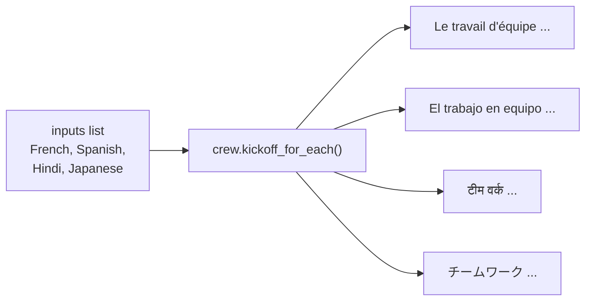

## 10 · Flow

**You** control the steps, not the agents. The `@router` asks the LLM to label the question, then only the matching `@listen` branch runs. `self.state` is shared by every step.

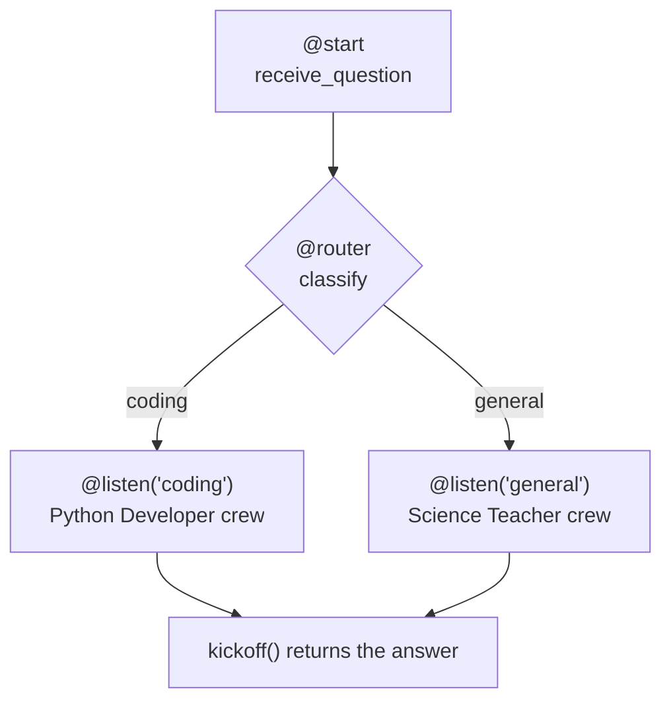

---

## Setup and keys

`settings.config` at the repo root (git-ignored) needs:

```text
NVDIA_API_KEY='nvapi-...'
# optional: pick another model from https://build.nvidia.com
NVIDIA_MODEL='nvidia/nemotron-3-super-120b-a12b'
```

The venv uses Python 3.13 (CrewAI doesn't install on 3.14). See [../simple-crew-agent/simple-crew-agent.md](../simple-crew-agent/simple-crew-agent.md#how-to-run) for the setup commands.

Each example takes roughly 5–60 seconds. Files 02, 04 and 07 print the agent's thinking (`verbose=True`). Look for the *Thought / Action / Observation* steps, i.e. the scratchpad.
