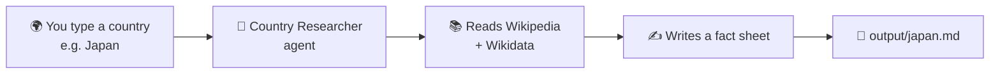
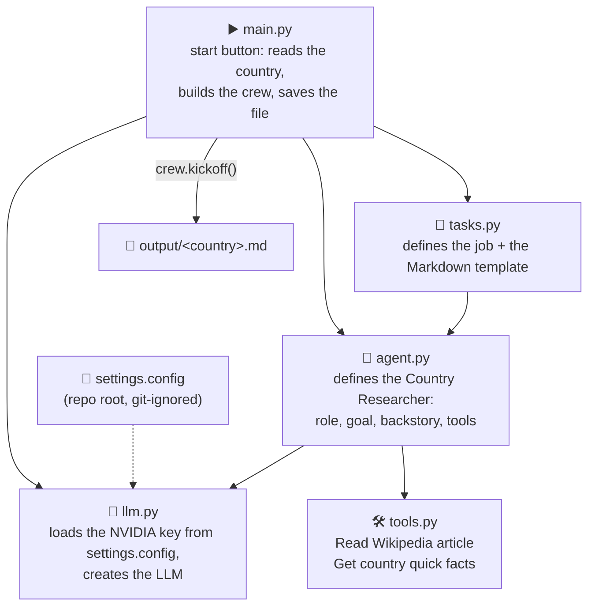
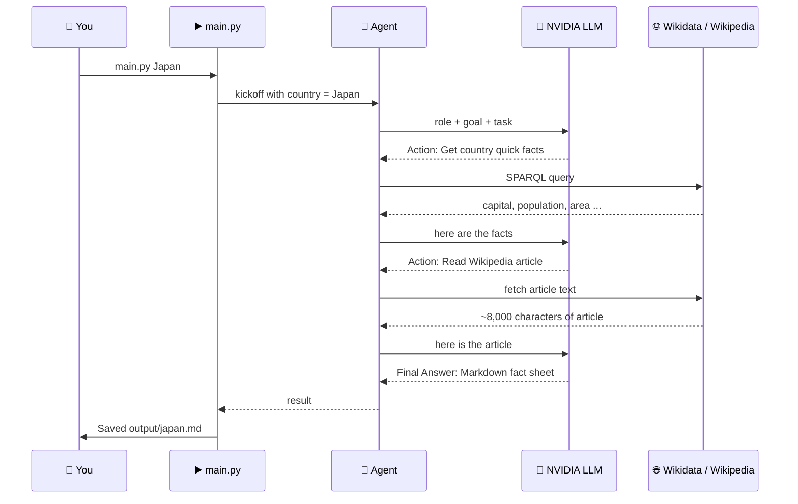
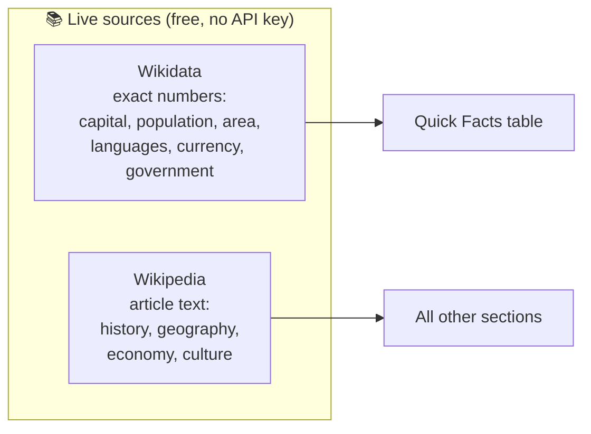
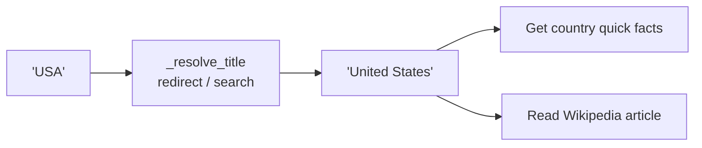
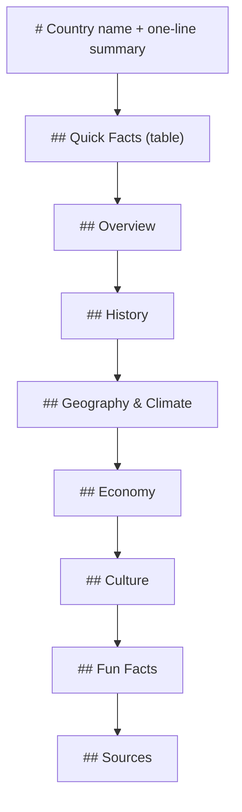
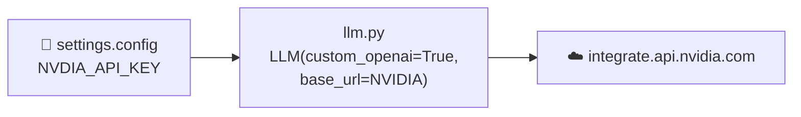

# Simple Crew Agent

## Objective

**One-liner:** give it a country name, and one AI agent reads about that country online and writes a clean Markdown fact sheet for you.



### Program flow (which file does what)



### What happens during one run



---

## Inputs

| Input | Where it comes from | Example |
|---|---|---|
| Country name | Command-line argument | `Japan`, `"New Zealand"`, `USA` |
| NVIDIA API key | `settings.config` at the repo root | `NVDIA_API_KEY='nvapi-...'` |
| Model *(optional)* | `settings.config` | `NVIDIA_MODEL='nvidia/nemotron-3-super-120b-a12b'` |

Short names and nicknames work too: `USA` → *United States* (Wikipedia redirects, with a search fallback).

## Knowledge

The agent has **no built-in knowledge files**. It looks everything up live, every run:



Why two sources? Wikipedia's plain-text export drops the infobox, so numbers like *area* and *currency* go missing. Wikidata stores exactly those facts in a structured form.

## Agents

One agent, defined in [agent.py](agent.py):

| Field | Value |
|---|---|
| `role` | Country Researcher |
| `goal` | Read reliable information about {country} and turn it into a clear, accurate fact sheet |
| `backstory` | A geography teacher who only states facts read in sources and never makes up numbers |
| `tools` | `get_country_facts`, `read_wikipedia` |
| `max_iter` | 5 (caps the think → act → observe loop) |
| `verbose` | True (prints the Thought / Action / Observation steps, i.e. the scratchpad) |

## Tools

Defined in [tools.py](tools.py) with CrewAI's `@tool` decorator. The **docstring** is what the LLM reads to decide when to use each tool.

| Tool name (as the LLM sees it) | Python function | Calls | Returns |
|---|---|---|---|
| Get country quick facts | `get_country_facts` | Wikidata SPARQL | capital, population, area_km2, official_languages, currency, continent, government |
| Read Wikipedia article | `read_wikipedia` | Wikipedia API | source URL + first 8,000 characters of the article |



## Outputs

`output/<country>.md`, which follows the template in [tasks.py](tasks.py):



If a fact isn't in the sources, the agent writes **"Not found"** instead of guessing. Sample outputs: [output/japan.md](output/japan.md), [output/usa.md](output/usa.md).

---

## Files in this Program and their purpose

| File | Purpose |
|---|---|
| [main.py](main.py) | Start button. Parses the country, builds the crew (1 agent + 1 task, sequential), runs `kickoff()`, saves the Markdown |
| [llm.py](llm.py) | Reads `settings.config`, creates the NVIDIA LLM through CrewAI's OpenAI-compatible client |
| [agent.py](agent.py) | The Country Researcher agent (who) |
| [tasks.py](tasks.py) | The research-and-write task plus the Markdown template (what) |
| [tools.py](tools.py) | The two tools: Wikidata facts + Wikipedia article (how) |
| `output/` | Generated fact sheets (created automatically) |

## Where are the LLM Keys

In **`settings.config` at the repo root**. Use the NVIDIA key:

```text
NVDIA_API_KEY='nvapi-...'
# optional: pick a different NVIDIA model
NVIDIA_MODEL='nvidia/nemotron-3-super-120b-a12b'
```

- Both spellings work: `NVDIA_API_KEY` (as in the current file) or `NVIDIA_API_KEY`.
- `settings.config` is listed in the repo's `.gitignore`, so **the keys never get committed**.
- Get a free key at <https://build.nvidia.com>. NVIDIA's API is OpenAI-compatible (`https://integrate.api.nvidia.com/v1`), so no extra packages are needed.



---

## How to run

CrewAI needs **Python 3.10 – 3.13** (it doesn't install on 3.14 yet). If your system Python is 3.14, let `uv` download 3.13 for you:

```bash
# from the repo root
pip install uv
uv venv --python 3.13 .venv
uv pip install --python .venv\Scripts\python.exe crewai requests

# run it
.venv\Scripts\python scripts\simple-crew-agent\main.py Japan
.venv\Scripts\python scripts\simple-crew-agent\main.py "New Zealand"
```

A run takes about 30–60 seconds and makes 3 LLM calls.

## Known limits

- Only the first 8,000 characters of the article are read (to keep calls fast and cheap), so later sections may be thin.
- Quick facts are only as good as what Wikidata currently stores. For example, the USA run listed territory languages (Hawaiian, Samoan ...) but not English. Double-check surprising values.
- The free NVIDIA tier occasionally slows down; `llm.py` uses a 180-second timeout per call.
